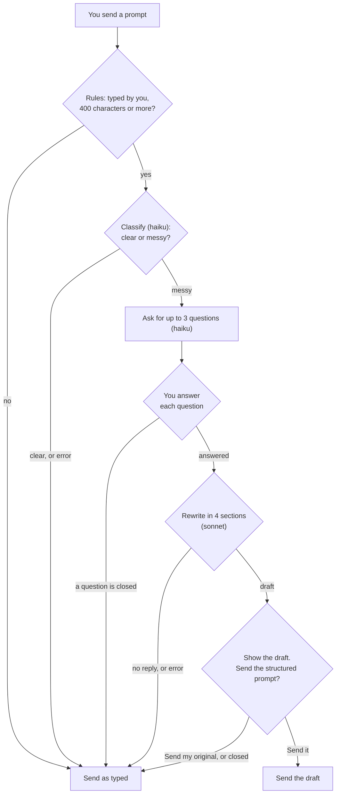
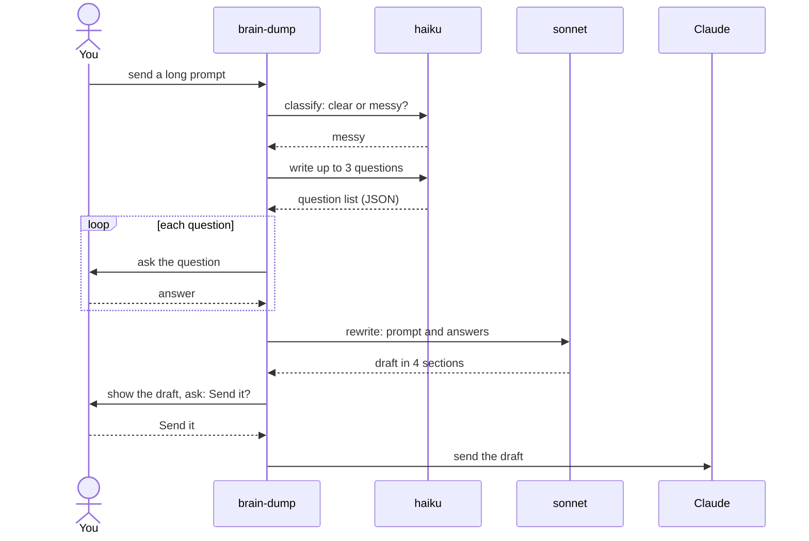

# brain-dump

A Claude Code mod. It turns a long, messy prompt into a clear, structured prompt before Claude reads it.

An HTML version of this document is in `README.html`. It has the same content and the same diagrams.

To install the mod, go to section 5. To prove that it works, go to section 6.

## 1. Purpose

Some prompts are long and unclear. They mix many ideas, they leave out the goal, and they do not say when the work is done. Claude must then guess what you want.

This mod prevents that. It does the following:

1. It catches a long prompt that you type, before Claude gets it.
2. It asks a small model if the prompt is clear or messy.
3. If the prompt is messy, it asks you up to 3 short questions.
4. It rewrites the prompt in 4 sections: Task, Why, Guardrails, and Definition of done.
5. It shows you the new prompt. You choose to send the new prompt or your original prompt.

The mod uses only facts from your prompt and your answers. It writes `Unspecified` where a fact is missing. If anything goes wrong, the mod sends your original prompt.

The mod asks you two kinds of question. Each question shows a header and a short list of options:

```text
Clarify
Which part of the login page is slow?
  - OAuth sign-in
  - Password reset
  - Both

Brain Dump
Send the structured prompt?
  - Send it
  - Send my original
```

## 2. Where to find the code

All logic is in one file: `hooks/register.ts`. Search for the function name if a line number is different.

| Item | File | Line |
|------|------|------|
| Constants `MIN_CHARS` and `MAX_QUESTIONS` | `hooks/register.ts` | 4–5 |
| Instruction for the question model (`QUESTIONS_SYSTEM`) | `hooks/register.ts` | 7–11 |
| Instruction for the rewrite model (`REFORMULATE_SYSTEM`) | `hooks/register.ts` | 13–22 |
| Button labels `SEND_IT` and `SEND_ORIGINAL` | `hooks/register.ts` | 24–25 |
| Types `Question`, `Answer`, `Submission`, `Engine` | `hooks/register.ts` | 27–30 |
| `isQuestion()` – checks one item of the question list | `hooks/register.ts` | 32 |
| `parseQuestions()` – reads the question list from a reply | `hooks/register.ts` | 38 |
| `draftInput()` – builds the text for the rewrite request | `hooks/register.ts` | 50 |
| `isRefinable()` – decides if a prompt is in scope | `hooks/register.ts` | 60 |
| `draftFrom()` – classifies, asks, and rewrites | `hooks/register.ts` | 64 |
| `confirmDraft()` – shows the draft and asks for your choice | `hooks/register.ts` | 101 |
| `register()` – adds the hook | `hooks/register.ts` | 116 |
| Hook `prompt.submit` | `hooks/register.ts` | 117 |
| Plugin name and description | `.claude-plugin/plugin.json` | all |
| Tests | `hooks/register.test.ts` | 12–134 |

Other files: `hooks/hooks.json` names the module. `tsconfig.json` is for the type-check.

## 3. How it works

The mod has one hook, `prompt.submit`. The engine runs this hook each time a prompt is sent. The hook can hold the prompt, change its text, and then let it go.

### 3.1 The path of a prompt

A prompt takes one of two ways out: it is sent as you typed it, or it is sent as the new draft. Most prompts are sent as typed.



The mod holds the prompt while it works. Claude does not see the prompt until the mod sends one of the two results.

### 3.2 One messy prompt, in order

This diagram shows who sends what to whom for one messy prompt. Time goes down.



### 3.3 Which prompts the mod handles

`isRefinable()` checks all of these rules. A prompt must pass every rule. If one rule fails, the mod does nothing and makes no model request.

| Rule | Passes when | Reason |
|------|-------------|--------|
| Source | `origin.kind` is `composer` (you typed it in the prompt box) | Prompts from plugins, peers, and notifications are not yours to rewrite. |
| Not a command | There is no `command` | A command, for example `/config`, must stay as it is. |
| Not a meta message | `isMeta` is not true | The engine makes meta messages. They are not your words. |
| Length | The text has 400 characters or more (`MIN_CHARS`) | A short prompt is usually clear. |

### 3.4 The three model requests

For one long prompt, the mod makes up to 3 model requests. All of them use the engine (`$.model`). None of them use the conversation.

| Request | Call | Model | Limits | Result |
|---------|------|-------|--------|--------|
| 1. Classify | `$.model.classify` | haiku | none set | `clear` or `messy`. Only `messy` continues. |
| 2. Questions | `$.model.complete` | haiku | 800 tokens, low effort, 20 seconds | A JSON list of up to 3 questions, each with 2 to 4 options. `[]` means no question. |
| 3. Rewrite | `$.model.complete` | sonnet | 1500 tokens, 60 seconds | The new prompt, as text. |

The mod reads the question list with `parseQuestions()`. The function finds the first `[` and the last `]` in the reply. It keeps only items that have a `question` text and an `options` list. It keeps the first 3 items.

If the question reply has no valid question, the mod does not stop. It goes to the rewrite request with no answers.

### 3.5 The new prompt

The rewrite request tells the model to use 4 sections, in this order. Each section has its label.

| Section | Content |
|---------|---------|
| Task | What to do, in one or two sentences. |
| Why | The goal or context behind the task. |
| Guardrails | Constraints, things to avoid, and assumptions made. |
| Definition of done | How to tell that the work is complete. |

The model must use only facts from your prompt and your answers. It writes `Unspecified` for a missing fact. Example of a draft:

```text
Task: Find and fix the cause of the slow, unreliable login page.
Why: The page feels slow and sometimes fails. Unspecified.
Guardrails: Check OAuth sign-in and password reset. Unspecified.
Definition of done: Unspecified.
```

The mod shows the draft in the transcript (`$.ui.log`) and then asks for your choice. If you choose `Send it`, Claude gets the draft and does not get your original text.

### 3.6 When the mod sends your original prompt

The mod always has a safe result: your original prompt. Each row below ends in that result.

| What happens | Result |
|--------------|--------|
| The prompt fails a rule in 3.3 | Sent as typed. No model request. |
| The classify request says `clear` | Sent as typed. |
| A classify request or a rewrite request fails or times out | Sent as typed. |
| The rewrite reply has no answer | Sent as typed. |
| You close a question without an answer | Sent as typed. The mod makes no rewrite request. |
| You choose `Send my original` | Sent as typed. |
| You close the final choice without an answer | Sent as typed. |

If the question reply has no answer, the mod does not use the rows above. It treats the result as no questions and goes on to the rewrite request.

### 3.7 Stored values

This mod stores no values. It has no timers and no module variables. Each prompt is handled alone, and the next prompt starts clean.

## 4. Settings

This mod has no settings in `/config`. Two values are fixed in the code:

| Value | Default | Line | Effect |
|-------|---------|------|--------|
| `MIN_CHARS` | 400 | 4 | The shortest prompt (in characters) that the mod handles. |
| `MAX_QUESTIONS` | 3 | 5 | The most questions the mod asks. |

To change a value, see section 5.7. The model names (`haiku`, `sonnet`) and the time limits are in `draftFrom()` (line 64).

## 5. Install

You install this mod by telling Claude Code where its folder is. The mod is not in a marketplace yet.

### 5.1 Before you start

You need:

- Claude Code. The version used to write and test this mod is 2.1.310. To see your version, run `claude --version`.
- A copy of this repository on your computer.
- A terminal. A terminal is a window where you type commands. On macOS, open the app named Terminal.

In this document, the **repository root** is the top folder of the repository (the folder named `claude-mods`). All commands in this document start from that folder. To go there, type `cd` and the path to the folder. Example:

```bash
cd ~/Developer/claude-mods
```

### 5.2 Choose a method

| Method | Use it when | Lasts for |
|--------|-------------|-----------|
| A. Flag `--plugin-dir` | You want to try the mod. | One session |
| B. Setting `CLAUDE_CODE_PLUGIN_DIRS` | You want the mod in every session. | All sessions, until you remove the setting |
| C. Marketplace | You want to share the mod with other people. | **Not available yet.** See 5.5. |

### 5.3 Method A: try it for one session

1. Open a terminal and go to the repository root (see 5.1).
2. Start Claude Code with the flag:

   ```bash
   claude --plugin-dir mods/brain-dump
   ```

3. Do the check in 5.6.

If you edit a file of the mod while the session is open, Claude Code reloads the mod.

### 5.4 Method B: load the mod in every session

1. Open the file `~/.claude/settings.json` in a text editor.
2. Add an `env` block that names the full path of the mod folder. If the file already has an `env` block, add only the line inside it.

   ```json
   {
     "env": {
       "CLAUDE_CODE_PLUGIN_DIRS": "/Users/your-name/Developer/claude-mods/mods/brain-dump"
     }
   }
   ```

3. Replace `/Users/your-name/Developer/claude-mods` with the real path to your repository. To print the path, run `pwd` in the repository root.
4. Save the file. Start a new Claude Code session.
5. Do the check in 5.6.

To uninstall, delete the line and start a new session.

If the `CLAUDE_CODE_PLUGIN_DIRS` line already names the `cache-warm` folder, do not replace it. Put both paths in the same value. See the Claude Code documentation for the separator.

### 5.5 Method C: marketplace (not available yet)

A marketplace install needs two things that this repository does not have:

- A marketplace file, `.claude-plugin/marketplace.json`, at the repository root.
- At least one commit that you pushed to GitHub.

When both exist, other people can install the mod with `/plugin install brain-dump --marketplace <owner>/<repo>`. Replace `<owner>/<repo>` with the GitHub name of the repository.

### 5.6 Check that the install worked

This mod shows nothing until you send a long, messy prompt. Do the live check in 6.3, steps 1 and 2.

1. Start a session with method A or method B.
2. Send the sample prompt from 6.3.
3. Wait a few seconds.

**Expected:** a question dialog with the header `Clarify` appears.

If no dialog appears, see the table in 6.5.

### 5.7 Change the fixed values

1. Open `mods/brain-dump/hooks/register.ts` in a text editor.
2. Change the number after `MIN_CHARS =` (line 4) or `MAX_QUESTIONS =` (line 5).
3. Save the file. Claude Code reloads the mod if you started it with method A. Otherwise, start a new session.
4. Run the tests (see 6.2). The tests use the default values. A changed value can make a test fail.

See section 4 for the meaning of each value.

## 6. Validate

To validate means to prove that the mod works as this document says. There are three levels. Do level 1 and level 2 each time you change the code. Do level 3 once after you install.

| Level | What it proves | Time | Needs an API request |
|-------|----------------|------|----------------------|
| 1. Validate | The files are correct, and the engine can read the mod. | 2 seconds | No |
| 2. Test | The logic is correct (rules, questions, choices, fallbacks). | 2 seconds | No |
| 3. Live check | The mod works in a real session. | 2 minutes | Yes (2 or 3 small ones) |

### 6.1 Level 1: validate the files

1. Go to the repository root (see 5.1).
2. Run:

   ```bash
   claude plugin validate mods/brain-dump
   ```

3. Read the last line of the output.

| Last line | Meaning | Action |
|-----------|---------|--------|
| `✔ Validation passed with warnings` | The mod is correct. | None. This is the expected result. |
| `✔ Validation passed` | The mod is correct. | None. |
| `✘ Validation failed` | The engine refuses the mod. | Read the lines that start with `✘`. Fix the file they name. Run the command again. |

The expected output contains messages that look like problems. They are not problems:

| Message | Why you can ignore it |
|---------|----------------------|
| `author: No author information provided` | Only a note. The mod works without an author. |
| `LICENSE: License missing` | This check is for sending a mod to the public plugin directory. It does not change the result. |
| `ICON_MISSING` | Same reason. |
| `gating hook without .catch: prompt.submit` | Only a note. The hook holds the prompt until it finishes. The functions `draftFrom()` and `confirmDraft()` catch their own errors and return the original prompt. |

The output also lists what the mod uses. Compare it with this list:

- Hooks: `prompt.submit`
- Stored values: none
- Engine calls: `$.model.classify`, `$.model.complete`, `$.ui.ask`, `$.ui.log`

If the output lists a hook or a call that is not in this list, the code and this document are different. Tell the owner of the mod.

### 6.2 Level 2: run the tests

1. Go to the repository root.
2. Run:

   ```bash
   claude plugin test mods/brain-dump
   ```

3. **Expected result:** the last lines are `10 pass` and `0 fail`.

The tests use a fake model and fake dialogs. They do not call the API and they cost nothing. Section 6.4 explains each test.

If a test fails, the output shows the test name and the reason. Find the test name in the table in 6.4. It shows which rule is broken.

### 6.3 Level 3: live check in a session

Do this once after you install. You need a sample prompt that is long (400 characters or more) and unclear. Use this one:

```text
ok so i have been thinking about the login page and it feels slow and kind of broken sometimes, maybe the oauth part or maybe the password reset, i am not sure, and we also need it to look better on phones, and somebody said something about rate limits but i do not remember what, so can you look at it and fix whatever is wrong and make it better and also maybe add some tests if that makes sense or whatever you think is best
```

| Step | Action | Expected result |
|------|--------|-----------------|
| 1 | Paste the sample prompt. Press Enter. | After a short wait, a dialog with the header `Clarify` shows a question and options. |
| 2 | Answer each question (up to 3). | After the last answer, there is a wait. The draft appears in the transcript, with the 4 labels `Task`, `Why`, `Guardrails`, and `Definition of done`. |
| 3 | Read the dialog `Send the structured prompt?`. Choose `Send it`. | Claude answers the draft, not your original text. |
| 4 | Send the sample prompt again. Choose `Send my original` at the end. | Claude answers your original text. |
| 5 | Send the sample prompt again. Close the final dialog with no choice. | Claude answers your original text. |
| 6 | Send the short prompt `fix the typo in README`. | The prompt is sent at once. No dialog appears. |

The model decides if a prompt is messy. If step 1 shows no dialog, change the sample prompt to make it less clear, and try again.

No person has done this check yet.

### 6.4 What each test proves

| Test (in `hooks/register.test.ts`) | Line | Rule it proves |
|-------------------------------------|------|----------------|
| only a long prompt the person typed is refined | 12 | A prompt of 400 characters or more from `composer` passes. A short prompt, no source, a plugin source, a command, and a meta message do not. |
| questions come out of a reply, capped at three, junk dropped | 21 | `parseQuestions()` reads a list inside other text. It returns `[]` for text that is not JSON and for wrong items. It keeps 3 items at most. |
| a short prompt is sent as typed, with no model call | 81 | A short prompt is sent as it is. The model gets 0 calls. |
| a prompt that is not the person's own is left alone | 88 | A prompt from a peer is sent as it is. The model gets 0 calls. |
| a clear prompt is sent as typed, with no question | 95 | The only call is `classify`. The prompt is sent as it is. |
| a messy prompt asks its questions, then sends the draft on "Send it" | 102 | The calls are in this order: classify, haiku, question, sonnet, final choice. The draft is sent. |
| "Send my original" sends the prompt as typed | 112 | The original text is sent. |
| dismissing the final choice sends the prompt as typed | 121 | The original text is sent. |
| a dismissed question sends the prompt as typed, with no rewrite | 127 | The sonnet request is not made. The original text is sent. |
| a failed rewrite sends the prompt as typed | 134 | A rewrite with no answer gives the original text. |

### 6.5 Problems and solutions

| Problem | Cause | Solution |
|---------|-------|----------|
| `claude: command not found` | Claude Code is not installed, or the terminal cannot find it. | Install Claude Code. Open a new terminal. |
| `claude plugin validate` says the path does not exist | You are not in the repository root. | Run `pwd`. Run `cd` to the repository root. Try again. |
| Validation fails | A file of the mod has an error. | Read the lines that start with `✘`. Fix the file they name. |
| No dialog after you send a long prompt | The mod did not load. | Check the transcript for a line with `brain-dump`. It names the error. Check that the path in the flag or the setting is correct. |
| No dialog, but no error | The prompt is shorter than 400 characters, you did not type it (for example, it came from a command), or the model said it is clear. | Send a longer and less clear prompt. |
| Only the final dialog appears, with no question | The question model returned no question, or its reply had no answer. | None needed. The mod goes on to the rewrite. |
| A long wait, then the prompt is sent as typed | The classify request or the rewrite request failed or ran out of time (60 seconds for the rewrite). | Send the prompt again. |
| The draft has many `Unspecified` words | Your prompt and answers do not give those facts. | Add the facts to your prompt, or choose `Send my original`. |
| The draft is wrong | The model misread the prompt. | Choose `Send my original`. |

### 6.6 Type-check (optional)

A type-check finds mistakes in the code types. It needs `tsc`, the TypeScript program. `tsc` was not installed when this document was written, so this check was **not run**.

To run it, install TypeScript. Load the mod in a session one time (the engine then writes the folder `.claude-plugin/types/`). Then run `tsc -p mods/brain-dump`. **Expected result:** no output and no errors.

## 7. Known limits

- **Cost and wait.** Each long prompt that you type makes a classify request, even if it is clear. A messy prompt makes 2 more requests (haiku and sonnet). Each request takes time before Claude starts.
- **No conversation.** The code passes only your prompt and your answers to the models. It does not pass the conversation. A prompt that refers to earlier messages can give a draft with `Unspecified` words.
- **No edit.** You cannot edit the draft. You can only send it or send your original.
- **The original is not kept.** After you choose `Send it`, Claude gets only the draft. The draft is in the transcript.
- **One closed question stops the flow.** If you close a question, the mod sends the original and does not ask the next question.
- **No time limit for you.** The model requests have time limits. Your answers do not. The prompt waits until you answer or close the dialog.
- **Fixed values.** The length (400) and the question limit (3) are not settings. To change them, edit the code (see 5.7).
- **The model decides.** The classify request decides if a prompt is messy. It can be wrong in both directions.

## 8. Glossary

| Term | Meaning |
|------|---------|
| Prompt | The text that you send to Claude. |
| Hook | A part of a mod that the engine runs when an event occurs. This mod has one hook, `prompt.submit`. |
| Classify | Ask a model to put a text in one of a few named groups. Here: `clear` or `messy`. |
| Messy | A prompt that is unclear, or that leaves out the goal or the limits. |
| Draft | The new prompt in 4 sections that the mod writes. |
| Dialog | A box with a question and options. You choose an option. |
| Close (a dialog) | End a dialog with no choice. The mod then sends your original prompt. |
| haiku | The small, fast model. The mod uses it to classify and to write questions. |
| sonnet | The larger model. The mod uses it to write the draft. |
| Transcript | The list of messages in the session. |
