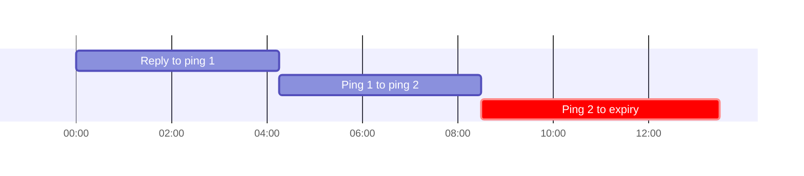
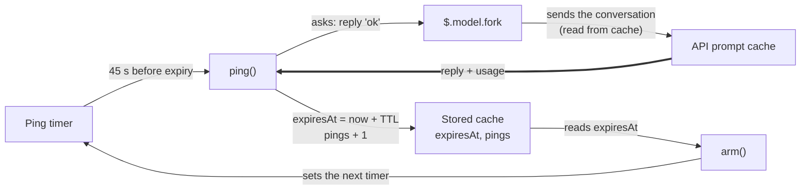

# cache-warm

A Claude Code mod. It keeps the prompt cache warm while you are away from the session.

An HTML version of this document is in `README.html`. It has the same content and the same diagrams.

To install the mod, go to section 5. To check that it works, go to section 6.

## 1. Purpose

Claude keeps the conversation in a prompt cache after each reply. The cache lasts for a fixed time, the TTL. When the cache expires, the next reply writes the whole conversation again at full price.

This mod prevents that. It does the following:

1. It shows a band above the prompt with a countdown to cache expiry.
2. It sends a small request, a ping, shortly before the cache expires.
3. The ping reads the conversation from the cache. This resets the TTL. The ping costs 5 to 10 percent of the full price.

The band has three lines of text and one button:

```text
◔ Cache warm 4:58 ████████████████                    [Stop keeping warm]
5 minute cache, as the last reply set it. Reply now and 214k tokens cost 5 to 10% as much.
Keeping warm · first ping in 4:13
```

## 2. Where to find the code

All logic is in one file: `hooks/register.tsx`. The line numbers apply to this version of the file. If a line number is different, search for the function name.

| Item | File | Line |
|------|------|------|
| Constants (ping lead time, tick, bar width, ping timeout, ping text) | `hooks/register.tsx` | 7–12 |
| Stored values `cache`, `isOn`, `now` | `hooks/register.tsx` | 17–19 |
| Module variables (TTL, ping limit, timers, turn flag, ping count) | `hooks/register.tsx` | 32–38 |
| `disarm()` – cancels both timers | `hooks/register.tsx` | 40 |
| `logError()` – writes an error to the debug log | `hooks/register.tsx` | 48 |
| `withTimeout()` – gives up on a ping after `PING_TIMEOUT_MS` | `hooks/register.tsx` | 56 |
| `tick()` – redraws the countdown, detects expiry | `hooks/register.tsx` | 71 |
| `ping()` – sends the ping, handles the reply | `hooks/register.tsx` | 82 |
| `pingFailed()` – stops keeping warm when a ping throws or times out | `hooks/register.tsx` | 123 |
| `arm()` – starts both timers from the stored cache | `hooks/register.tsx` | 129 |
| `register()` – reads the settings, adds the hooks | `hooks/register.tsx` | 145 |
| Hook `session.start` | `hooks/register.tsx` | 150 |
| Hook `session.end` | `hooks/register.tsx` | 156 |
| Hook `turn.start` | `hooks/register.tsx` | 163 |
| Hook `turn.complete` | `hooks/register.tsx` | 172 |
| Hook `ui.render` (the band) | `hooks/register.tsx` | 191 |
| Button "Stop keeping warm" / "Keep warm" | `hooks/register.tsx` | 219 |
| Type of the stored values | `types/index.d.ts` | 1–22 |
| Setting `ttl` | `.claude-plugin/plugin.json` | 7 |
| Setting `maxPings` | `.claude-plugin/plugin.json` | 15 |
| Tests, one line for each of the 12 tests (see 6.4) | `hooks/register.test.tsx` | 64, 76, 88, 98, 110, 132, 151, 171, 200, 228, 244, 270 |

Other files: `hooks/hooks.json` names the module on line 2. `tsconfig.json` is for the type-check. See 6.6.

## 3. How it works

### 3.1 States

The mod is in 1 of 4 states.

```mermaid
stateDiagram-v2
    state "No cache" as NoCache
    NoCache --> Running: turn.start
    Warm --> Running: turn.start
    Pinging --> Running: turn.start
    Running --> Warm: turn.complete
    Warm --> Pinging: 45 s before expiry
    Pinging --> Warm: ping answered
    Warm --> NoCache: timer reaches 0
    Pinging --> NoCache: no reply or 30 s
    linkStyle 4,5 stroke-width:3px
```

**Figure 1.** The four states. A turn start moves the mod to Running. The band is shown in Warm and Pinging. The thick lines show the ping cycle.

| State | Meaning | Band |
|-------|---------|------|
| No cache | The mod holds no cache expiry. | Hidden |
| Running | A turn is in progress. Both timers are cancelled. | Hidden |
| Warm | The cache is valid. The countdown runs. | Shown |
| Pinging | A ping request is in progress. It ends at a reply, or after 30 seconds. | Shown |

In the Warm state, the mod sends a ping only when both conditions are true:

- `isOn` is true. You did not press "Stop keeping warm".
- The ping count is less than `maxPings`.

If a condition is false, the countdown runs and no ping is sent. The band then shows "Not keeping warm · the cache goes cold when the timer ends".

### 3.2 Timeline of one cache lifetime

The mod pings 45 seconds before expiry. For a 5-minute cache, the first ping is at 4:15 after the reply. Each ping resets the timer to the full TTL. After the ping count reaches `maxPings`, the mod stops pinging. The timer then runs to 0:00 and the cache expires.

This example uses `maxPings` = 2 and `ttl` = `5m`. The default for `maxPings` is 6. Times are minutes:seconds after the end of your last reply.



**Figure 2.** The cache timer over one lifetime, with `maxPings` = 2. Each bar is one interval between two events. The highlighted bar is the last interval. The cache goes cold at its end.

| Time | Event | Time left on the timer after the event |
|------|-------|----------------------------------------|
| 0:00 | The reply ends (`turn.complete`). The timer starts. | 5:00 |
| 4:15 | Ping 1 is sent. The reply to the ping arrives and resets the timer. | 5:00 |
| 8:30 | Ping 2 is sent. The reply resets the timer. The limit is reached. | 5:00 |
| 13:30 | The timer reaches 0:00. The cache expires. The band disappears. | 0:00 |

### 3.3 What each hook does

| Event | Condition | Action |
|-------|-----------|--------|
| `session.start` | Always | `arm()`: start the timers from the stored cache. This restores the mod after a reload. |
| `turn.start` | Main loop only | Set `isTurnRunning`. Cancel both timers. |
| `turn.complete` | Main loop only, usage present | Set expiry to now plus TTL. Set the token count. Set the ping count to 0. Clear `isPinging`. |
| `turn.complete` | Main loop only, no usage | Clear `isPinging`. The old expiry stays. |
| `turn.complete` | Main loop only | Clear `isTurnRunning`. Call `arm()`. |
| `ui.render` (`AbovePrompt`) | Not during a survey, not during a turn, cache not expired | Draw the band. |
| `session.end` | Always | Cancel both timers. Clear the cache. |

`arm()` sets two timers. The tick timer (line 139) calls `tick()` every 1 second. The ping timer (line 141) calls `ping()` 45 seconds before expiry.

Subagent turns do not change the timers or the cache. `turn.start` and `turn.complete` act only when `e.agentId` is undefined (lines 164 and 173).

### 3.4 The ping

`ping()` sets `isPinging` to true (line 85). Then it sends one request with `$.model.fork` (line 89). The request has a 30-second timeout (line 56). The request uses the conversation as the main thread last sent it. The usage in the reply shows how much of the request the cache served (line 112).



**Figure 3.** One ping. The thick line is the reply and its usage. It returns to `ping()`, which stores the new expiry. Then `arm()` sets the timer for the next ping.

| Result | Action |
|--------|--------|
| The reply is answered and the cache served at least half of the tokens | Set expiry to now plus TTL. Add 1 to the ping count. Clear `isPinging`. Call `arm()`. |
| The reply is answered and the cache served less than half | Do the same. Also show a toast: "The cache had already gone cold, so that ping rewrote the context at full price." |
| No reply, or the request failed | Cancel both timers. Clear the cache. Show a toast: "Cache keep-warm stopped: the ping got no reply." |
| An error is thrown after `isPinging` is set, for example at line 110 when the reply has no `usage` | Log the error to the debug log. Cancel both timers. Clear the cache. Show no toast. |
| No reply within 30 seconds (the timeout) | Log one line to the debug log. Cancel both timers. Clear the cache. Show no toast. Do nothing if a turn runs, a later ping has started, or `isPinging` is clear. |
| A reply arrives after the timeout | Ignored. The state does not change. |
| A turn started during the ping | Return without changing the cache. `isPinging` stays true until the turn completes (lines 180 and 183). |

### 3.5 Stored values

| Name | Type | Meaning | Changed by (line) |
|------|------|---------|-------------------|
| `cache.expiresAt` | number | Time when the cache expires, in milliseconds. 0 means no cache. | Set by `turn.complete` (180) and `ping()` (116). Cleared at 76, 104, 126, 134 and 158. |
| `cache.tokens` | number | Tokens in the cached conversation. | Set by 180 and 116. Cleared with the cache. |
| `cache.pings` | number | Pings sent since the last reply. | Set to 0 by 180 and by the Keep warm button (224). Increased by 116. |
| `cache.isPinging` | boolean | A ping is in progress. | Set to true at 85. Set to false at 116, 180 and 183. Cleared with the cache. |
| `isOn` | boolean | Pinging is allowed. | Toggled by the button (223). |
| `now` | number | Time at the last update. The band redraws from it. | Set at 79, 115, 138 and 179. |

"Cleared with the cache" means the mod sets the whole `cache` value to `EMPTY` (line 14).

The code comments say the stored cache survives a reload. The timers and `isTurnRunning` are module variables. A reload resets them. `session.start` then arms the timers again (lines 29–31).

## 4. Settings

Change the settings in `/config`. This review did not run the `/config` steps. No person has done this check yet.

| Setting | Values | Default | Effect | Line |
|---------|--------|---------|--------|------|
| `ttl` | `5m` or `1h` | `5m` | The cache lifetime. Any other value counts as `5m`. Set it to the real lifetime of your cache. | 146 |
| `maxPings` | a number | 6 | The most pings after one reply. Set 0 to turn pinging off. A negative number counts as 0. | 147 |

The fixed constants are these:

| Constant | Value | Line | Effect |
|----------|-------|------|--------|
| `LEAD_MS` | 45,000 ms (45 seconds) | 7 | The ping starts this long before expiry. |
| `TICK_MS` | 1,000 ms (1 second) | 8 | The countdown redraws this often. |
| `BAR_CELLS` | 16 | 9 | The number of cells in the bar. |
| `PING_TIMEOUT_MS` | 30,000 ms (30 seconds) | 11 | A ping with no reply in this time counts as failed. It is not a setting. |
| `PING_PROMPT` | Text | 12 | The text sent with each ping: `Cache keep-alive ping. Reply with the single word "ok" and nothing else.` |

The engine does not report the real cache lifetime. If `ttl` is wrong, the pings arrive too late or too early.

## 5. Install

You install this mod for one session, for every session, or from the marketplace. Section 5.2 helps you choose.

### 5.1 Before you start

You need:

- Claude Code. The version used to write and test this mod is 2.1.310. To see your version, run `claude --version`.
- A copy of this repository on your computer.
- A terminal. A terminal is a window where you type commands. On macOS, open the app named Terminal. On Windows, open PowerShell or Windows Terminal.

In this document, the **repository root** is the top folder of the repository, named `claude-mods`. All commands in this document start from that folder. To go there, run `cd` and the path to the folder:

```bash
cd ~/Developer/claude-mods
```

On Windows PowerShell, run this command:

```powershell
cd $HOME\Developer\claude-mods
```

On Windows, `scripts\install-mods.ps1` does the marketplace steps in 5.5 for you. See the root `README.md`. The Windows steps in this document are not tested.

### 5.2 Choose a method

| Method | Use it when | Lasts for |
|--------|-------------|-----------|
| A. Flag `--plugin-dir` | You want to try the mod. | 1 session |
| B. Setting `CLAUDE_CODE_PLUGIN_DIRS` | You want the mod in every session, from your copy of the repository. | Until you remove the setting |
| C. Marketplace | You want to install the mod as you install other plugins. | Until you uninstall it |

### 5.3 Method A: try it for one session

1. Open a terminal. Go to the repository root (see 5.1).
2. Start Claude Code with the flag:

   ```bash
   claude --plugin-dir mods/cache-warm
   ```

3. Do the check in 5.6.

### 5.4 Method B: load the mod in every session

1. Open the file `~/.claude/settings.json` in a text editor.
2. Add an `env` block that names the full path of the mod folder. If the file already has an `env` block, add only the line inside it.

   ```json
   {
     "env": {
       "CLAUDE_CODE_PLUGIN_DIRS": "/Users/your-name/Developer/claude-mods/mods/cache-warm"
     }
   }
   ```

3. Replace `/Users/your-name/Developer/claude-mods` with the real path to your repository. To print the path, run `pwd` in the repository root.
4. Save the file. Start a new Claude Code session.
5. Do the check in 5.6.

On Windows, the settings file is `%USERPROFILE%\.claude\settings.json`. Use forward slashes in the path, for example `C:/Users/your-name/Developer/claude-mods/mods/cache-warm`. Or double each backslash in the JSON. In PowerShell, run `(Get-Location).Path` in the repository root to print the path. This Windows step is not tested.

To remove the mod from every session, delete the line and start a new session.

### 5.5 Method C: marketplace

The file `.claude-plugin/marketplace.json` at the repository root lists `cache-warm`. The marketplace is named `claude-mods`. This review did not run the `marketplace add` and `install` commands below. No person has done this check yet.

1. Add the marketplace once. Run:

   ```bash
   claude plugin marketplace add plaktoz/claude-mods
   ```

2. Install the mod. Run:

   ```bash
   claude plugin install cache-warm@claude-mods
   ```

   The default scope is `user`, which applies the mod to every project. To change the scope, add `--scope project` or `--scope local`. See the root `README.md`.

3. Restart Claude Code. Do the check in 5.6.

To use your copy of the repository instead, run the install script from the repository root. The script points the marketplace at your copy. Run one of these commands:

- Linux, macOS, or Git Bash: `bash scripts/install-mods.sh cache-warm`
- Windows PowerShell: `powershell -ExecutionPolicy Bypass -File scripts\install-mods.ps1 cache-warm`

To remove the mod, run `bash scripts/install-mods.sh --uninstall cache-warm`. The Windows PowerShell script uses `-Uninstall`. These Windows commands are not tested.

### 5.6 Check that the install worked

1. Start a session after method A, B or C.
2. Send any prompt, for example `hello`.
3. Wait for the answer to finish.
4. Look above the prompt box.

**Expected:** the band appears with `Cache warm` and a countdown.

If the band does not appear, see the table in 6.5.

### 5.7 Change the settings

1. In a session, type `/config`.
2. Find the rows for `cache-warm`: `ttl` and `maxPings`.
3. Change a value. The mod reloads with the new value.

This review did not run these steps. No person has done this check yet. See section 4 for the meaning of each setting.

## 6. Validate

To validate means to check that the mod works as this document says. There are three levels. Run levels 1 and 2 after each change to the code. Run level 3 once after you install the mod.

| Level | What it proves | Time | Needs an API request |
|-------|----------------|------|----------------------|
| 1. Validate | The files are correct, and the engine can read the mod. | Under 1 second | No |
| 2. Test | The logic is correct: countdown, ping, timeout, stop and limit. | 2 to 3 seconds | No |
| 3. Live check | The mod works in a real session. | 5 minutes or more | Yes, a small one |

### 6.1 Level 1: validate the files

1. Go to the repository root (see 5.1).
2. Run:

   ```bash
   claude plugin validate mods/cache-warm
   ```

3. Read the last line of the output.

| Last line | Meaning | Action |
|-----------|---------|--------|
| `✔ Validation passed with warnings` | The mod is correct. | None. This is the expected result. |
| `✘ Validation failed` | The engine refuses the mod. | Read the lines under the `✘ Found` heading. Fix the file they name. Run the command again. |

The output can contain lines that look like problems. The last line decides the result. These messages do not change it:

| Message | Why you can ignore it |
|---------|----------------------|
| `author: No author information provided` | Only a note. The mod works without an author. |
| `✘ Found 1 problem the plugin directory refuses a submission for`, with `LICENSE: License missing (LICENSE_MISSING)` | This check is for submitting the mod to the plugin directory. The last line still reads `✔ Validation passed with warnings`. |
| `ICON_MISSING` | Same reason. |
| `types ./types/index.d.ts declares on $: nothing` | Correct. The mod adds nothing to `$`. |

The output also lists what the mod uses. Compare it with this list:

- Hooks: `session.start`, `session.end`, `turn.start`, `turn.complete`, `ui.render{component=AbovePrompt}`
- Stored values: `cache-warm.cache`, `cache-warm.isOn`, `cache-warm.now`
- Engine calls: `$.clock.after`, `$.clock.every`, `$.clock.now`, `$.model.fork`, `$.state.get`, `$.state.set`, `$.ui.log`, `$.ui.resolve`, `$.ui.toast`

If the output lists a hook or a call not in this list, the code and this document differ. Tell the owner of the mod.

### 6.2 Level 2: run the tests

1. Go to the repository root.
2. Run:

   ```bash
   claude plugin test mods/cache-warm
   ```

3. Check the last lines.

**Expected result:** the last lines are `12 pass` and `0 fail`. This review printed:

```text
 12 pass
 0 fail
Ran 12 tests across 1 file. [2.90s]
```

The time in brackets changes from run to run.

The tests use a fake clock and a fake model request. They do not call the API and they cost nothing. Section 6.4 explains each test.

If a test fails, the output shows the test name and the reason. Find the test name in the table in 6.4. It shows which rule is broken.

### 6.3 Level 3: live check in a session

Do this once after you install. Use `ttl` = `5m`, the default, so that you wait less.

| Step | Action | Expected result |
|------|--------|-----------------|
| 1 | Send a prompt. Wait for the answer. | The band shows `Cache warm 5:00` and counts down. |
| 2 | Read the third line of the band. | `Keeping warm · first ping in 4:15`. The time counts down. |
| 3 | Wait until the ping time is `0:00`. | The status shows `Pinging to keep the cache warm…` for a short time. Then the countdown returns to about `5:00`. The status shows `next ping in`. |
| 4 | Press the button `Stop keeping warm`. | The button changes to `Keep warm`. The status shows `Not keeping warm`. The countdown continues. |
| 5 | Press the button `Keep warm`. | The status shows `Keeping warm` and a ping time. |
| 6 | Send a prompt. | The band is hidden while the answer is written. It returns at `5:00` when the answer is complete. |

**No person has done this check yet.**

### 6.4 What each test proves

| Test (in `hooks/register.test.tsx`) | Line | Rule it proves |
|---|---|---|
| a finished turn shows the countdown and the first ping | 64 | After `turn.complete`, the band shows `5:00`, `214k tokens` and `first ping in 4:15`. |
| a ping is sent before the cache lapses and the countdown restarts | 76 | No ping at 4:14. One ping at 4:16. The status then shows `next ping in`. |
| pings stop after the limit and the band disappears when the cache lapses | 88 | Exactly 6 pings. Then the band is gone. |
| a failed ping stops keeping warm and says so | 98 | A ping with no reply gives a toast and removes the band. |
| a turn that starts during a ping and ends without usage clears isPinging | 110 | After such a turn, the band shows no pinging status. |
| a ping that rejects clears isPinging, logs to the debug log and raises no rejection | 132 | After the error, the band is hidden. One line goes to the debug log. The kit fails the file on an unhandled rejection. |
| a ping that never answers stops after 30 seconds and the band drops the pinging text | 151 | At 29 seconds the band still says pinging. At 30 seconds it does not. One debug-log line is written. |
| a reply after the timeout changes no expiry, token count or ping count | 171 | The late reply changes nothing. The band still shows `4:00`, `214k tokens` and `first ping in 3:15`. |
| a turn that ends during a hung ping keeps its cache when the timeout fires | 200 | The turn ends during the ping. When the timeout fires, the band keeps its cache and shows no pinging text. |
| Stop keeping warm during a hung ping still clears the ping when the timeout fires | 228 | After Stop, the timeout still clears the pinging text. |
| the timeout of an older ping does not end a newer ping | 244 | Stop, then Keep warm, starts a second ping. The first ping timeout leaves the second ping running. |
| Stop keeping warm cancels the pings and the cache is left to expire | 270 | After the button press: 0 pings and the status `Not keeping warm`. |

### 6.5 Problems and solutions

| Problem | Cause | Solution |
|---------|-------|----------|
| `claude: command not found` | Claude Code is not installed, or the terminal cannot find it. | Install Claude Code. Open a new terminal. |
| `claude plugin validate` shows `File not found` | You are not in the repository root. | Run `pwd`. Run `cd` to the repository root. Run the command again. |
| `✘ Validation failed` | A file of the mod has an error. | Read the lines under the `✘ Found` heading. Fix the file they name. |
| No band after you send a prompt | The mod did not load. | Run `claude plugin validate mods/cache-warm` from the repository root. Read any `✘` line. Check that the path in the flag or the setting is correct. |
| No band after you send a prompt, and no error | The last turn gave no usage data, for example because you interrupted it. | Send a new prompt. Wait for the full answer. |
| The band shows `Pinging to keep the cache warm…` for more than 30 seconds | The ping has not ended. The timeout should end it within 30 seconds. | Send a new prompt. Wait for the full answer. Tell the owner of the mod how long the text stayed. |
| The band disappears after about 30 seconds of pinging. No toast says why. | The ping got no reply within 30 seconds. The mod writes one line to the debug log. | Send a new prompt. The next reply starts the cache timer again. |
| The band appears but no ping is sent | Pinging is off, the limit is reached, or `maxPings` is not a number. | Read the status line. If it says `Not keeping warm`, press `Keep warm`. Check that `maxPings` is a number above 0. |
| Pings arrive too late, or too early | `ttl` does not match your real cache lifetime. | Set `ttl` in `/config` to the real value. |
| A toast says the cache had already gone cold | The cache had expired when the ping arrived. A likely cause is a `ttl` setting longer than the real lifetime. | Set `ttl` in `/config` to the real value. |

### 6.6 Type-check (optional)

A type-check finds mistakes in the code types. It uses `tsc`, the TypeScript compiler. `tsc` was not installed when this review ran, so this check was **not run**.

The file `tsconfig.json` extends `./.claude-plugin/types/tsconfig.json`. That folder did not exist in the repository when this review ran. This review did not check how the engine makes the folder. The check cannot run as written until that folder exists.

## 7. Known limits

- **Cost.** Each ping reads the whole conversation from the cache. The band and the manifest state a cost of 5 to 10 percent of the full price. This review did not measure that price. `maxPings` limits the pings after one reply.
- **TTL is a setting.** The mod trusts `ttl`. It does not read the real lifetime. Any value other than `1h` counts as `5m` (line 146).
- **Ping time.** The new expiry is the time the reply arrives plus the TTL (lines 111 and 116). The mod does not know when the API set the cache. The real expiry can be a little earlier.
- **Button label.** After the ping limit, the status shows "Not keeping warm". The button still shows "Stop keeping warm" (line 221). Pressing it sets `isOn` to false.
- **Stop persists.** A new turn does not reset `isOn`. After "Stop keeping warm", pinging stays off until you press "Keep warm".
- **Turn without usage.** A turn that ends with no usage data keeps the old expiry (line 180 does not run). If the ping time has passed, `arm()` sets the ping timer to 0 (line 141). The ping then runs at once. This was verified by reading the code. It was not run.
- **Timeout is fixed.** A ping with no reply in 30 seconds counts as failed (line 11). The timeout is not a setting. A reply that arrives later is ignored (lines 56 to 69). The tests cover this with a fake clock (section 6.4).
- **The timed-out request keeps running.** The code cannot cancel a fork, because `$.model.fork` takes only a prompt. The mod ignores the request. This review did not check whether the engine stops it or bills it. This was verified by reading the types.
- **Late ping reply.** A ping reply can overwrite the token count of a turn that already completed (lines 109 to 116). It also sets a new expiry. The band can then show the ping's token count instead of the turn's count. This was verified by reading the code. It was not run.
- **Invalid `maxPings`.** `Number(...)` returns NaN for a value that is not a number (line 147). `Math.max` keeps NaN. The check at line 140 then fails, so no ping is sent. The status shows "Not keeping warm". This follows from the JavaScript rules. It was not run in the engine.
- **Legacy Windows console.** The characters `◔`, `█`, `░` and `…` can display wrongly on a console that does not use UTF-8. They are on lines 203, 212, 216 and 217. Windows Terminal is expected to display them. This was not checked on Windows.
- **Silent stop on a thrown ping or a timeout.** When a ping throws or times out, the band disappears and no toast says so. The debug log has one line. The no-reply path shows a toast. This path does not.
- **Errors are only partly logged.** The mod writes a debug-log line when `tick()` or `ping()` rejects (lines 48 to 50, 139 and 141). A fork error caught at line 90 is treated as no reply and writes no log line. The `turn.complete` hook has a `.catch` handler (line 189) that calls `next(e)` and writes no log line. `ui.render` (line 191) has no `.catch`. This review did not check what the engine does with these errors.

## 8. Glossary

| Term | Meaning |
|------|---------|
| Band | The area above the prompt where the mod draws its text. |
| Cache | The stored copy of the conversation that the API reads at a lower price. |
| Debug log | The engine's log for developers. The mod writes to it with `$.ui.log` and `to: debug`. The screen does not show these lines. |
| Engine | Claude Code. It loads the mod and calls its hooks. |
| Expiry | The time when the cache expires. Stored in `cache.expiresAt`. |
| Fork | A request that uses the conversation as the main thread last sent it. Called with `$.model.fork`. |
| Hook | A function that the engine calls when an event happens, such as `turn.complete`. |
| Main loop | The main conversation. A turn with no agent ID belongs to the main loop. |
| Ping | A small request that reads the cache and resets the TTL. |
| Reply | The answer that a request returns. |
| Stored value | A value that the engine keeps for the session. See 3.5. |
| Subagent | A helper run that the main conversation starts. Its turns have an agent ID. |
| Tick | The one-second timer that redraws the band and checks expiry. |
| Timeout | The 30-second limit on a ping. A ping with no reply by then counts as failed. See 4. |
| Toast | A short message that the engine displays. |
| TTL | The time the API keeps the cache after a request. Set by the `ttl` setting. |
| Turn | One run of the main loop, from your prompt to the final answer. |
| Usage | The token counts that a reply reports: input, cache read and cache creation tokens. |
