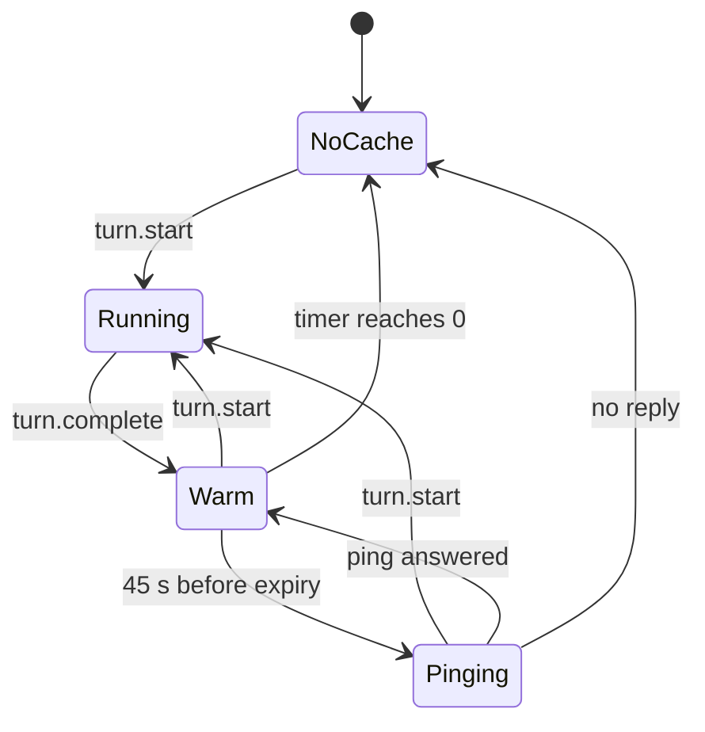
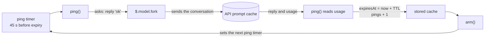

# cache-warm

A Claude Code mod. It keeps the prompt cache warm while you are away from the session.

An HTML version of this document is in `README.html`. It has the same content and the same diagrams.

To install the mod, go to section 5. To prove that it works, go to section 6.

## 1. Purpose

Claude keeps the conversation in a prompt cache after each reply. The cache lasts for a fixed time (the TTL). When the cache expires, the next reply must write the whole conversation again at full price.

This mod prevents that. It does the following:

1. It shows a band above the prompt with a countdown to cache expiry.
2. It sends a small request (a ping) shortly before the cache expires.
3. The ping reads the conversation from the cache. This resets the TTL at 5 to 10 percent of the full price.

The band has three lines of text and one button:

```text
◔ Cache warm 4:58 ████████████████                    [Stop keeping warm]
5 minute cache, as the last reply set it. Reply now and 214k tokens cost 5 to 10% as much.
Keeping warm · first ping in 4:13
```

## 2. Where to find the code

All logic is in one file: `hooks/register.tsx`. Search for the function name if a line number is different.

| Item | File | Line |
|------|------|------|
| Constants (ping lead time, tick, bar width, ping text) | `hooks/register.tsx` | 6–10 |
| Stored values `cache`, `isOn`, `now` | `hooks/register.tsx` | 15–17 |
| Module variables (timers, turn flag) | `hooks/register.tsx` | 30–34 |
| `disarm()` – cancels both timers | `hooks/register.tsx` | 36 |
| `tick()` – redraws the countdown, detects expiry | `hooks/register.tsx` | 43 |
| `ping()` – sends the ping, handles the reply | `hooks/register.tsx` | 54 |
| `arm()` – starts both timers from the stored cache | `hooks/register.tsx` | 85 |
| `register()` – reads the settings, adds the hooks | `hooks/register.tsx` | 101 |
| Hook `session.start` | `hooks/register.tsx` | 106 |
| Hook `session.end` | `hooks/register.tsx` | 112 |
| Hook `turn.start` | `hooks/register.tsx` | 119 |
| Hook `turn.complete` | `hooks/register.tsx` | 128 |
| Hook `ui.render` (the band) | `hooks/register.tsx` | 144 |
| Button "Stop keeping warm" / "Keep warm" | `hooks/register.tsx` | 172 |
| Type of the stored values | `types/index.d.ts` | all |
| Settings `ttl` and `maxPings` | `.claude-plugin/plugin.json` | `userConfig` |
| Tests | `hooks/register.test.tsx` | 58–102 |

Other files: `hooks/hooks.json` names the module. `tsconfig.json` is for the type-check.

## 3. How it works

### 3.1 States

The mod is always in one of four states.



| State | Meaning | Band |
|-------|---------|------|
| No cache | The mod holds no cache expiry. | Hidden |
| Running | A turn is in progress. Both timers are cancelled. | Hidden |
| Warm | The cache is valid. The countdown runs. | Shown |
| Pinging | A ping request is in progress. | Shown |

In the Warm state, the mod sends a ping only when both conditions are true:

- `isOn` is true (you did not press "Stop keeping warm").
- The ping count is less than `maxPings`.

If a condition is false, the countdown runs and no ping is sent. The band then shows "Not keeping warm".

### 3.2 Timeline of one cache lifetime

The mod pings 45 seconds before expiry. For a 5-minute cache, the first ping is at 4:15 after the reply. Each ping resets the timer to the full TTL. After `maxPings` pings, the timer runs to 0:00 and the cache expires.

This example uses `maxPings` = 2 and `ttl` = `5m`. The default for `maxPings` is 6. Times are minutes:seconds after the end of your last reply.

| Time | Event | Time left on the timer after the event |
|------|-------|----------------------------------------|
| 0:00 | The reply ends (`turn.complete`). The timer starts. | 5:00 |
| 4:15 | Ping 1 is sent. The reply to the ping arrives and resets the timer. | 5:00 |
| 8:30 | Ping 2 is sent. The reply resets the timer. The limit is reached. | 5:00 |
| 13:30 | The timer reaches 0:00. The cache expires. The band disappears. | 0:00 |

The graphic version is in `README.html`, figure 2.

### 3.3 What each hook does

| Event | Condition | Action |
|-------|-----------|--------|
| `session.start` | Always | `arm()`: start the timers from the stored cache. This restores the mod after a reload. |
| `turn.start` | Main loop only | Set `isTurnRunning`. Cancel both timers. |
| `turn.complete` | Main loop only, usage present | Set expiry to now plus TTL. Set the token count. Set the ping count to 0. |
| `turn.complete` | Main loop only | Clear `isTurnRunning`. Call `arm()`. |
| `ui.render` (`AbovePrompt`) | Not during a survey, not during a turn, cache not expired | Draw the band. |
| `session.end` | Always (includes `/clear`) | Cancel both timers. Clear the cache. |

Subagent turns do not change the mod. The hooks check `e.agentId`.

### 3.4 The ping

`ping()` sends one request with `$.model.fork`. The request uses the conversation as the main thread last sent it. The API serves that part from the cache.



| Result | Action |
|--------|--------|
| The reply arrives and the cache served at least half of the tokens | Set expiry to now plus TTL. Add 1 to the ping count. Call `arm()`. |
| The reply arrives and the cache served less than half | Do the same, and show a toast: the ping rewrote the conversation at full price. |
| No reply, or the request failed | Cancel the timers. Clear the cache. Show a toast. |
| A turn started while the ping was in progress | Do nothing. The turn already refreshed the cache. |

### 3.5 Stored values

| Name | Type | Meaning | Reset by |
|------|------|---------|----------|
| `cache.expiresAt` | number | Expiry time in milliseconds. 0 means no cache. | `turn.complete`, `ping()`, expiry, `session.end` |
| `cache.tokens` | number | Tokens in the cached conversation. | `turn.complete`, `ping()` |
| `cache.pings` | number | Pings sent since the last reply. | `turn.complete` |
| `cache.isPinging` | boolean | A ping is in progress. | `ping()` |
| `isOn` | boolean | Pinging is allowed. | The button only |
| `now` | number | Time at the last tick. The band redraws from it. | `tick()` |

The engine keeps these values for the session. They stay through a reload. The timers and `isTurnRunning` are plain variables. A reload resets them, and `session.start` starts the timers again.

## 4. Settings

Change the settings in `/config`. A change reloads the mod.

| Setting | Values | Default | Effect |
|---------|--------|---------|--------|
| `ttl` | `5m`, `1h` | `5m` | The cache lifetime. Set it to the real lifetime of your cache. |
| `maxPings` | number | 6 | The maximum pings after one reply. Set 0 to turn pinging off. |

The engine does not report the real cache lifetime. If `ttl` is wrong, the pings arrive too late or too early.

## 5. Install

You install this mod by telling Claude Code where its folder is. The mod is not in a marketplace yet.

### 5.1 Before you start

You need:

- Claude Code. The version used to write and test this mod is 2.1.310. To see your version, run `claude --version`.
- A copy of this repository on your computer.
- A terminal. A terminal is a window where you type commands. On macOS, open the app named Terminal.

In this document, the **repository root** is the top folder of the repository (the folder named `claude-mods`). All commands in this document start from that folder. To go there, type `cd` and the path to the folder. Example:

```bash
cd ~/Developer/claude-mods
```

### 5.2 Choose a method

| Method | Use it when | Lasts for |
|--------|-------------|-----------|
| A. Flag `--plugin-dir` | You want to try the mod. | One session |
| B. Setting `CLAUDE_CODE_PLUGIN_DIRS` | You want the mod in every session. | All sessions, until you remove the setting |
| C. Marketplace | You want to share the mod with other people. | **Not available yet.** See 5.5. |

### 5.3 Method A: try it for one session

1. Open a terminal and go to the repository root (see 5.1).
2. Start Claude Code with the flag:

   ```bash
   claude --plugin-dir mods/cache-warm
   ```

3. Do the check in 5.6.

If you edit a file of the mod while the session is open, Claude Code reloads the mod.

### 5.4 Method B: load the mod in every session

1. Open the file `~/.claude/settings.json` in a text editor.
2. Add an `env` block that names the full path of the mod folder. If the file already has an `env` block, add only the line inside it.

   ```json
   {
     "env": {
       "CLAUDE_CODE_PLUGIN_DIRS": "/Users/your-name/Developer/claude-mods/mods/cache-warm"
     }
   }
   ```

3. Replace `/Users/your-name/Developer/claude-mods` with the real path to your repository. To print the path, run `pwd` in the repository root.
4. Save the file. Start a new Claude Code session.
5. Do the check in 5.6.

To uninstall, delete the line and start a new session.

### 5.5 Method C: marketplace (not available yet)

A marketplace install needs two things that this repository does not have:

- A marketplace file, `.claude-plugin/marketplace.json`, at the repository root.
- At least one commit that you pushed to GitHub.

When both exist, other people can install the mod with `/plugin install cache-warm --marketplace <owner>/<repo>`. Replace `<owner>/<repo>` with the GitHub name of the repository.

### 5.6 Check that the install worked

1. Start a session with method A or method B.
2. Send any prompt, for example `hello`.
3. Wait for the answer to finish.
4. Look above the prompt box. **Expected:** the band appears with `Cache warm` and a countdown.

If the band does not appear, see the table in 6.5.

### 5.7 Change the settings

1. In a session, type `/config`.
2. Find the rows for `cache-warm`: `ttl` and `maxPings`.
3. Change a value. The mod reloads with the new value.

See section 4 for the meaning of each setting.

## 6. Validate

To validate means to prove that the mod works as this document says. There are three levels. Do level 1 and level 2 each time you change the code. Do level 3 once after you install.

| Level | What it proves | Time | Needs an API request |
|-------|----------------|------|----------------------|
| 1. Validate | The files are correct, and the engine can read the mod. | 2 seconds | No |
| 2. Test | The logic is correct (countdown, ping, stop, limit). | 2 seconds | No |
| 3. Live check | The mod works in a real session. | 5 minutes or more | Yes (a small one) |

### 6.1 Level 1: validate the files

1. Go to the repository root (see 5.1).
2. Run:

   ```bash
   claude plugin validate mods/cache-warm
   ```

3. Read the last line of the output.

| Last line | Meaning | Action |
|-----------|---------|--------|
| `✔ Validation passed with warnings` | The mod is correct. | None. This is the expected result. |
| `✔ Validation passed` | The mod is correct. | None. |
| `✘ Validation failed` | The engine refuses the mod. | Read the lines that start with `✘`. Fix the file they name. Run the command again. |

The expected output contains messages that look like problems. They are not problems:

| Message | Why you can ignore it |
|---------|----------------------|
| `author: No author information provided` | Only a note. The mod works without an author. |
| `LICENSE: License missing` | This check is for sending a mod to the public plugin directory. It does not change the result. |
| `ICON_MISSING` | Same reason. |
| `types … declares on $: nothing` | Correct. The mod adds nothing to `$`. |

The output also lists what the mod uses. Compare it with this list:

- Hooks: `session.start`, `session.end`, `turn.start`, `turn.complete`, `ui.render{component=AbovePrompt}`
- Stored values: `cache-warm.cache`, `cache-warm.isOn`, `cache-warm.now`
- Engine calls: `$.clock.after`, `$.clock.every`, `$.clock.now`, `$.model.fork`, `$.state.get`, `$.state.set`, `$.ui.resolve`, `$.ui.toast`

If the output lists a hook or a call that is not in this list, the code and this document are different. Tell the owner of the mod.

### 6.2 Level 2: run the tests

1. Go to the repository root.
2. Run:

   ```bash
   claude plugin test mods/cache-warm
   ```

3. **Expected result:** the last lines are `5 pass` and `0 fail`.

The tests use a fake clock and a fake model request. They do not call the API and they cost nothing. Section 6.4 explains each test.

If a test fails, the output shows the test name and the reason. Find the test name in the table in 6.4. It shows which rule is broken.

### 6.3 Level 3: live check in a session

Do this once after you install. Use `ttl` = `5m`, the default, so you wait less.

| Step | Action | Expected result |
|------|--------|-----------------|
| 1 | Send a prompt. Wait for the answer. | The band shows `Cache warm 5:00` and counts down. |
| 2 | Read the third line of the band. | `Keeping warm · first ping in 4:15` (the time counts down) |
| 3 | Wait until the ping time is `0:00`. | The status shows `Pinging to keep the cache warm…` for a short time. Then the countdown goes back to about `5:00`. The status shows `next ping in`. |
| 4 | Press the button `Stop keeping warm`. | The button changes to `Keep warm`. The status shows `Not keeping warm`. The countdown continues. |
| 5 | Press the button `Keep warm`. | The status shows `Keeping warm` and a ping time. |
| 6 | Send a prompt. | The band is hidden while the answer is written. It comes back at `5:00` when the answer is complete. |

No person has done this check yet.

### 6.4 What each test proves

| Test (in `hooks/register.test.tsx`) | Line | Rule it proves |
|-------------------------------------|------|----------------|
| a finished turn shows the countdown and the first ping | 58 | After `turn.complete`, the band shows `5:00`, `214k tokens` and `first ping in 4:15`. |
| a ping is sent before the cache lapses and the countdown restarts | 70 | No ping at 4:14. One ping at 4:16. The status then shows `next ping in`. |
| pings stop after the limit and the band disappears when the cache lapses | 82 | Exactly 6 pings. Then the band is gone. |
| a failed ping stops keeping warm and says so | 92 | A ping with no reply gives a toast and removes the band. |
| Stop keeping warm cancels the pings and the cache is left to expire | 102 | After the button press: 0 pings and the status `Not keeping warm`. |

### 6.5 Problems and solutions

| Problem | Cause | Solution |
|---------|-------|----------|
| `claude: command not found` | Claude Code is not installed, or the terminal cannot find it. | Install Claude Code. Open a new terminal. |
| `claude plugin validate` says the path does not exist | You are not in the repository root. | Run `pwd`. Run `cd` to the repository root. Try again. |
| Validation fails | A file of the mod has an error. | Read the lines that start with `✘`. Fix the file they name. |
| No band after you send a prompt | The mod did not load. | Check the transcript for a line with `cache-warm`. It names the error. Check that the path in the flag or the setting is correct. |
| No band after you send a prompt, but no error | The turn gave no usage data (for example, you interrupted it). | Send a new prompt and wait for the full answer. |
| The band appears but no ping is sent | Pinging is off or the limit is reached. | Read the status line. If it says `Not keeping warm`, press `Keep warm`, or check that `maxPings` is more than 0. |
| Pings arrive too late, or too early | `ttl` does not match your real cache lifetime. | Set `ttl` in `/config` to the real value. |
| A toast says the ping rewrote the context at full price | The cache was already cold when the ping arrived. | Set a lower `maxPings`, or set `ttl` to the real value. |

### 6.6 Type-check (optional)

A type-check finds mistakes in the code types. It needs `tsc`, the TypeScript program. `tsc` was not installed when this document was written, so this check was **not run**.

To run it, install TypeScript. Load the mod in a session one time (the engine then writes the folder `.claude-plugin/types/`). Then run `tsc -p mods/cache-warm`. **Expected result:** no output and no errors.

## 7. Known limits

- **Cost.** Each ping reads the whole conversation from the cache. This costs about 5 to 10 percent of the full price. `maxPings` limits the total.
- **TTL is a setting.** The mod trusts `ttl`. It does not read the real lifetime.
- **Button label.** After the ping limit, the status shows "Not keeping warm", but the button still shows "Stop keeping warm". Pressing it turns `isOn` off.
- **Stop persists.** `isOn` is not reset by a new turn. After "Stop keeping warm", pinging stays off until you press "Keep warm".
- **Turn without usage.** If a turn ends with no usage data (for example, an interrupt), the mod keeps the old expiry.
- **Ping time.** The new expiry is the time the ping reply arrives plus the TTL. The real cache expiry can be a little earlier.

## 8. Glossary

| Term | Meaning |
|------|---------|
| Cache | The stored copy of the conversation that the API reads at a lower price. |
| TTL | The time the API keeps the cache after a request. |
| Ping | A small request that reads the cache and resets the TTL. |
| Band | The area above the prompt where the mod draws its text. |
| Turn | One model run, from your prompt to the final answer. |
| Fork | A request that uses the conversation as the main thread last sent it. |
