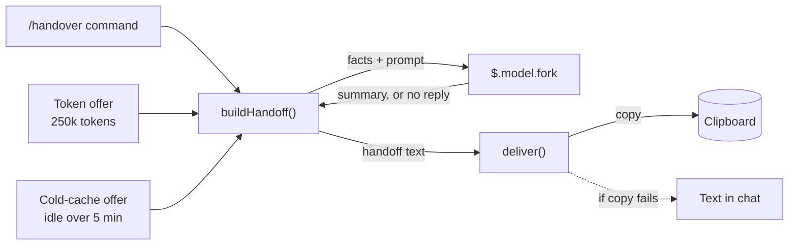
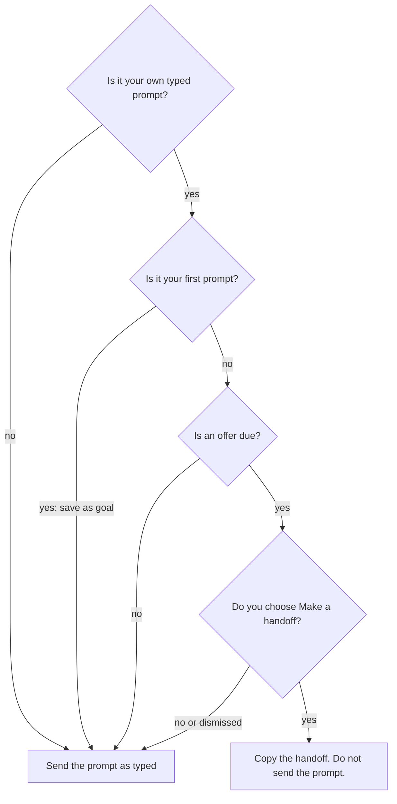
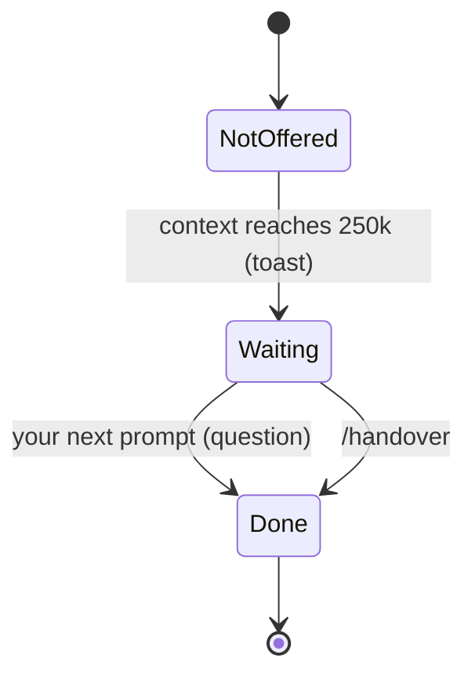
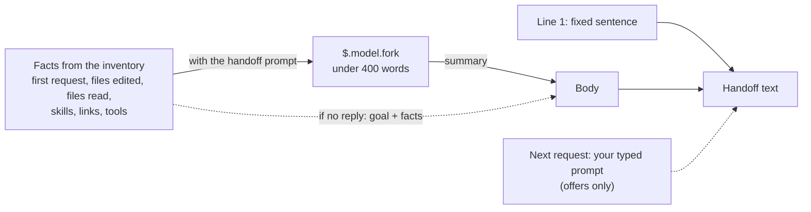

# handoff

A Claude Code mod. It packs a session into a prompt for a fresh chat.

An HTML version of this document is in `README.html`. It has the same content and the same diagrams.

To install the mod, go to section 5. To test that the mod works, go to section 6.

## 1. Purpose

A long session has two problems:

1. The conversation becomes large.
2. The prompt cache can expire. When the cache expires, the next reply costs full price.

A fresh chat solves both problems. A fresh chat does not know your work. This mod gives the fresh chat the information it needs. The mod does the following:

1. It records the work of the session. The record contains the first request, the files, the skills, the links and the tools.
2. It asks if you want to start a fresh chat. It asks when the session passes 250k tokens, or when the cache has likely expired.
3. If you agree, it asks the model for a summary. This summary is the handoff. The mod copies the handoff to the clipboard.
4. You start a fresh chat and paste the handoff.

You can also run the command `/handover` at any time. The mod name is `handoff`. The command name is `handover`.

The question has this text:

```text
This session was idle 7 minutes, so its cache has likely gone cold. Move to a fresh chat with a handoff?
```

The question has the header `Handoff`. It has two options: `Make a handoff` and `Continue here`.

## 2. Where to find the code

All logic is in one file: `hooks/register.ts`. If a line number is different, search for the function name.

| Item | File | Line |
|------|------|------|
| Constants (token limit, cache time, list limit) | `hooks/register.ts` | 6–10 |
| `EMPTY`: the inventory at the start | `hooks/register.ts` | 12 |
| Stored values `inventory`, `pending`, `lastTurnEnd`, `hasOfferedTokens` | `hooks/register.ts` | 14–20 |
| `HANDOFF_PROMPT`: the request to the model | `hooks/register.ts` | 22–31 |
| `addUnique()`: adds an item to a list and keeps the last 50 | `hooks/register.ts` | 33 |
| `describe()`: turns the inventory into text | `hooks/register.ts` | 36 |
| `buildHandoff()`: asks the model and builds the handoff text | `hooks/register.ts` | 55 |
| `deliver()`: copies the text and clears the offer | `hooks/register.ts` | 70 |
| `register()`: adds the hooks | `hooks/register.ts` | 79 |
| Hook `session.start`: adds the command | `hooks/register.ts` | 80 |
| Hook `command.run`: the `/handover` command | `hooks/register.ts` | 89 |
| Hook `tool.call`: records the inventory | `hooks/register.ts` | 95 |
| Hook `session.measure`: the 250k token offer | `hooks/register.ts` | 111 |
| Hook `turn.complete`: stores the end time | `hooks/register.ts` | 122 |
| Hook `prompt.submit`: the decision | `hooks/register.ts` | 131 |
| The question to you | `hooks/register.ts` | 151 |
| Type of the stored values | `types/index.d.ts` | all |
| Tests | `hooks/register.test.ts` | 63–176 |

Other files: `hooks/hooks.json` names the module. `tsconfig.json` is for the type check. `.claude-plugin/plugin.json` has the name and the version. The mod has no settings.

## 3. How it works

### 3.1 Three ways to start a handoff

| Way | When it starts | What you see |
|-----|----------------|--------------|
| Command `/handover` | You run the command. | The handoff is copied at once. |
| Token offer | The context passes 250k tokens. | A toast shows at once. The question shows at your next prompt. |
| Cold-cache offer | You send a prompt more than 5 minutes after the last reply ended. | The question shows before the prompt is sent. |

All three ways use the same two functions. `buildHandoff()` makes the text. `deliver()` copies the text.



### 3.2 What happens at each prompt

The hook `prompt.submit` runs each time you send a prompt. It makes these decisions in order.



These are the rules for each decision:

- **Your own prompt.** The prompt comes from the composer. It is not a slash command. It is not a hidden (meta) prompt. The mod sends prompts from peers, commands and hidden prompts unchanged.
- **First prompt.** The mod saves the first 2000 characters as the goal. It sends the prompt unchanged. It does not ask a question at the first prompt.
- **Offer due.** One reason must be true. Either the token offer is waiting, or the idle time is more than 5 minutes. The token reason has priority.
- **Idle time.** Idle time is the current time minus the time the last main reply ended. A subagent reply does not count. If no main reply has ended, the idle time is 0.
- **Your choice.** If you close the question without an answer, the mod uses `Continue here`.
- **After the question.** The mod clears the token offer. This happens for every answer.
- **Choice `Make a handoff`.** The mod adds your prompt to the handoff as the next request. The mod does not send your prompt to the model.
- **Build fails.** The mod shows the toast `Handoff failed; your prompt was sent here instead.` It sends your prompt in this session.

### 3.3 The token offer

The token offer has three states. The mod shows the toast one time only.



| State | Meaning | `hasOfferedTokens` | `pending` |
|-------|---------|--------------------|-----------|
| Not offered | The context is below 250k tokens. | false | none |
| Waiting | The toast was shown. The question waits for your next prompt. | true | `tokens` |
| Done | The question was answered, or you ran `/handover`. | true | none |

The toast text is: `Context passed 260k tokens. Run /handover, or you'll be asked at your next prompt.` The number is the token count in thousands.

### 3.4 What each hook does

| Event | Condition | Action |
|-------|-----------|--------|
| `session.start` | Always | Add the command `/handover`. |
| `command.run` | The command is `handover` | Build the handoff. Copy it. Show the result as the reply. |
| `tool.call` | Always | Count the tool. Record the file, link or skill. Pass the call on. |
| `session.measure` | Tokens are 250k or more, and no offer was made | Set `hasOfferedTokens`. Set `pending` to `tokens`. Show the toast. |
| `turn.complete` | Main loop only | Store the current time in `lastTurnEnd`. |
| `prompt.submit` | Any prompt | Make the decisions in 3.2. |

Subagent turns do not change `lastTurnEnd`. The hook checks `e.agentId`.

The hooks `tool.call` and `prompt.submit` have a `.catch`. If one of these hooks fails, the engine passes the event to the next hook. The engine does not stop.

### 3.5 What the mod records

The hook `tool.call` records one fact for each tool call.

| Tool | List | What it holds |
|------|------|---------------|
| `Read` | `read` | The file path. |
| `Edit` or `Write` | `edited` | The file path. |
| `WebFetch` | `urls` | The link. |
| `Skill` | `skills` | The skill name. |
| Any tool | `tools` | The number of calls for each tool name. |

Each list holds the last 50 items. The mod does not add an item that is already in the list.

The goal is a separate value. The mod sets it one time, at the first prompt.

When the mod writes the handoff, it does not list an edited file as read. An edited file is shown one time, as edited.

### 3.6 The handoff text

`buildHandoff()` sends the facts and `HANDOFF_PROMPT` to the model with `$.model.fork`. The model writes a summary of fewer than 400 words. The summary has five labels: Goal, Progress, Current state, Next steps and Context.



Line 1 is always: `Continue the work described in this handoff from a previous session.`

| Result | Action |
|--------|--------|
| The model replies | The body is the reply text. |
| The model gives no reply, or the request fails | The body is the goal and the facts. The body has no summary. |
| The copy works | The message is `Handoff copied to the clipboard. Start a fresh chat (/clear or a new session) and paste it.` |
| The copy fails | The message is `Could not copy the handoff.` The full text follows. Copy the text by hand. |

For an offer, this message replaces your prompt. For `/handover`, this message is the reply to the command.

### 3.7 Stored values

| Name | Type | Meaning | Set by | Cleared by |
|------|------|---------|--------|------------|
| `inventory` | object | The goal, the lists and the tool counts. | `tool.call`, `prompt.submit` | Nothing in this mod |
| `pending` | `tokens` or none | The token question is waiting. | `session.measure` | `prompt.submit`, `deliver()` |
| `lastTurnEnd` | number or none | The time the last main reply ended, in milliseconds. | `turn.complete` | Nothing |
| `hasOfferedTokens` | boolean | The token offer was made. | `session.measure` | Nothing |

The engine keeps these values for the session. They stay after a reload. The value `inventory` has the tag `inventory-1`. If the fields of `inventory` change, change the tag. The engine then does not load older values.

## 4. Settings

This mod has no settings. The values below are fixed in the code. To change a value, edit `hooks/register.ts`.

| Constant | Value | Effect | Line |
|----------|-------|--------|------|
| `TOKEN_THRESHOLD` | 250,000 tokens | The context size that starts the token offer. | 6 |
| `CACHE_TTL_MS` | 5 minutes | The idle time after which the cache is treated as cold. | 9 |
| `LIST_LIMIT` | 50 | The maximum number of items in each list. | 10 |

The engine does not report if the cache is warm. The mod uses idle time instead. If your real cache time is not 5 minutes, the question appears too early or too late.

## 5. Install

You install this mod by giving Claude Code the path to its folder. The mod is not in a marketplace yet.

### 5.1 Before you start

You need:

- Claude Code. The version used to write and test this mod is 2.1.310. To see your version, run `claude --version`.
- A copy of this repository on your computer.
- A terminal. A terminal is a window where you type commands. On macOS, open the app named Terminal.

In this document, the **repository root** is the top folder of the repository. The folder is named `claude-mods`. All commands in this document start from this folder. To go to this folder, type `cd` and the path. Example:

```bash
cd ~/Developer/claude-mods
```

### 5.2 Choose a method

| Method | Use it when | Duration |
|--------|-------------|----------|
| A. Flag `--plugin-dir` | You want to try the mod. | One session |
| B. Setting `CLAUDE_CODE_PLUGIN_DIRS` | You want the mod in every session. | Until you remove the setting |
| C. Marketplace | You want to share the mod with other people. | **Not available yet.** See 5.5. |

### 5.3 Method A: try the mod for one session

1. Open a terminal. Go to the repository root (see 5.1).
2. Start Claude Code with this flag:

   ```bash
   claude --plugin-dir mods/handoff
   ```

3. Do the check in 5.6.

If you change a file of the mod while the session is open, Claude Code reloads the mod.

### 5.4 Method B: load the mod in every session

1. Open the file `~/.claude/settings.json` in a text editor.
2. Add an `env` block with the full path of the mod folder. If the file has an `env` block, add only the line inside it.

   ```json
   {
     "env": {
       "CLAUDE_CODE_PLUGIN_DIRS": "/Users/your-name/Developer/claude-mods/mods/handoff"
     }
   }
   ```

3. Replace `/Users/your-name/Developer/claude-mods` with the real path to your repository. To print the path, run `pwd` in the repository root.
4. Save the file. Start a new Claude Code session.
5. Do the check in 5.6.

To remove the mod, delete the line. Start a new session.

### 5.5 Method C: marketplace (not available yet)

A marketplace install needs two things that this repository does not have:

- A marketplace file, `.claude-plugin/marketplace.json`, at the repository root.
- At least one commit that you pushed to GitHub.

When both exist, other people can install the mod with `/plugin install handoff --marketplace <owner>/<repo>`. Replace `<owner>/<repo>` with the GitHub name of the repository.

### 5.6 Check that the install worked

1. Start a session with method A or method B.
2. Send a prompt, for example `hello`. Wait for the full answer.
3. Type `/handover`. Press Enter.
4. **Expected:** the reply starts with `Handoff copied to the clipboard.`

If the command does not exist, see the table in 6.5.

### 5.7 Change the fixed values

This mod has no settings in `/config`. To change a value, see section 4.

## 6. Validate

To validate means to prove that the mod works as this document says. There are three levels. Do levels 1 and 2 each time you change the code. Do level 3 one time after you install.

| Level | What it proves | Time | Needs an API request |
|-------|----------------|------|----------------------|
| 1. Validate | The files are correct. The engine can read the mod. | 2 seconds | No |
| 2. Test | The logic is correct (goal, offers, handoff, copy). | 2 seconds | No |
| 3. Live check | The mod works in a real session. | 15 minutes or more | Yes (small ones) |

### 6.1 Level 1: validate the files

1. Go to the repository root (see 5.1).
2. Run:

   ```bash
   claude plugin validate mods/handoff
   ```

3. Read the last line of the output.

| Last line | Meaning | Action |
|-----------|---------|--------|
| `✔ Validation passed with warnings` | The mod is correct. | None. This is the expected result. |
| `✔ Validation passed` | The mod is correct. | None. |
| `✘ Validation failed` | The engine refuses the mod. | Read the lines that start with `✘`. Fix the file that each line names. Run the command again. |

The expected output contains messages that look like problems. These messages are not problems:

| Message | Why you can ignore it |
|---------|----------------------|
| `author: No author information provided` | This message is a note. The mod works without an author. |
| `LICENSE: License missing` | This check applies to a public plugin directory. It does not change the result. |
| `ICON_MISSING` | Same reason. |
| `types … declares on $: nothing` | This result is correct. The mod adds nothing to `$`. |

The output also lists what the mod uses. Compare the output with this list:

- Hooks: `session.start`, `command.run{command=handover}`, `tool.call`, `session.measure`, `turn.complete`, `prompt.submit`
- Stored values: `handoff.hasOfferedTokens`, `handoff.inventory`, `handoff.lastTurnEnd`, `handoff.pending`
- Engine calls: `$.clock.now`, `$.command.register`, `$.model.fork`, `$.state.get`, `$.state.set`, `$.ui.ask`, `$.ui.copy`, `$.ui.toast`

If the output lists a hook or a call that is not in this list, the code and this document are different. Tell the owner of the mod.

### 6.2 Level 2: run the tests

1. Go to the repository root.
2. Run:

   ```bash
   claude plugin test mods/handoff
   ```

3. **Expected result:** the last lines are `9 pass` and `0 fail`.

The tests use a fake clock, a fake clipboard and a fake model request. They do not call the API. They do not cost money. Section 6.4 describes each test.

If a test fails, the output shows the test name and the reason. Find the test name in the table in 6.4. The table shows which rule is broken.

### 6.3 Level 3: live check in a session

Do this check one time after you install. It uses the fixed 5-minute cache time. Step 8 is optional. It needs a long session.

| Step | Action | Expected result |
|------|--------|-----------------|
| 1 | Send a first prompt. Wait for the full answer. | No question appears. |
| 2 | Run `/handover`. | The reply starts with `Handoff copied to the clipboard.` |
| 3 | Paste the clipboard into a text editor. | The text starts with `Continue the work described in this handoff from a previous session.` It has the labels Goal, Progress, Current state, Next steps and Context. |
| 4 | Wait 6 minutes. Send a second prompt. | The question shows: `This session was idle 6 minutes, so its cache has likely gone cold.` |
| 5 | Choose `Continue here`. | Your second prompt is sent in this session. |
| 6 | Wait for the full answer to the second prompt. Wait 6 minutes. Send a third prompt. Choose `Make a handoff`. | Your third prompt is not sent. The reply starts with `Handoff copied to the clipboard.` |
| 7 | Paste the clipboard into a text editor. | The text ends with `Next request:` and your third prompt. |
| 8 | (Optional) Use one session until the context passes 250k tokens. | One toast shows: `Context passed …k tokens. Run /handover, or you'll be asked at your next prompt.` |

No person has done this check yet.

### 6.4 What each test proves

| Test (in `hooks/register.test.ts`) | Line | Rule it proves |
|-------------------------------------|------|----------------|
| the first prompt is recorded as the goal and sent untouched | 63 | The first prompt is sent unchanged. The request to the model contains `First request: fix the login flow`. |
| /handover copies a handoff built from the session, tools included | 73 | One copy is made. The copy has the summary and no `Next request`. An edited file is shown one time, as edited. The reply says `copied to the clipboard`. |
| /handover falls back to the facts when the fork fails, and prints the text if the copy fails | 90 | With no model reply, the text has the `Goal:` line. With a failed copy, the reply says `Could not copy` and shows the full text. |
| crossing 250k tokens toasts once and asks at the next prompt | 101 | No toast at 100k. One toast at 260k. No second toast at 270k. One question at the next prompt. No second question after you decline. |
| accepting the offer copies a handoff that carries the prompt, and drops it here | 123 | Your prompt is not sent. The copy has the summary and `Next request:` with your prompt. |
| a dismissed question sends the prompt on as typed | 136 | A dismissed question makes no copy. Your prompt is sent unchanged. |
| a prompt after a cold cache is asked about; a warm one is not | 147 | No question after 4 minutes. One question after 7 minutes, with the text `idle 7 minutes`. |
| a subagent finishing does not reset the idle clock | 164 | A subagent reply after 7 minutes does not stop the question. |
| prompts that are not the person's own are never asked about | 176 | A peer prompt, a hidden prompt and `/compact` get no question. All three are sent unchanged. |

### 6.5 Problems and solutions

| Problem | Cause | Solution |
|---------|-------|----------|
| `claude: command not found` | Claude Code is not installed. Or the terminal cannot find it. | Install Claude Code. Open a new terminal. |
| `claude plugin validate` says the path does not exist | You are not in the repository root. | Run `pwd`. Go to the repository root with `cd`. Try again. |
| Validation fails | A file of the mod has an error. | Read the lines that start with `✘`. Fix the file that each line names. |
| `/handover` does not exist | The mod did not load. The command is added at session start. | Check that the path in the flag or the setting is correct. Start a new session. |
| No question after a long wait | The prompt is your first prompt, or a command, or you did not wait for the full answer first. | Send a normal prompt. Wait for the full answer. Wait more than 5 minutes. Send another prompt. |
| No question after the toast | The question was already answered. The token offer is made one time for each session. | Run `/handover`. |
| The reply says `Could not copy the handoff.` | The clipboard is not available. | Select the text in the reply. Copy it by hand. |
| The toast says `Handoff failed` | The model request or the copy failed. | Your prompt was sent in this session. Run `/handover` again. |

### 6.6 Type check (optional)

A type check finds mistakes in the code types. It needs `tsc`, the TypeScript program. This check was **not run** when this document was written.

To run the check, install TypeScript. Load the mod in a session one time. The engine then writes the folder `.claude-plugin/types/`. Run `tsc -p mods/handoff`.

**Expected result:** no output and no errors.

## 7. Known limits

- **Fixed values.** The token limit and the cache time are in the code. They are not settings.
- **Cache time is an estimate.** The mod uses 5 minutes of idle time as the sign of a cold cache. For a 1-hour cache, the question appears too early.
- **One token offer.** `hasOfferedTokens` is never cleared. After you answer the token question, only `/handover` and the cold-cache offer remain.
- **No clean-up.** The mod has no `session.end` hook. The mod does not clear its stored values. This behavior was not tested with `/clear`. If the values remain, a new chat can start with the old goal and the old lists.
- **Five tools are recorded.** The mod records `Read`, `Edit`, `Write`, `WebFetch` and `Skill`. Other tools only add to the count. A file that changes through `Bash` is not listed.
- **List size.** Each list holds the last 50 items. Older items are removed.
- **Cost of the summary.** The model request uses the conversation as the main thread last sent it. If the cache is cold, this request costs full price one time.
- **Summary quality.** The model writes the summary from the conversation and the facts. The summary can miss a detail. Read the handoff before you use it.
- **Dismiss counts as a choice.** If you close the token question without an answer, the mod uses `Continue here`. The mod does not ask again.

## 8. Glossary

| Term | Meaning |
|------|---------|
| Handoff | A text that tells a fresh chat what the session did and what to do next. |
| Fresh chat | A new session that has no conversation. Start one with `/clear` or a new session. |
| Cache | The stored copy of the conversation. The API reads the copy at a lower price. |
| TTL | Time to live. The time the API keeps the cache after a request. |
| Cold cache | A cache that has expired. The next reply costs full price. |
| Offer | The question "Move to a fresh chat with a handoff?". |
| Inventory | The goal, the lists of files, links and skills, and the tool counts that the mod records. |
| Toast | A short message that shows on the screen and then goes away. |
| Turn | One model run, from your prompt to the final answer. |
| Fork | A request that uses the conversation as the main thread last sent it. |
| Drop | Do not send your prompt to the model. The mod shows a message instead. |
