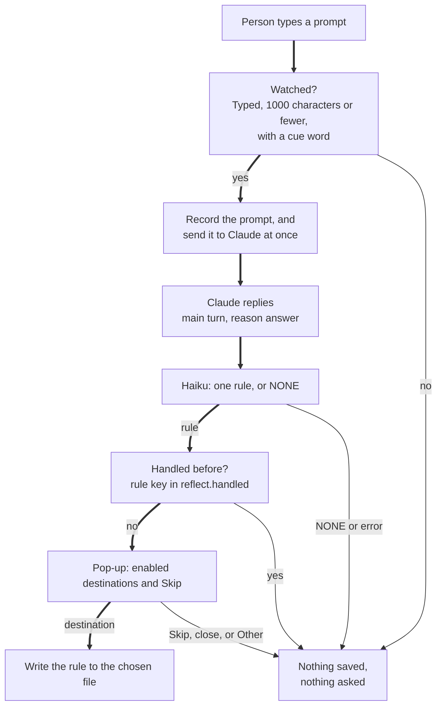
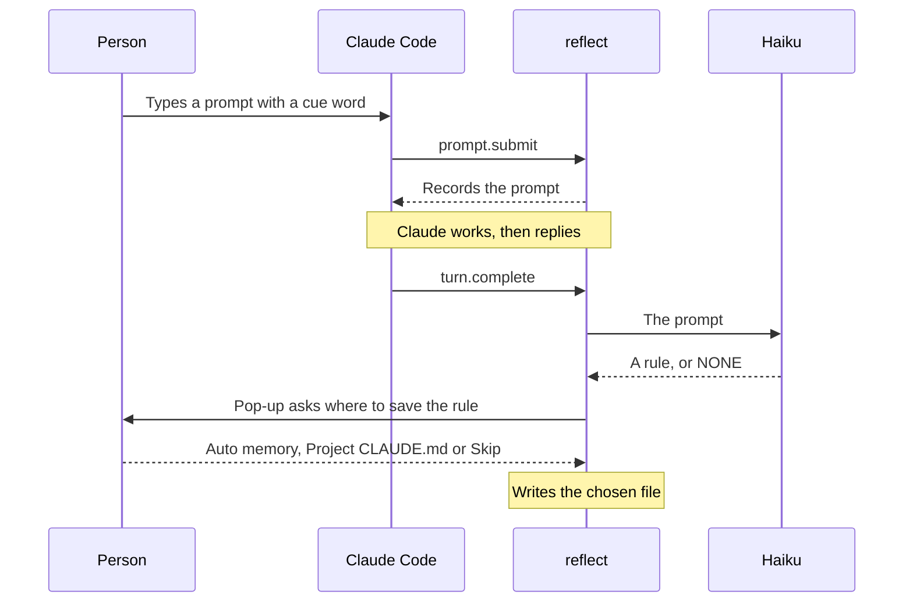

# reflect

A Claude Code mod. It finds a lasting rule in a prompt you type. After Claude replies, it asks where to save the rule.

An HTML version of this document is in `README.html`. It has the same content and the same diagrams.

To install the mod, go to section 5. To check that it works, go to section 6.

## 1. Purpose

A prompt can state a rule for all later work. For example: "never use m-dashes in your answers". You must save such a rule, or repeat it in each later session.

This mod gives you a choice of where the rule is saved. It does the following:

1. It records a prompt that you type, when the prompt holds a cue word such as `always` or `never`.
2. It sends the prompt to Claude at once. The mod never holds a prompt.
3. After Claude's reply, it asks Haiku, a small model, for the lasting rule in the prompt. Haiku writes the rule in one line, or it writes NONE.
4. If there is a rule, it shows a pop-up that asks where to save the rule.
5. If you choose a destination, it writes the rule to that file. Skip, closing the pop-up and free text under Other write nothing.

The pop-up asks `Save this rule for later?`, shows the rule, and offers the enabled destinations and `Skip`. The engine draws the pop-up.

Two destinations are on by default: auto memory and the project `CLAUDE.md`. The global `~/.claude/CLAUDE.md` is off by default. A Second Brain destination is not built.

## 2. Where to find the code

The hooks and the detection are in `hooks/register.ts`. The writers are in `hooks/save.ts`. The line numbers apply to this version of the files. If a line number is different, search for the function name.

| Item | File | Line |
|------|------|------|
| Constants `MAX_PROMPT_CHARS`, `MAX_PENDING`, `MAX_HANDLED`, `MAX_RULE_CHARS` | `hooks/register.ts` | 10–13 |
| Instructions to Haiku, `RULE_SYSTEM` | `hooks/register.ts` | 15–21 |
| `SKIP`, the label of the skip option | `hooks/register.ts` | 23 |
| `LABELS`, the pop-up label of each destination | `hooks/register.ts` | 27–31 |
| Stored values `pending` and `handled` | `hooks/register.ts` | 39–40 |
| `settingsFrom()` – reads the settings | `hooks/register.ts` | 47–59 |
| `isWatched()` – typed, short, from the prompt box | `hooks/register.ts` | 63–68 |
| `hasCue()` – finds a cue word as whole words | `hooks/register.ts` | 71–77 |
| `parseRule()` – reads the rule from the reply | `hooks/register.ts` | 80–90 |
| `ruleFrom()` – one Haiku call for one prompt | `hooks/register.ts` | 93–108 |
| `chooseDestination()` – the pop-up | `hooks/register.ts` | 112–123 |
| `keep()` – writes the rule and shows a toast | `hooks/register.ts` | 126–139 |
| `offerRules()` – checks each recorded prompt | `hooks/register.ts` | 142–158 |
| `register()` – adds the hooks | `hooks/register.ts` | 160–193 |
| Hook `prompt.submit` | `hooks/register.ts` | 166–172 |
| Hook `turn.complete` | `hooks/register.ts` | 174–192 |
| `addRule()` – adds a bullet under `## Rules` | `hooks/save.ts` | 30–55 |
| `addIndexLine()` – adds one line to `MEMORY.md` | `hooks/save.ts` | 58–63 |
| `memoryName()` – the name of a memory file | `hooks/save.ts` | 74–82 |
| `memoryFile()` – the text of a memory file | `hooks/save.ts` | 90–107 |
| `indexLine()` – the line in `MEMORY.md` | `hooks/save.ts` | 109–110 |
| `projectFolder()` – the project folder name | `hooks/save.ts` | 114 |
| `join()` – joins a path with its own separator | `hooks/save.ts` | 118–122 |
| `configDir()` – the Claude Code config folder | `hooks/save.ts` | 126–134 |
| `saveToMarkdown()` – writes a `CLAUDE.md` file | `hooks/save.ts` | 142–148 |
| `saveToMemory()` – writes auto memory | `hooks/save.ts` | 150–164 |
| `saveRule()` – picks the file for a destination | `hooks/save.ts` | 168–173 |
| Type of the stored values | `types/index.d.ts` | 1–12 |
| Settings | `.claude-plugin/plugin.json` | 11, 18, 25, 32, 39 |
| Entry in the marketplace | `.claude-plugin/marketplace.json` | 28 |
| Tests: 20 in `register.test.ts`, 25 in `save.test.ts` (see 6.4) | `hooks/register.test.ts`, `hooks/save.test.ts` | Listed in 6.4 |

Other files: `hooks/hooks.json` names the module on line 2. `tsconfig.json` extends the types config on line 2. See 6.6 for the type-check.

## 3. How it works

### 3.1 The path of one prompt



**Figure 1.** The path of one prompt. The thick lines show the path to a saved rule. Each box is a check or an action.

The checks, in the order the code runs them:

| Check | Where | When it fails |
|-------|-------|---------------|
| Typed in the prompt box, with no command and no meta flag | `hooks/register.ts` 63–68 | Not recorded. Plugin, peer and SDK prompts also fail this check. |
| Text is not empty, and has 1000 characters or fewer | `hooks/register.ts` 63–68 | Not recorded. |
| A cue word, as whole words, in any case | `hooks/register.ts` 71–77 | Not recorded. No Haiku call is made. |
| The turn is not a subagent turn | `hooks/register.ts` 179 | The turn is ignored. Recorded prompts stay for the main turn. |
| The turn ended with reason `answer` | `hooks/register.ts` 180–181 | Recorded prompts are dropped. Nothing is asked. |
| Haiku returns a rule, not NONE, and not a failed call | `hooks/register.ts` 80–90, 93–108 | Silent. Nothing is asked. |
| The rule is not handled before in this session | `hooks/register.ts` 152 | Not asked again. |
| The pop-up returns a destination | `hooks/register.ts` 112–123 | Skip, a closed pop-up or free text under Other writes nothing. |

Haiku gets one call for each recorded prompt. The call uses `maxTokens` 120 (`hooks/register.ts` line 99), `effort` low (line 100) and a 20-second `timeoutMs` (line 101). The rule is the first line of the reply. Quotes are removed. A rule longer than 200 characters (`MAX_RULE_CHARS`, line 13) is dropped.

### 3.2 Timing of one turn



**Figure 2.** The calls for one turn with one rule. The prompt goes to Claude before the reply. The pop-up comes after the reply.

The `prompt.submit` hook returns the prompt unchanged (line 171). The mod never delays the prompt. The `turn.complete` hook calls `offerRules()` (line 186). That is where the pop-up appears. The pop-up never appears before the reply.

Each recorded prompt gets its own check, and each rule that is found gets its own pop-up. A turn can record up to 5 prompts (`MAX_PENDING`, line 11).

### 3.3 Where a rule is saved

| Destination | File written | Default |
|-------------|--------------|---------|
| Auto memory | `<config folder>/projects/<project folder>/memory/feedback-<slug>-<hash>.md`, plus one line in `MEMORY.md` in the same folder | On |
| Project `CLAUDE.md` | `<project root>/CLAUDE.md` | On |
| Global `CLAUDE.md` | `<config folder>/CLAUDE.md` | Off |

The config folder is the value of `CLAUDE_CONFIG_DIR`. If that is not set, it is `.claude` in the home folder. The project root comes from `$.session.root()`. The project folder is the project root with each character that is not a letter or a digit replaced by `-` (`hooks/save.ts` line 114). On macOS, `/Users/your-name/Developer/claude-mods` gives `-Users-your-name-Developer-claude-mods`.

The writers follow these rules:

- A writer reads the file first. It writes nothing when the file already holds the rule. The check ignores case, extra spaces and a bullet mark (`ruleKey`, line 12).
- A `CLAUDE.md` rule is a bullet at the end of the `## Rules` section. The section is made at the end of the file when it is missing.
- A `CLAUDE.md` file keeps its own line endings, CRLF or LF (`eolOf`, line 14).
- A memory file has a front matter block, the rule, and a `Why` and `How to apply` line. Its name stays the same for the same rule.
- A file that exists but cannot be read is never written over.
- A saved rule shows a toast: `Saved to <destination>.`. A rule already there shows `Already in <destination>.`.

### 3.4 Stored values

| Name | Type | Meaning | Changed by (line) |
|------|------|---------|-------------------|
| `reflect.pending` | string list | Typed prompts with a cue word, for this turn. Holds up to 5. | Added to at line 168. Cleared at line 145, when the turn is checked, and at line 181, when the turn does not end with an answer. |
| `reflect.handled` | string list | Rule keys asked about in this session. Holds up to 200. | Added to at line 153. The key is added before the pop-up, so a skipped rule counts too. |

The stored values belong to the session. A new session asks about a rule again.

## 4. Settings

The settings are in `.claude-plugin/plugin.json`. The code reads them once, in `register()` (`hooks/register.ts` line 161).

| Setting | Values | Default | Effect | Line |
|---------|--------|---------|--------|------|
| `toAutoMemory` | true or false | true | Offers auto memory. | 11 |
| `toProjectClaudeMd` | true or false | true | Offers the project `CLAUDE.md`. | 18 |
| `toGlobalClaudeMd` | true or false | false | Offers `~/.claude/CLAUDE.md`. | 25 |
| `secondBrainPath` | a folder path | empty | Not read by any code. A Second Brain destination is not built. | 32 |
| `cues` | a comma-separated list | 11 words and phrases | A prompt is checked only when it holds one of these as whole words. | 39 |

The default `cues` list has 11 entries. It is written in `.claude-plugin/plugin.json` line 44. It includes `do not` and its apostrophe form.

With no destination on, `register()` returns before it adds a hook (`hooks/register.ts` line 164). Then the mod makes no Haiku call.

The fixed constants are these:

| Constant | Value | Line | Effect |
|----------|-------|------|--------|
| `MAX_PROMPT_CHARS` | 1000 characters | 10 | A longer prompt is a task, and it is not checked. |
| `MAX_PENDING` | 5 | 11 | The most prompts recorded in one turn. |
| `MAX_HANDLED` | 200 | 12 | The most rule keys kept in `reflect.handled`. |
| `MAX_RULE_CHARS` | 200 characters | 13 | A longer rule from Haiku is dropped. |

## 5. Install

You install this mod for one session, for every session, or from the marketplace. Section 5.2 helps you choose.

### 5.1 Before you start

You need:

- Claude Code. The version used to write and test this mod is 2.1.310. To see your version, run `claude --version`.
- A copy of this repository on your computer.
- A terminal. A terminal is a window where you type commands. On macOS, open the app named Terminal. On Windows, open PowerShell or Windows Terminal.

In this document, the **repository root** is the top folder of the repository, named `claude-mods`. All commands in this document start from that folder. To go there, run `cd` and the path to the folder:

```bash
cd ~/Developer/claude-mods
```

On Windows PowerShell, run this command:

```powershell
cd $HOME\Developer\claude-mods
```

The Windows steps in this document are not tested.

### 5.2 Choose a method

| Method | Use it when | Lasts for |
|--------|-------------|-----------|
| A. Flag `--plugin-dir` | You want to try the mod. | 1 session |
| B. Setting `CLAUDE_CODE_PLUGIN_DIRS` | You want the mod in every session, from your copy of the repository. | Until you remove the setting |
| C. Marketplace | You want to install the mod as you install other plugins. | Until you uninstall it |

### 5.3 Method A: try it for one session

1. Open a terminal. Go to the repository root (see 5.1).
2. Start Claude Code with the flag:

   ```bash
   claude --plugin-dir mods/reflect
   ```

3. Do the check in 5.6.

### 5.4 Method B: load the mod in every session

1. Open the file `~/.claude/settings.json` in a text editor.
2. Add an `env` block that names the full path of the mod folder. If the file already has an `env` block, add only the line inside it.

   ```json
   {
     "env": {
       "CLAUDE_CODE_PLUGIN_DIRS": "/Users/your-name/Developer/claude-mods/mods/reflect"
     }
   }
   ```

3. Replace `/Users/your-name/Developer/claude-mods` with the real path to your repository. To print the path, run `pwd` in the repository root.
4. Save the file. Start a new Claude Code session.
5. Do the check in 5.6.

On Windows, the settings file is `%USERPROFILE%\.claude\settings.json`. Use forward slashes in the path, for example `C:/Users/your-name/Developer/claude-mods/mods/reflect`. Or double each backslash in the JSON.

To remove the mod from every session, delete the line and start a new session.

### 5.5 Method C: marketplace

The file `.claude-plugin/marketplace.json` at the repository root lists `reflect`. The marketplace is named `claude-mods`. This review did not run the `marketplace add` and `install` commands below. No person has done this check yet.

This review did not check which branch the marketplace reads. The `reflect` entry is on this branch only, so check that it is on the branch the marketplace reads.

1. Add the marketplace once. Run:

   ```bash
   claude plugin marketplace add https://github.com/plaktoz/claude-mods
   ```

2. Install the mod. Run:

   ```bash
   claude plugin install reflect@claude-mods
   ```

   The default scope is `user`, which applies the mod to every project. To change the scope, add `--scope project` or `--scope local`. See the root `README.md`.

3. Restart Claude Code. Do the check in 5.6.

Add the marketplace with the repository URL. Do not use the GitHub link to `.claude-plugin/marketplace.json`: the command treats a link as a git repository and fails.

To use your copy of the repository instead, run the install script from the repository root. Run one of these commands:

- Linux, macOS, or Git Bash: `bash scripts/install-mods.sh reflect`
- Windows PowerShell: `powershell -ExecutionPolicy Bypass -File scripts\install-mods.ps1 reflect`

To remove the mod, run `bash scripts/install-mods.sh --uninstall reflect`. The Windows PowerShell script uses `-Uninstall`. Neither script was run for this review.

### 5.6 Check that the install worked

1. Start a session after method A, B or C.
2. Send a prompt that holds a rule and a cue word, for example `never use m-dashes in your answers`.
3. Wait for the answer to finish.
4. Look for the pop-up. It asks where to save the rule.

**Expected:** the pop-up appears with the rule and the options. Choose Skip to save nothing.

If the pop-up does not appear, see the table in 6.5.

No person has done this check yet.

### 5.7 Change the settings

1. In a session, type `/config`.
2. Find the rows for `reflect`: `toAutoMemory`, `toProjectClaudeMd`, `toGlobalClaudeMd`, `secondBrainPath` and `cues`.
3. Change a value, then start a new session. The code reads the settings once, when the mod loads (see section 4).

This review did not run these steps. No person has done this check yet.

## 6. Validate

To validate means to check that the mod works as this document says. There are three levels. Run levels 1 and 2 after each change to the code. Run level 3 once after you install the mod.

| Level | What it proves | Time | Needs an API request |
|-------|----------------|------|----------------------|
| 1. Validate | The files are correct, and the engine can read the mod. | Under 1 second | No |
| 2. Test | The logic is correct: detection, the pop-up, the writers and the limits. | Under 1 second | No |
| 3. Live check | The mod works in a real session. | 5 minutes or more | Yes, a small one |

### 6.1 Level 1: validate the files

1. Go to the repository root (see 5.1).
2. Run:

   ```bash
   claude plugin validate mods/reflect
   ```

3. Read the last line of the output.

| Last line | Meaning | Action |
|-----------|---------|--------|
| `✔ Validation passed` | The mod is correct. | None. This is the expected result. |
| `✘ Validation failed` | The engine refuses the mod. | Read the lines under the `✘ Found` heading. Fix the file they name. Run the command again. |

The real output of the last run ended with these lines:

```text
  ❯ ./register.ts hooks: prompt.submit, turn.complete
  ❯ ./register.ts gating hook without .catch: prompt.submit
  ...
  ⚠ Found 1 plugin directory warning:
  ❯ .claude-plugin/plugin.json icon: No icon (ICON_MISSING).
  ...
✔ Validation passed
```

These messages do not change the result:

| Message | Why you can ignore it |
|---------|----------------------|
| `ICON_MISSING` | Only a note for the plugin directory. The mod works without an icon. |
| `gating hook without .catch: prompt.submit` | A note about the `prompt.submit` hook. The hook has no `.catch`. See section 7. |

The output also lists what the mod uses. Compare it with this list:

- Hooks: `prompt.submit`, `turn.complete`.
- Engine calls: `$.env.get`, `$.fs.exists`, `$.fs.read`, `$.fs.write`, `$.model.complete`, `$.session.root`, `$.state.get`, `$.state.set`, `$.ui.ask`, `$.ui.toast`.
- Environment variables read: `CLAUDE_CONFIG_DIR`, `HOME`, `USERPROFILE`.
- Stored values: `reflect.handled`, `reflect.pending`.

If the output lists a hook or a call not in this list, the code and this document differ. Tell the owner of the mod.

### 6.2 Level 2: run the tests

1. Go to the repository root.
2. Run:

   ```bash
   claude plugin test mods/reflect
   ```

3. Check the last lines.

**Expected result:** the last lines are `45 pass` and `0 fail`. This review printed:

```text
 45 pass
 0 fail
Ran 45 tests across 2 files. [0.82s]
```

The time in brackets changes from run to run.

The tests use a fake model, a fake pop-up and a fake file system. They do not call the API and they cost nothing. Section 6.4 lists each test.

If a test fails, the output shows the test name and the reason. Find the test name in the table in 6.4.

### 6.3 Level 3: live check in a session

Do this once after you install. The steps need a person at the pop-up.

| Step | Action | Expected result |
|------|--------|-----------------|
| 1 | Send `never use m-dashes in your answers`. Wait for the answer. | The pop-up asks `Save this rule for later?`, with the rule and the options. |
| 2 | Choose `Auto memory`. | A toast says `Saved to Auto memory.`. A `feedback-<rule slug>-<hash>.md` file is in the project's memory folder, and `MEMORY.md` has one new line. |
| 3 | Send the same prompt again. Wait for the answer. | No pop-up. The rule is handled in this session. |
| 4 | Send `from now on keep hooks under 12 words`. Wait for the answer. Choose `Project CLAUDE.md`. | A toast says `Saved to Project CLAUDE.md.`. The file `CLAUDE.md` in the project root has the bullet under `## Rules`. |
| 5 | Send `never use m-dashes in your answers` in a new session. Choose `Skip`. | No file changes. |

**No person has done this check yet.**

The auto-memory path in step 2 is the one the code builds. Claude Code has no API for that folder. The real write is not yet tested in a session.

### 6.4 What each test proves

Register tests, in `hooks/register.test.ts`:

| Test | Line | Rule it proves |
|------|------|----------------|
| settings: destinations follow the switches, cues are split and lowercased | 11 | The switches set the destinations. Cues split on commas and are lowercased. |
| only a short prompt the person typed is watched | 24 | Only typed prompts of 1000 characters or fewer are recorded. |
| a cue counts as whole words, in any case, with either apostrophe | 35 | A cue matches whole words, in any case, with either apostrophe. |
| a rule is read from the first line of the reply; NONE and junk give nothing | 44 | The first line is the rule. NONE, empty and long replies give nothing. |
| a prompt with a rule is offered after the reply, not before | 105 | No pop-up appears at prompt time. The options are the enabled destinations and Skip. |
| the prompt itself is never held or changed | 117 | The prompt sent to Claude is the prompt typed. |
| a one-off task, with no cue word, makes no model call | 125 | A prompt with no cue word makes no Haiku call. |
| a cue word in a one-off task is dropped when haiku says NONE | 135 | A cue word with no rule gives no pop-up. |
| a command, a meta message, a plugin, a peer and a long prompt are ignored | 145 | These prompts are not recorded and make no Haiku call. |
| a rule already handled is not asked about again | 159 | A rule is asked about once in a session. |
| the prompt is asked about once: a second turn end has nothing recorded | 170 | The recorded prompts are used once. |
| a failed or throwing model call is silent and asks nothing | 180 | A failed Haiku reply gives no pop-up and no message. |
| a throwing model call is silent | 190 | A thrown Haiku error gives no pop-up and no message. |
| a dismissed dialog does not fail the turn | 199 | A closed pop-up does not stop the turn. |
| an interrupted turn drops the recorded prompt | 208 | A turn that ends with reason other than `answer` drops the recorded prompts. |
| a subagent's turn end does not use up the recorded prompt | 219 | A subagent turn leaves the recorded prompts for the main turn. |
| the global file is not offered by default | 230 | The global option is absent by default. |
| with every destination off the mod does nothing | 239 | With no destination, no hook runs and no Haiku call is made. |
| with the global file on, all three destinations and Skip are offered | 249 | The global option is offered when it is on. |
| two prompts typed in one turn are each checked | 258 | Each recorded prompt gets its own check. |

Writer tests, in `hooks/save.test.ts`:

| Test | Line | Rule it proves |
|------|------|----------------|
| a rule is added to a new file under a Rules heading | 18 | A new file gets a `## Rules` heading and the bullet. |
| a file with no Rules section gets one at the end, after a blank line | 22 | A missing section is added at the end of the file. |
| a rule goes to the end of an existing Rules section, before the next heading | 26 | The bullet goes after the last line of the section. |
| an empty Rules section at the end of the file gets the bullet | 32 | An empty section gets the bullet. |
| a rule that is already there is a duplicate, however it is bulleted or cased | 37 | A duplicate is found whatever its bullet or case. |
| CRLF stays CRLF and LF stays LF; the file has one closing newline | 43 | The file keeps its line endings and ends with one newline. |
| non-ASCII text is kept | 51 | Characters outside ASCII are kept. |
| the memory index gets one line, once | 57 | `MEMORY.md` gets one line for each memory file. |
| a memory file is a feedback memory with a stable name | 67 | The memory file has the feedback type and the same name for the same rule. |
| the project folder name follows the path; a Windows path and a path with spaces work | 80 | The folder name follows the path rule, for Windows paths too. |
| join keeps the separator of the base path | 85 | A Windows path joins with a backslash. |
| the project CLAUDE.md is created when it is missing | 150 | A missing `CLAUDE.md` is created with the section. |
| the project CLAUDE.md keeps its content and its CRLF | 158 | Existing content and line endings are kept. |
| a rule already in the file is not written twice | 165 | The file is not written when the rule is there. |
| auto memory gets a feedback file and one index line | 174 | Auto memory writes the file and the index line. |
| auto memory creates the index when there is none, and honours CLAUDE_CONFIG_DIR | 184 | The index is created when missing. `CLAUDE_CONFIG_DIR` sets the folder. |
| auto memory is not written twice | 191 | A second save of the same rule writes nothing new. |
| a memory file whose index line is missing gets the line | 203 | A memory file without its index line gets the line. |
| the global CLAUDE.md is in the home folder, found by USERPROFILE on Windows | 210 | The home folder comes from `USERPROFILE` when `HOME` is not set. |
| Skip writes nothing | 221 | Skip writes no file. |
| a dismissed dialog writes nothing | 229 | A closed pop-up writes no file. |
| free text under "Other" writes nothing | 236 | Free text writes no file. |
| a file that cannot be read is never overwritten | 243 | A file that cannot be read is not written. |
| a failed write is silent | 253 | A failed write shows no toast. |
| no home folder: the global file is not written | 261 | No home folder means no global write. |

### 6.5 Problems and solutions

| Problem | Cause | Solution |
|---------|-------|----------|
| `claude: command not found` | Claude Code is not installed, or the terminal cannot find it. | Install Claude Code. Open a new terminal. |
| `claude plugin validate` shows `File not found` | You are not in the repository root. | Run `pwd`. Run `cd` to the repository root. Run the command again. |
| `✘ Validation failed` | A file of the mod has an error. | Read the lines under the `✘ Found` heading. Fix the file they name. |
| No pop-up after a prompt with a rule | The mod did not load. | Run `claude plugin validate mods/reflect` from the repository root. Read any `✘` line. Check that the path in the flag or the setting is correct. |
| No pop-up after a prompt with a rule, and no error | The prompt has no cue word, or it is longer than 1000 characters. Or the turn did not end with an answer. | Use a cue word from the list in section 4. Keep the prompt short. Send a new prompt and wait for the full answer. |
| No pop-up, and the cue word is in the prompt | Haiku said NONE, the call failed, or the rule was handled before in this session. The mod writes no log line for these cases. | Start a new session to ask again. Use a clearer rule, such as one that starts with `never` or `always`. |
| The pop-up has no `Project CLAUDE.md` option | `toProjectClaudeMd` is off. | Turn it on in `/config`, then start a new session. |
| The pop-up has no `Auto memory` option | `toAutoMemory` is off. | Turn it on in `/config`, then start a new session. |
| A rule is saved in a different folder than expected | `CLAUDE_CONFIG_DIR` is set, or the project root is not the folder you expect. | Run `echo $CLAUDE_CONFIG_DIR`. Compare the project root with the folder that Claude Code shows. |
| The same rule is asked again in a new session | The handled list is for one session. | This is by design. Skip the rule again, or save it, to keep it. |

### 6.6 Type-check (optional)

A type-check finds mistakes in the code types. It uses `tsc`, the TypeScript compiler. `tsc` was not installed when this review ran, so this check was **not run**.

The file `tsconfig.json` extends `./.claude-plugin/types/tsconfig.json`. That folder did not exist in the repository when this review ran. The engine writes it once the mod has loaded. The check cannot run as written until that folder exists.

### 6.7 Cross-platform review

This review checked the code against the cross-platform checklist in `CLAUDE.md`. The tests ran on macOS only. Nothing ran on Windows or Linux. Each result below is marked by how it was checked.

| Check | Result | How it was checked |
|-------|--------|--------------------|
| Hard-coded `/` path joins | No. Paths are built with `join()` (`hooks/save.ts` 118–122). It keeps the separator of the base path, so a Windows path uses `\`. | Verified by reading. The tests for `join` and the project folder name use Windows path strings (`hooks/save.test.ts` 80 and 85). |
| `HOME` without a `USERPROFILE` fallback | Handled. `configDir()` reads `HOME`, then `USERPROFILE` (`hooks/save.ts` 126–134). `CLAUDE_CONFIG_DIR` is read first. | Verified by test: `hooks/save.test.ts` 210 and 184. Not run on Windows. |
| POSIX-only shell commands | None. The mod runs no shell command. | Verified by reading. A search of `hooks/` found no `exec`, `spawn` or `child_process`. |
| `python3`-only interpreter calls | None. The mod runs no interpreter. | Verified by reading. |
| Missing `encoding="utf-8"` | Not applicable. The mod does not open files itself. `$.fs.read` and `$.fs.write` work on UTF-8 text in the engine. | Verified by reading the engine types (`types/claude-code.d.ts`, the file system section). The non-ASCII test is `hooks/save.test.ts` 51. |
| CRLF handling | Handled. The writer keeps the file's line endings (`eolOf`, `hooks/save.ts` 14). | Verified by test: `hooks/save.test.ts` 43 and 158. Not run on a Windows file. |
| Windows memory folder name | Built with the same rule as macOS: each character that is not a letter or a digit becomes `-`. `C:\Users\me\app` gives `C--Users-me-app`. | Verified by reading and by test (`hooks/save.test.ts` 80). Not checked against a real Windows install. |
| Engine path for the global file on Windows | Built from `configDir()`. | Verified by test with the `USERPROFILE` path (`hooks/save.test.ts` 210). Not run on Windows. |

**Result:** no code change was needed for the checklist. The Windows and Linux paths are verified by reading only. Run the tests on Windows or Linux before you rely on them there.

## 7. Known limits

- **Haiku can misjudge.** A prompt with a rule can get NONE, and a prompt with no rule can get a rule. The pop-up always asks first, so a wrong rule saves nothing unless you choose a destination.
- **The cue list is fixed text.** A rule with no cue word is not checked. A cue word in a one-off task costs one Haiku call.
- **Long prompts are ignored.** A prompt of more than 1000 characters is treated as a task. A long rule in one prompt is not checked.
- **Only typed prompts count.** A prompt from a plugin, a peer, a command or the SDK is not checked (`hooks/register.ts` 63–68).
- **A prompt is checked at the end of its turn.** A prompt typed while Claude works is checked at the end of the turn that follows. A turn that ends with reason other than `answer` drops the recorded prompts.
- **The handled list is per session.** A rule is asked about once in a session. A new session asks again.
- **Closing the pop-up saves nothing, and the rule is marked handled.** The mod adds the rule key to `reflect.handled` before it shows the pop-up (`hooks/register.ts` 152–153).
- **Free text under Other saves nothing.** Only the listed options write a file.
- **Failures are silent.** A failed Haiku call, a failed write and a closed pop-up show no message. A saved or already-saved rule shows a toast.
- **A failed write in `prompt.submit` is not caught.** The `update()` call at `hooks/register.ts` line 168 has no `try`. The validator reports this as `gating hook without .catch`. The test kit cannot force this failure: the engine skips a `state.set` stub that throws, so the write still lands. No test covers it. How the engine treats the error in a real session was not checked.
- **Auto memory is not tested in a session.** Claude Code has no API for the memory folder. The path is built from the config folder and the project root. The real write is not yet tested. See 6.3.
- **Second Brain is not built.** The `secondBrainPath` setting is not read by any code.
- **The global file is off by default.** Turn it on in `/config`.
- **Settings are read once.** `register()` reads the settings when the mod loads (`hooks/register.ts` 161). A change to a setting can need a new session. This was not checked.
- **Only the standard heading is matched.** A `## Rules` heading with other case, such as `## rules`, is not matched. The code then adds a new `## Rules` section at the end of the file.
- **One rule per prompt.** The instructions ask Haiku for the most important rule only. A prompt with two rules gets one pop-up.
- **Limit of 200 characters.** A rule longer than 200 characters is dropped (`MAX_RULE_CHARS`, line 13).
- **The reply format is fixed.** The instructions to Haiku (lines 15–21) and the parser (lines 80–90) must change together.
- **The marketplace entry needs a merge.** The marketplace reads GitHub. The `reflect` entry works after this branch reaches `main`.
- **Windows and Linux are not run.** See 6.7. The paths are verified by reading.
- **The type-check was not run.** See 6.6.
- **No live check has been done.** See 6.3.

## 8. Glossary

| Term | Meaning |
|------|---------|
| Auto memory | Claude Code's memory folder for a project. Each memory is a file, and `MEMORY.md` lists the files. |
| Cue word | A word or phrase from the `cues` setting. A prompt with a cue word is recorded. |
| Destination | A place a rule can be saved: auto memory, the project `CLAUDE.md` or the global `CLAUDE.md`. |
| Engine | Claude Code. It loads the mod and calls its hooks. |
| Haiku | A small Claude model. The mod uses it to find and write a rule. |
| Hook | A function that the engine calls when an event happens, such as `turn.complete`. |
| Mod | A plugin for Claude Code that adds hooks. |
| Pop-up | The question that asks where to save a rule. |
| Recorded prompt | A typed prompt with a cue word, kept until its turn ends. |
| Rule | A lasting instruction about how to work, for later tasks and this one. |
| Skip | The pop-up option that saves nothing. |
| Subagent | A helper run that the main conversation starts. Its turns have an agent ID. |
| Turn | One reply cycle: a prompt, then Claude's work, then the reply. |
