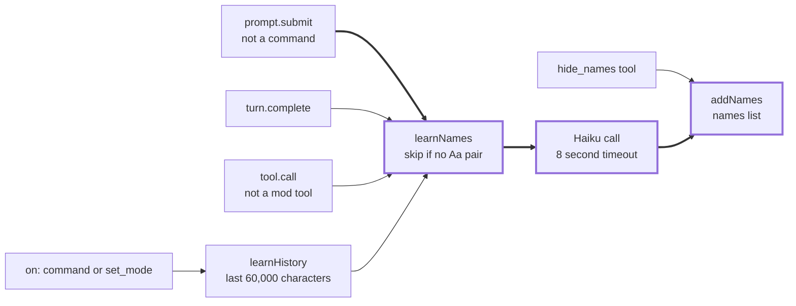
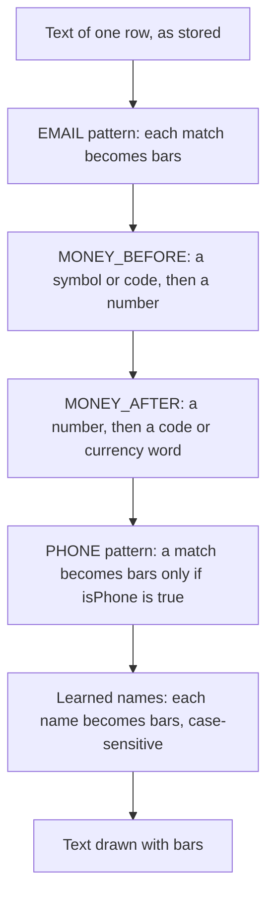

# screen-share

This mod masks names, emails, phone numbers and money amounts on screen. Claude still reads the real data.

The mod masks what the transcript draws. It does not change the stored conversation.

The mod is not a privacy guarantee. Real text still reaches Claude. The name search also sends text to Haiku.

## 1. Purpose

Use this mod when you share or record your screen during a Claude Code session.

While the mode is on, the mod draws shaded bars over:

- Emails, phone numbers and money amounts, found by pattern.
- Names, learned from the conversation by a small model.

The mod also adds a band above the prompt. The band says the mode is on. It has a **Turn off** button.

Claude receives the real text. Only the drawing changes.

## 2. Where to find the code

| Item | File | Line |
|------|------|------|
| Mode flag (session state) | `hooks/register.tsx` | 9 |
| Learned names list (session state) | `hooks/register.tsx` | 11-13 |
| Stored key for the mode flag | `hooks/register.tsx` | 15, 153, 192 |
| Bar helper | `hooks/register.tsx` | 23-24 |
| Email pattern | `hooks/register.tsx` | 26 |
| Money patterns | `hooks/register.tsx` | 28-31 |
| Phone pattern | `hooks/register.tsx` | 32 |
| Phone check, `isPhone` | `hooks/register.tsx` | 35-41 |
| Name pattern | `hooks/register.tsx` | 49-59 |
| Masking, `mask` | `hooks/register.tsx` | 61-71 |
| Masking inside tool data, `deepMask` | `hooks/register.tsx` | 74-85 |
| Name list entries, `expand` | `hooks/register.tsx` | 88-100 |
| Add names to the list, `addNames` | `hooks/register.tsx` | 102-106 |
| Model prompt and reply parser | `hooks/register.tsx` | 108-123 |
| Model call for names, `learnNames` | `hooks/register.tsx` | 126-137 |
| History scan, `learnHistory` | `hooks/register.tsx` | 140-149 |
| Mode change, `setMode` | `hooks/register.tsx` | 151-155 |
| Mode prompt text, `MODE_PROMPT` | `hooks/register.tsx` | 161-163 |
| Session start: command, tools, restore | `hooks/register.tsx` | 166-195 |
| Slash command, `/screen-share` | `hooks/register.tsx` | 197-203 |
| Tool hook, `set_mode` | `hooks/register.tsx` | 205-210 |
| Tool hook, `hide_names` | `hooks/register.tsx` | 212-218 |
| Learn from tool calls | `hooks/register.tsx` | 221-228 |
| Hook, `prompt.submit` | `hooks/register.tsx` | 230-234 |
| Hook, `turn.complete` | `hooks/register.tsx` | 236-240 |
| Hook, `prompt.compose` | `hooks/register.tsx` | 242-247 |
| Drawing hooks for rows | `hooks/register.tsx` | 250-287 |
| Band above the prompt | `hooks/register.tsx` | 290-307 |
| Hooks module list | `hooks/hooks.json` | 1 |
| Plugin name and version | `.claude-plugin/plugin.json` | 2-3 |
| State types | `types/index.d.ts` | 2, 5-9 |
| Tests | `hooks/register.test.tsx` | 51, 77, 93 |
| Test stand-in engine | `hooks/register.test.tsx` | 29-49 |

## 3. How it works

### 3.1 Modes

The mode has two states: on and off. The mode starts off.

Three actions turn the mode on or off:

- The command `/screen-share on`, `/screen-share off`, or `/screen-share` alone. Without an argument, the command toggles the mode.
- The tool `set_mode`. Claude calls it when the person asks.
- The **Turn off** button in the band.

Turning off stops the masking. Turning off does not clear the names list.

### 3.2 Learning names

The mod learns names in five places. Four of them run only when the mode is on. The `hide_names` tool adds names without a model call.

- `prompt.submit`: the mod reads the prompt text. Slash command prompts are skipped.
- `turn.complete`: the mod reads the finished reply.
- `tool.call`: the mod reads the tool input and output. Calls to the mod's own tools are skipped.
- `/screen-share on` and `set_mode` with `on`: the mod reads the recent history with `learnHistory`.
- `hide_names`: the mod adds the names that Claude gives. It makes no model call.

`learnNames` reads the last 20,000 characters of its text. It skips the text when the text has no capital letter followed by a lower-case letter. Otherwise it asks Haiku for the names. `Aa pair` means a capital letter followed by a lower-case letter.

Figure 1 shows the paths.



**Figure 1.** How the mod learns names. Each trigger reaches `learnNames` or `addNames`. The highlighted path runs from a prompt to the names list through the Haiku call.

### 3.3 Masking one row

`mask` runs four pattern steps and then the names step. Each step replaces matches with bars. The stored text does not change.

Figure 2 shows the order.



**Figure 2.** The masking steps for one row. The steps run in this order. The names step runs last.

The mod draws one bar for each non-space character. Spaces stay as they are.

### 3.4 What each hook does

| Hook | Condition | Action |
|------|-----------|--------|
| `session.start` | Always | Registers the command, the `set_mode` tool and the `hide_names` tool. Sets the mode on when the stored value is `true` (line 192). |
| `command.run` for `screen-share` | Always | Sets the mode from the argument, or toggles it. Returns the on or off text. |
| `tool.call` for `set_mode` | Always | Sets the mode from the `on` input. Returns the on or off text. If the call fails, the hook denies it. |
| `tool.call` for `hide_names` | Always | Adds the names from the input. Makes no model call. If the call fails, the hook denies it. |
| `tool.call`, any other tool | Mode on, not a mod tool | Calls `learnNames` on the input and the result. If the call fails, the hook passes the call on. |
| `prompt.submit` | Mode on, not a command | Calls `learnNames` on the prompt text. If the call fails, the hook passes the prompt on. |
| `turn.complete` | Mode on | Calls `learnNames` on the reply. The hook has no fallback. |
| `prompt.compose` | Mode on | Adds the mode prompt text to the session prompt. |
| `ui.render` for five row components | Mode on | Draws masked text. The components are `UserMessage`, `AssistantMessage`, `CommandOutput`, `ToolUse` and `ToolResult`. |
| `ui.render` for `AbovePrompt` | Mode on, no survey open | Adds the band below any other band. |

### 3.5 Mode prompt and tools

The mode prompt tells Claude three things:

- The mod masks names, emails, phone numbers and money amounts on screen.
- Claude still reads the real data. Claude does not reword the text.
- Claude calls `hide_names` before it writes a new name.

The two tools are `set_mode` and `hide_names`. Both use the mod's tool prefix, `mcp__screen-share__`.

`hide_names` shows its own input as bars in the transcript. The names in that input are not yet in the list.

### 3.6 Stored values

| Value | Where | Kept across sessions |
|-------|-------|----------------------|
| Mode flag, `isOn` | `$.store` under the key `isOn` (line 15) | Yes. Session start reads it (line 192). |
| Mode flag, live copy | Session atom `isOn` (line 9) | No. Set by `setMode`, and by session start when the stored value is `true` (line 192). |
| Names list | Session atom `names`, shape tag `names-1` (lines 11-13) | Not checked. |

The shape tag `names-1` marks the list format. Change the tag when the meaning of the list changes.

## 4. Settings

This mod has no settings in `/config`. The manifest has no `userConfig` block.

The values below are fixed in the code. To change a value, edit `hooks/register.tsx`.

| Name | Line | Value | Effect |
|------|------|-------|--------|
| `MAX_NAMES` | 18 | 500 | The list keeps the last 500 names. |
| `SCAN_CHARS` | 20 | 20,000 characters | Text read by one model call. |
| `HISTORY_CHUNKS` | 21 | 3 | Number of chunks read by `learnHistory`. Total: 60,000 characters. |
| `model` | 130 | `haiku` | Model for name finding. |
| `maxTokens` | 133 | 600 | Reply size limit for name finding. |
| `timeoutMs` | 134 | 8000 | A name finding call stops after 8 seconds. |
| `BAR` | 23 | `░` | Character for each masked character. |
| `TOOL_PREFIX` | 16 | `mcp__screen-share__` | Prefix for the mod's tools. |

Name entries keep only text from 2 to 60 characters (line 92). Name parts keep only text of 2 characters or more that starts with a capital letter (line 95). The text `Claude` is never added (line 99).

## 5. Install

You install this mod in one of three ways. Method A and method B load the mod from a folder on your computer. Method C installs it through the repository's marketplace.

### 5.1 Before you start

You need:

- Claude Code. The version used to write and test this mod is 2.1.310. To see your version, run `claude --version`.
- A copy of this repository on your computer.
- A terminal. A terminal is a window where you type commands.

In this document, the **repository root** is the top folder of the repository. The folder is named `claude-mods`. All commands in this document start from this folder.

This review did not run any Windows or Linux step. There is no OS-specific code in this mod.

### 5.2 Choose a method

| Method | Use it when | Duration |
|--------|-------------|----------|
| A. Flag `--plugin-dir` | You want to try the mod. | One session |
| B. Setting `CLAUDE_CODE_PLUGIN_DIRS` | You want the mod in every session, from your clone. | Until you remove the setting |
| C. Marketplace | You want a standard install. | Until you uninstall the mod |

### 5.3 Method A: try the mod for one session

1. Open a terminal. Go to the repository root.
2. Start Claude Code with this flag: `claude --plugin-dir mods/screen-share`.
3. Do the check in 5.6.

This review did not start a session with this flag.

### 5.4 Method B: load the mod in every session

1. Open the file `~/.claude/settings.json` in a text editor.
2. Add the full path of the mod folder to an `env` block. The line is `"CLAUDE_CODE_PLUGIN_DIRS": "/Users/your-name/Developer/claude-mods/mods/screen-share"`.
3. Replace `/Users/your-name/Developer/claude-mods` with the real path to your repository.
4. Save the file. Start a new Claude Code session.
5. Do the check in 5.6.

The file has this shape:

```json
{
  "env": {
    "CLAUDE_CODE_PLUGIN_DIRS": "/Users/your-name/Developer/claude-mods/mods/screen-share"
  }
}
```

To remove the mod, delete the line. Start a new session.

This review did not test method B.

### 5.5 Method C: marketplace

The repository marketplace file, `.claude-plugin/marketplace.json`, lists `screen-share` at line 28.

1. Add the marketplace once. Run this command: `claude plugin marketplace add plaktoz/claude-mods`.
2. Install the mod. Run this command: `claude plugin install screen-share@claude-mods`.
3. Restart Claude Code to load the mod.

This review did not run method C. It needs network access to GitHub and it changes your Claude Code setup. The install command was not run.

### 5.6 Check that the install worked

1. Start a session with method A, B or C.
2. Run `/screen-share on`.
3. **Expected:** the reply starts with `Screen-share is on.` The band shows `Screen-share mode:` above the prompt.

No person has done this check yet.

### 5.7 Change the fixed values

This mod has no settings in `/config`. To change a value, see section 4.

## 6. Validate

### 6.1 Level 1: validate the files

Run this command from the repository root:

```bash
claude plugin validate mods/screen-share
```

The last lines of the real output in this review:

```text
✔ Validation passed with warnings
```

The command exited with code 0. The output has 1 warning: `author: No author information provided`.

The plugin directory checks add 1 problem and 1 warning. They do not change the result:

- `LICENSE_MISSING`: the plugin folder has no LICENSE file and `plugin.json` has no `license`.
- `ICON_MISSING`: the plugin has no icon.

The output also has 1 advice line. It asks for a `/plugin install` line with `<owner>/<repo>` filled in. Section 5.5 uses `claude plugin install` instead. The advice was not applied.

### 6.2 Level 2: run the tests

Run this command from the repository root:

```bash
claude plugin test mods/screen-share
```

The last lines of the real output in this review:

```text
 3 pass
 0 fail
Ran 3 tests across 1 file. [0.37s]
```

The command exited with code 0. The three tests are:

- `a prompt row is drawn masked once the mode is on`
- `the mode leaves dates, versions and plain words alone`
- `the band shows while on and Turn off ends the mode`

### 6.3 Level 3: live check in a session

Start a session with the mod. Then:

1. Run `/screen-share on`. Check the band.
2. Send a prompt with a name, an email and a phone number. Check that the row shows bars.
3. Run `/screen-share off`. Check that the band is gone and the text is normal.

No person has done this check yet.

### 6.4 What each test proves

| Test | What it proves | What it does not prove |
|------|----------------|------------------------|
| `a prompt row is drawn masked once the mode is on` | A `UserMessage` row with a name, an email, a phone number and an amount draws masked. It does this on two surfaces, `terminal` and `desktop`. | Learning from a real model. The stand-in returns `Jane Doe` for every call. |
| `the mode leaves dates, versions and plain words alone` | An `AssistantMessage` with `2.1.310`, `2026-10-24` and the word `Northvale` draws unchanged. | Masking of plain number lists. |
| `the band shows while on and Turn off ends the mode` | The band shows on two surfaces. `Turn off` sets the stored flag to `false` and removes the band. | Restore after a new session. |

The test stand-in is in `hooks/register.test.tsx` at lines 29-49. It provides a store, a history with one row, a model that returns `["Jane Doe"]`, and a transcript that draws the text it receives.

The tests do not cover:

- `prompt.submit`, `turn.complete`, `tool.call` learning, `hide_names` and `prompt.compose`.
- The model reply parser, `parseNames`, with real model output.
- Masking of tool input and output (`ToolUse` and `ToolResult`).
- Each regex edge case in section 7.
- The 8-second timeout.
- A restore after a new session.
- A live session.

### 6.5 Problems and solutions

| Problem | Cause | Solution |
|---------|-------|----------|
| Validate shows `LICENSE_MISSING`. | The plugin folder has no LICENSE file, and `plugin.json` has no `license`. | Add a LICENSE file, or set `license` in `plugin.json`. |
| Validate shows `ICON_MISSING`. | The plugin has no icon. | Add a square PNG icon, or set `icon` in `plugin.json`. |
| `/screen-share` is not a command. | The mod is not loaded. | Check the install with 5.6. Start a new session after a change. |
| A name shows in a reply. | The mod learns names after the reply finishes. | Ask Claude to call `hide_names` first. Learning takes place after the reply. |

### 6.6 Type check (optional)

This review did not run a type check. The `tsc` command is not installed on this computer. `tsconfig.json` extends `./.claude-plugin/types/tsconfig.json`.

## 7. Known limits

Each limit below comes from the code or from a check in this review.

### 7.1 Rows that the mod does not draw

- The mod has no hook for `ToolGroup`, `AskUserQuestion` or `InfoNotice`.
- Rows drawn by these components are not masked by the mod.
- A live check was not run.

### 7.2 Text that the mod does not mask

- The mod does not scan slash command prompts (line 231).
- The mod does not mask the prompt box, the status line or the panes of other mods.
- The mod does not mask keys of objects in tool input or output (line 79). Only string values are masked.
- The `hide_names` input is always bars (line 276). The transcript shows bars for the names in that input.

### 7.3 Name matching

- Learned names are case-sensitive. The name `Jane Doe` does not mask `jane doe`.
- A common word learned as a name masks every capital use of that word. For example, the name `Mark` turns `Mark said mark` into `░ said mark`.
- A name next to a letter or number is not masked. For example, `田中太郎が` is not masked when the name is `田中太郎`.
- A name in a reply is learned when the reply finishes. A name in a streaming reply shows until then, unless `hide_names` ran first.
- A name is learned only when the model returns it. The mod does not check the model reply against the text.
- A name of one character is not learned (line 92).
- Lower-case name parts, such as `van`, are not learned alone (line 95).

### 7.4 Phone numbers

- A plain figure group is masked when it has 7 to 15 digits. The check is `isPhone` (lines 35-41).
- Plain numbers with spaces between them are masked. For example, `2024 2025 2026` becomes bars.
- These numbers are not masked: `4155550134` (no separator), `415,555,0134` (commas), and `415 555` followed by a line break and `0134`.
- Dates such as `2026-10-24` and addresses such as `192.168.1.10` are not masked.
- A number with a leading `+` is masked, for example `+4155550134`.

Checked in this review with the mod's patterns:

| Input | Result |
|-------|--------|
| `2024 2025 2026` | Masked: `░░░░ ░░░░ ░░░░` |
| `3 4 5 6 7 8 9` | Masked: `░ ░ ░ ░ ░ ░ ░` |
| `ref 1234-5678` | Masked: `ref ░░░░░░░░░` |
| `1.234.567 units` | Masked: `░░░░░░░░░ units` |
| `0412 345 678` | Masked: `░░░░ ░░░ ░░░` |
| `4155550134` | Not masked |
| `415,555,0134` | Not masked |
| `1,234,567 units` | Not masked |
| `2026-10-24`, `2.1.310` | Not masked |

### 7.5 Money amounts

- A symbol or code before a number is masked, for example `$`, `€`, `£`, `US$`, `S$`, `USD` or `EUR`. Checked: `$12,000`, `S$5` and `USD 5`.
- A currency code after a number is masked: `USD`, `EUR`, `GBP`, `SGD`, `AUD`, `CAD`, `JPY`, `INR` or `CHF`. Checked: `12 USD`. The words `dollars`, `euros` and `pounds` are masked too.
- These amounts are not masked: `5€`, `1.234,56 €`, `5 €`, `5 million dollars`, `5 dollar`, `1 euro`, `100 yen`, `₩5000` and `Rs 500`.

### 7.6 Bars

- The bar helper has no `u` flag (line 24). One character outside the Basic Multilingual Plane, such as an emoji, draws as 2 bars.

### 7.7 Model calls

- Each name call sends its text to Haiku. The text can include prompts, tool inputs, tool outputs, replies and history.
- A call can take up to 8 seconds (line 134).
- `prompt.submit` and `tool.call` wait for the call before they continue. `turn.complete` waits too. `/screen-share on` and `set_mode` wait for up to three calls in parallel (line 148).
- The calls are billed to the session.
- The `turn.complete` hook has no fallback. The effect of a failed call on that hook was not checked.
- The model result varies. Names can be missed or added. The live model was not tested.

### 7.8 State

- The mode flag is saved with `$.store`. A new session reads it (line 192).
- The names list is session state. Session start does not scan the history again.
- Whether the names list survives a resume was not checked.
- The list keeps the last 500 names (line 105). Older names are dropped.
- `Turn off` does not clear the names list.

## 8. Glossary

| Term | Meaning in this document |
|------|--------------------------|
| Band | The line above the prompt that shows the mode and the **Turn off** button. |
| Bar | The character `░`. The mod draws one bar for each masked character. |
| Drawn text | The text on screen. The stored conversation does not change. |
| Haiku | The small model that the mod calls to find names. |
| Hook | A function that the engine runs on an event, such as `prompt.submit`. |
| Learned name | A name in the names list. The mod masks it on screen. |
| Mode | Screen-share mode. The mode is on or off. |
| Mode flag | The stored value `isOn` that says whether the mode is on. |
| Names list | The session list of learned names. |
| Mask | To draw bars over text. |
| Rewrite | A change that a `ui.render` hook makes to the text it draws. |
| Session state | A value kept for the current session. It is not stored across sessions. |
| Store | The engine store that keeps a value across sessions. |
| Stand-in | The fake engine in the tests. |
