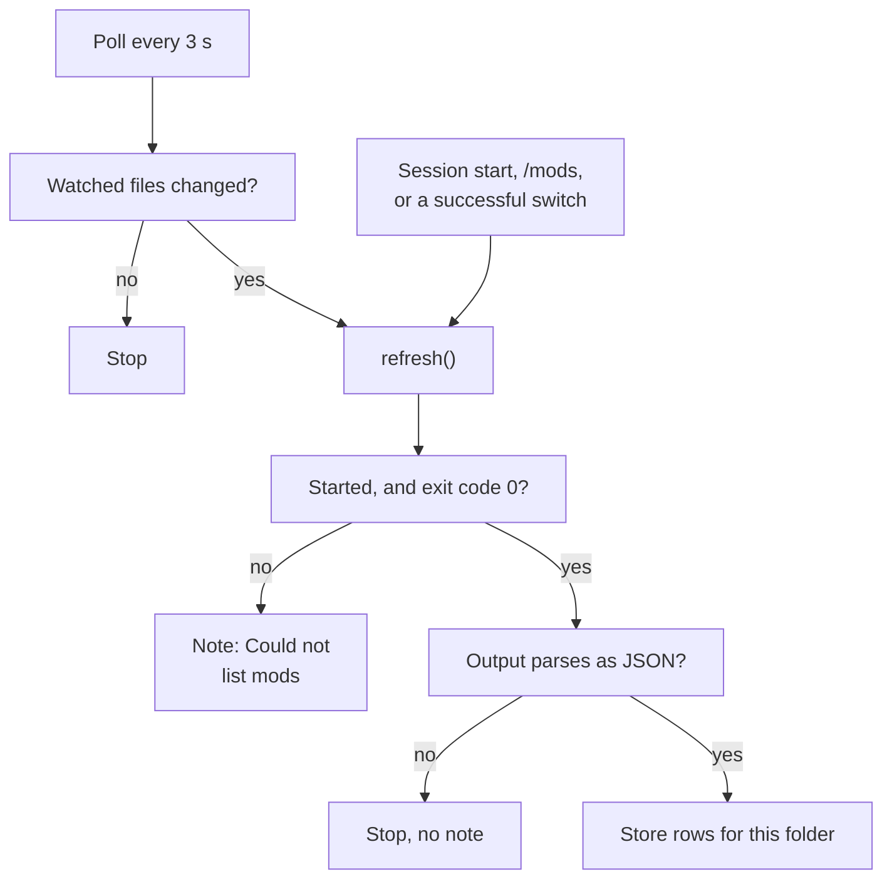
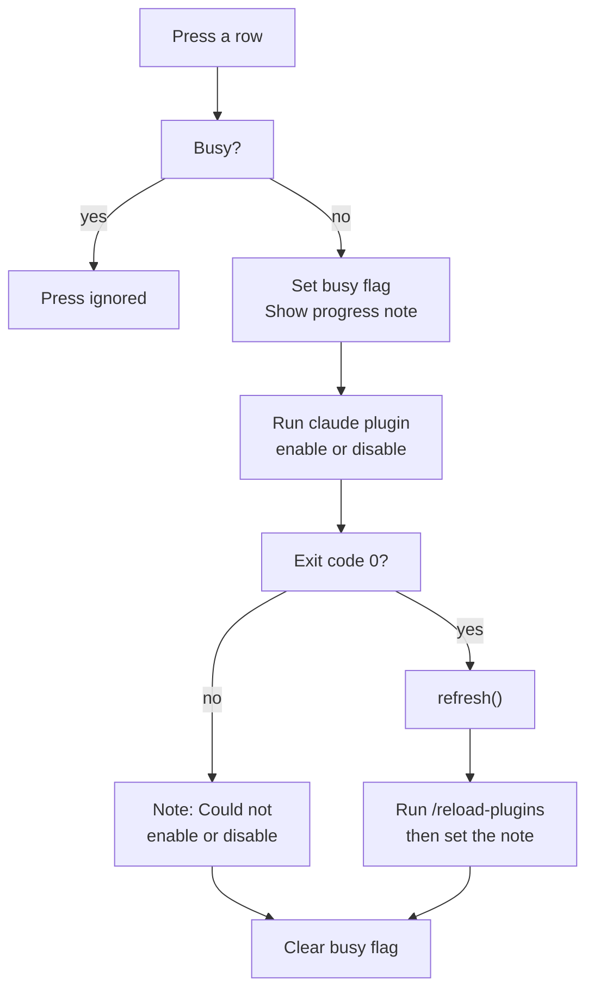

# switchboard

A Claude Code mod. It shows the installed mods in one pane, with an on/off switch for each.

An HTML version of this document is in `README.html`. It has the same content and the same diagrams.

To install the mod, go to section 5. To test that the mod works, go to section 6.

## 1. Purpose

Without this mod, you type the `claude plugin` commands and `/reload-plugins` yourself. This mod shows every mod for the working folder in one pane. You press a row to switch it.

The mod does the following:

1. It reads the installed plugins with `claude plugin list --json`.
2. It keeps the plugins that apply to the working folder.
3. It shows one row for each plugin. `[x]` means on. `[ ]` means off.
4. It runs `claude plugin enable` or `claude plugin disable` when you press a row.
5. It runs `/reload-plugins`, so the change applies to the running session.
6. It checks two files every 3 seconds. It reads the list again when a file changes.

Type `/mods` to open the pane.

## 2. Where to find the code

All logic is in one file: `hooks/register.tsx`. Search for the function name if a line number is different.

| Item | File | Line |
|------|------|------|
| Constants `PANE` and `POLL_MS` | `hooks/register.tsx` | 6–7 |
| Stored values `rows` and `note` | `hooks/register.tsx` | 11–14 |
| `WATCHED`: the two watched files | `hooks/register.tsx` | 17–20 |
| `LIST_FAILED`: the start of a failure note | `hooks/register.tsx` | 21 |
| Module variables `seen` and `isBusy` | `hooks/register.tsx` | 23–24 |
| `ListedPlugin`: one entry of the CLI output | `hooks/register.tsx` | 26–32 |
| `isWindowsPath()` and `normalized()`: Windows path folding | `hooks/register.tsx` | 35–40 |
| `isHere()`: keeps the plugins for the working folder | `hooks/register.tsx` | 42–50 |
| `homeOf()`: reads the home folder | `hooks/register.tsx` | 53–55 |
| `under()`: joins a path with the home separator | `hooks/register.tsx` | 58–62 |
| `reason()`: the text of an error | `hooks/register.tsx` | 64 |
| `fingerprint()`: reads the size and time of the watched files | `hooks/register.tsx` | 66–76 |
| `refresh()`: lists the plugins and stores the rows | `hooks/register.tsx` | 79–129 |
| `detail()`: the text after the row name | `hooks/register.tsx` | 131–132 |
| `toggle()`: enables or disables one row | `hooks/register.tsx` | 134–169 |
| `register()`: adds the hooks | `hooks/register.tsx` | 171 |
| Hook `session.start`: adds the command and the poll | `hooks/register.tsx` | 172–186 |
| Poll `$.clock.every` | `hooks/register.tsx` | 179–183 |
| Hook `command.run` for `mods`: opens the pane | `hooks/register.tsx` | 188–193 |
| Hook `ui.render` for the pane: draws the rows | `hooks/register.tsx` | 195–218 |
| Type `SwitchboardRow`: one row | `types/index.d.ts` | 2–9 |
| Type of the stored values | `types/index.d.ts` | 11–18 |
| Tests | `hooks/register.test.tsx` | 17–34 |

Other files: `hooks/hooks.json` names the hooks module. `tsconfig.json` extends `.claude-plugin/types/tsconfig.json`. That file is not in the repository. `.claude-plugin/plugin.json` has the name and the version. The manifest has no `userConfig` block.

## 3. How it works

### 3.1 Which plugins the pane shows

The pane shows a plugin when its scope matches the working folder. The working folder is the folder where the session runs (`$.session.cwd()`, line 110).

| Scope | Shown when |
|-------|------------|
| `user` | Always. |
| `project` or `local` | The working folder is the plugin's project path, or is inside it. |
| Any scope with no project path, such as `session` | Never. |

The mod compares paths as text. It does not check that a folder exists. A folder named `app2` is not inside a project path `app`.

### 3.2 Windows paths

The hooks module has no `path` module and no platform flag. The code checks the shape of each path instead.

- The home folder comes from `HOME` (line 54). If `HOME` is empty, the mod reads `USERPROFILE`.
- If neither is set, `refresh()` returns with no note. The poll does nothing.
- A Windows path starts with a drive letter and a separator, such as `C:\` or `C:/`. It can also start with `\\` (line 35).
- For a Windows path, `normalized()` (line 36) changes `\` to `/`, removes trailing slashes and lowercases the whole path. A POSIX path is compared exactly.
- The mod starts `claude` with no shell, as an argument list (lines 88 and 142).
- The watched file paths join with the separator that the home folder uses (line 59). A home folder with `\` and no `/` joins with `\`. Otherwise, the join uses `/`.
- The Windows code has not run on Windows. Section 7 lists what is unverified.

### 3.3 Refresh the list

`refresh()` (line 79) reads the list and stores the rows. Figure 1 shows the steps.



Figure 1. How a refresh runs. The poll calls `refresh()` only when a watched file changed. The highlighted path is a failed list. It shows a note.

- `refresh()` stores the fingerprint first (line 84). The poll compares later fingerprints with it.
- If there is no home folder, `refresh()` returns before this step (line 81).
- It runs `claude plugin list --json` with a 20 second timeout (line 88).
- If the command does not start, the note shows `Could not list mods:` and the error text (lines 89–91).
- If the exit code is not 0, the note shows `Could not list mods:` and the first line of stderr. If stderr is empty, it uses the first line of stdout. If both are empty, it uses `exit code` and the number (lines 94–99).
- The mod splits output on `\r?\n`, so output with CRLF line endings gives the same first line.
- A failed list keeps the stored rows as they were.
- If the output is not valid JSON, `refresh()` returns with no note (lines 101–106). An earlier failure note stays on the pane.
- After the output parses, the mod clears a failure note (line 108).
- Each plugin becomes one row. The row name is the text before the last `@` in the plugin id. The marketplace is the text after it. The row also has `version`, `scope` and `isEnabled` (lines 111–124).
- The rows sort by name, then by scope (line 125).
- The mod stores the rows only when they differ from the stored rows (line 128).

### 3.4 The poll

- At session start, the mod starts a poll with a period of 3 seconds (`POLL_MS`, lines 179–183).
- On each tick, the poll does nothing if there is no home folder or if `isBusy` is `true`.
- Otherwise, the poll computes the fingerprint. If the fingerprint differs from `seen`, the poll calls `refresh()`.
- The fingerprint has one part for each watched file. The part is the modification time in milliseconds, a colon and the size. If the stat call fails, the part is `-`. The parts join with `|` (lines 66–76).
- The watched files are `<home>/.claude/plugins/installed_plugins.json` and `<home>/.claude/settings.json` (lines 17–20).
- The poll runs while the pane is closed. The code does not check whether the pane is open.
- The mod assumes that a plugin install or a switch changes one of the two watched files. This was not tested with a real install.

### 3.5 Switch a row

`toggle()` (line 134) runs when you press a row. Figure 2 shows the steps.



Figure 2. What a press on a row does. A press during a switch does nothing. The highlighted path is a failed switch. It shows a note and clears the busy flag.

- A press during a switch does nothing. The pane shows no message (line 135).
- The mod sets `isBusy` and shows `Enabling <name>...` or `Disabling <name>...` (lines 136–138).
- It runs `claude plugin enable <id> --scope <scope>` or `claude plugin disable <id> --scope <scope>`. The timeout is 60 seconds (lines 141–142).
- If the command does not start, or its exit code is not 0, the note shows `Could not enable <name>:` or `Could not disable <name>:`. The reason is the first line of stderr, or of stdout, or the error text. If none exists, the reason is `the command did not run` (lines 149–152). The split on `\r?\n` (line 150) also handles CRLF output.
- If the command succeeds, the mod refreshes the list (line 157). Then it runs `/reload-plugins` (lines 159–162).
- The success note is `<name> enabled.` or `<name> disabled.`. If `/reload-plugins` fails, the note adds ` Run /reload-plugins to apply it to this session.` (lines 163–167).
- `isBusy` returns to `false` on each normal exit (lines 152 and 168). Section 7 lists the case where it does not.

### 3.6 The pane

- At session start, the mod registers the command `/mods` (lines 172–176).
- Typing `/mods` opens the pane with the ID `mods` and the title `Mods`. The options set focus and `closeOnEscape` to `true` (line 189).
- The command also refreshes the list. The reply is `Switchboard opened.` (lines 190–192).
- The pane text is `No mods installed.` when no rows are stored. Otherwise, it is `<n> of <m> on. Press a mod to switch it.` (line 204).
- Each row is a button. The label is `[x]` or `[ ]`, the name, two spaces and the detail (line 209).
- The detail is the first 12 characters of the version, the scope and the marketplace. Empty parts do not show. The parts are separated by ` · ` (line 132).
- Pressing a row starts a switch (lines 210–212).
- The note shows below the rows when it is not empty (line 215).

### 3.7 Stored values

| Name | Type | Meaning | Set by | Cleared by |
|------|------|---------|--------|------------|
| `rows` | list of `SwitchboardRow`, shape `rows-1` | The plugins for the working folder. | `refresh()` | Replaced by the next different list. |
| `note` | text | The last message under the rows. | `refresh()`, `toggle()` | A list that parses clears a failure note. A switch replaces the note. |
| `seen` | text, module variable | The fingerprint at the last refresh. | `refresh()` | Replaced by the next refresh. |
| `isBusy` | boolean, module variable | A switch runs. | `toggle()` | `toggle()` at its normal exits. |

The engine stores `rows` and `note` as plugin state (lines 11–14). The shape tag `rows-1` marks the row fields. The comment at lines 9–10 says that a changed tag makes the engine decline an older stored value. If you change the fields of a row, change the tag.

The module variables `seen` and `isBusy` (lines 23–24) belong to the module. This document does not state what they hold after a module reload.

## 4. Settings

This mod has no settings in `plugin.json`. The values below are fixed in the code. To change a value, edit `hooks/register.tsx`.

| Constant | Value | Effect | Line |
|----------|-------|--------|------|
| `PANE` | `mods` | The ID of the pane. | 6 |
| `POLL_MS` | 3,000 milliseconds (3 seconds) | The time between two checks of the watched files. | 7 |
| List timeout | 20,000 milliseconds (20 seconds) | The longest wait for `claude plugin list --json`. | 88 |
| Switch timeout | 60,000 milliseconds (60 seconds) | The longest wait for `claude plugin enable` or `disable`. | 142 |
| Version length | 12 characters | The number of version characters that a row shows. | 132 |
| `LIST_FAILED` | `Could not list mods: ` | The start of a list failure note. | 21 |

The timeouts end the wait. The mod does not retry a timed-out command.

## 5. Install

### 5.1 Before you start

You need:

- Claude Code. The version used to write and test this mod is 2.1.310. To see your version, run `claude --version`.
- The `claude` command must be on your `PATH`. The mod starts `claude` to list and switch plugins.
- A copy of this repository on your computer.
- A terminal. A terminal is a window where you type commands. On macOS, open the app named Terminal. On Windows, open PowerShell or Windows Terminal.

In this document, the **repository root** is the top folder of the repository. Run the commands from that folder unless a step says otherwise.

No install has been run on Windows.

### 5.2 Choose a method

| Method | Use it when | Duration |
|--------|-------------|----------|
| A. Marketplace, user scope | You want the mod in every folder. | Until you remove it |
| B. Marketplace, project scope | You want the mod in one project, for everyone who opens it. | Until you remove it |
| C. Flag `--plugin-dir` | You want to try the mod. | One session |

To install from your clone, run `claude plugin marketplace add /path/to/claude-mods` in place of step 2 of 5.3. The scripts `scripts/install-mods.sh` and `scripts/install-mods.ps1` install every mod. See the root `README.md`.

### 5.3 Method A: install for every folder

1. Open a terminal. Go to the repository root (see 5.1).
2. Run the following command once:

   ```bash
   claude plugin marketplace add plaktoz/claude-mods
   ```

3. Run the following command. The default scope is `user`:

   ```bash
   claude plugin install switchboard@claude-mods
   ```

4. Start a new session. The `/mods` command is added at session start.

### 5.4 Method B: install for one project

1. Open a terminal. Go to the project folder:

   ```bash
   cd /path/to/your-project
   ```

2. If you did not run the marketplace command in 5.3, run it now:

   ```bash
   claude plugin marketplace add plaktoz/claude-mods
   ```

3. Run the following command. The `project` scope applies the mod to this project for everyone who opens it:

   ```bash
   claude plugin install switchboard@claude-mods --scope project
   ```

4. Start a new session.

### 5.5 Method C: try the mod for one session

1. Open a terminal. Go to the repository root (see 5.1).
2. Start Claude Code with this flag:

   ```bash
   claude --plugin-dir mods/switchboard
   ```

The pane does not list this mod itself. Its scope is `session`, and the pane shows no `session` plugins (section 3.1).

### 5.6 Check that the install worked

1. Start a session with a method from 5.3, 5.4 or 5.5.
2. Type `/mods`. Press Enter.
3. **Expected:** a pane titled `Mods` opens. The reply says `Switchboard opened.` The pane shows either `<n> of <m> on. Press a mod to switch it.` or `No mods installed.`

No person has done this check yet.

### 5.7 Change the fixed values

This mod has no settings. To change a value, see section 4.

## 6. Validate

To validate means to prove that the mod works as this document says. There are three levels. Do levels 1 and 2 each time you change the code. Do level 3 one time after you install.

| Level | What it proves | Command | Model request |
|-------|----------------|---------|---------------|
| 1. Validate | The files are correct. The engine reads the mod. | `claude plugin validate mods/switchboard` | No |
| 2. Test | The two tests pass. They cover the empty pane and one stored row. | `claude plugin test mods/switchboard` | No |
| 3. Live check | The pane lists plugins, and a switch works in a real session. | The steps in 6.3 | No |

### 6.1 Level 1: validate the files

1. Go to the repository root (see 5.1).
2. Run:

   ```bash
   claude plugin validate mods/switchboard
   ```

3. Read the last line of the output.

| Last line | Meaning | Action |
|-----------|---------|--------|
| `✔ Validation passed with warnings` | The mod is correct. | None. This is the expected result. |
| `✔ Validation passed` | The mod is correct. | None. |
| `✘ Validation failed` | The engine refuses the mod. | Read the lines that start with `✘`. Fix the file that each line names. Run the command again. |

The output from the run on 2026-10-25 ends with this line:

```text
✔ Validation passed with warnings
```

The output contains warnings that do not change the result:

- `author: No author information provided`. The mod works without an author.
- `types ./types/index.d.ts declares on $: nothing`. The mod adds nothing to `$`.

The output also lists what the mod uses. Compare it with this list:

- Hooks: `session.start`, `command.run{command=mods}`, `ui.render{component=Pane, requestId=mods}`.
- Stored values: `switchboard.note`, `switchboard.rows`.
- Engine calls: `$.clock.every`, `$.command.register`, `$.command.run`, `$.env.get`, `$.fs.stat`, `$.process.run`, `$.session.cwd`, `$.state.get`, `$.state.set`, `$.ui.open`, `$.ui.resolve`.
- Environment reads: `HOME` and `USERPROFILE`.

If the output lists an unknown hook or call, the code and this document differ. Tell the owner of the mod.

The directory profile checks what a plugin directory accepts. Run it with `claude plugin validate mods/switchboard --profile directory`. The run on 2026-10-25 printed `✘ Validation failed (--profile directory: the plugin directory would refuse a submission of this plugin)`. The problem is `LICENSE: License missing`. The warning is `ICON_MISSING`. This profile is not part of the install check.

### 6.2 Level 2: run the tests

1. Go to the repository root.
2. Run:

   ```bash
   claude plugin test mods/switchboard
   ```

3. **Expected result:** the last lines are `2 pass` and `0 fail`. The run on 2026-10-25 printed these last lines:

   ```text
    2 pass
    0 fail
   Ran 2 tests across 1 file. [0.38s]
   ```

The time in brackets changes between runs.

If a test fails, the output shows the test name and the reason. Find the test name in the table in 6.4.

### 6.3 Level 3: live check in a session

Do this check one time after you install. It sends no prompt to the model.

| Step | Action | Expected result |
|------|--------|-----------------|
| 1 | Type `/mods`. Press Enter. | A pane titled `Mods` opens. The reply says `Switchboard opened.` |
| 2 | Press the row of a plugin other than `switchboard`. | The note shows `Disabling <name>...`, then `<name> disabled.`. The row shows `[ ]`. |
| 3 | Press the same row again. | The note shows `<name> enabled.`. The row shows `[x]`. |
| 4 | In another terminal, install or remove a plugin. Wait 5 seconds. | The pane lists the change. You do not type `/mods`. |

No person has done this check yet. No Windows run has happened.

### 6.4 What each test proves

| Test (in `hooks/register.test.tsx`) | Line | Rule it proves |
|-------------------------------------|------|----------------|
| the pane says when no mod is installed | 17 | With no stored rows, the pane shows `No mods installed.` |
| a stored row is drawn with its switch | 24 | A stored row shows as a button with the text `[x] demo`. |

The tests do not call the CLI. They do not check these parts of the code:

- `isHere()`: scope matching, project path matching and the Windows folding.
- `normalized()` and `isWindowsPath()`: the Windows path shape and the folding.
- `homeOf()` and `under()`: the `HOME` and `USERPROFILE` fallback, and the separator.
- `fingerprint()` and the poll.
- `refresh()`: the CLI call, the parse, the sort and the failure notes.
- `toggle()`: the busy guard, the enable and disable commands and the reload note.
- The hook `command.run` for `mods`.

No test covers the Windows code. No Windows run has happened.

### 6.5 Problems and solutions

| Problem | Cause | Solution |
|---------|-------|----------|
| The note says `Could not list mods:` and an error. | `claude` is not on `PATH`, or the command failed. | Run `claude plugin list --json` in a terminal. Fix the error it shows. Start a new session. |
| The pane says `No mods installed.` and no note appears. | No plugin applies to the working folder. Or the output did not parse. Or no home folder is set. | Run `claude plugin list --json`. Check that your plugins have scope `user`, `project` or `local`. Check `HOME` or `USERPROFILE`. |
| A plugin is missing from the pane. | Its scope is `session`. Or its project path is not the working folder or a parent of it. | Install the plugin with a method in 5.3 or 5.4. Start the session in the project folder. |
| `/mods` does not exist. | The mod did not load. The command is added at session start. | Check the install in 5.6. Start a new session. |
| The note says `Could not enable <name>:` or `Could not disable <name>:`. | The CLI command failed or did not start. | Read the text after the colon. Run the command in a terminal, for example `claude plugin enable <id> --scope <scope>`. |
| A press does nothing. | A switch is already running. | Wait for the note to show the result. Press the row again. |
| The note says `Run /reload-plugins to apply it to this session.` | The mod could not run `/reload-plugins`. | Type `/reload-plugins`. |
| A change to a project's `.claude/settings.json` does not appear. | Only the two home files are watched. | Type `/mods`. The command reads the list again. |

### 6.6 Type check (optional)

A type check finds mistakes in the code types. It needs `tsc`. This check was **not run** when this document was written. `tsc` is not on `PATH`. The file `.claude-plugin/types/tsconfig.json` that `tsconfig.json` extends is not in the repository.

The expected result is no output and no errors. This expectation was not checked.

## 7. Known limits

- **Fixed values.** The pane ID, the poll period, the timeouts and the 12-character version cut are in the code. They are not settings (section 4).
- **Two watched files.** The poll watches only `<home>/.claude/plugins/installed_plugins.json` and `<home>/.claude/settings.json`. A change to a project or local `.claude/settings.json`, made outside the pane, does not trigger a refresh. Type `/mods` to read the list again.
- **Install detection is assumed.** The mod assumes that an install changes one of the two watched files. This was not tested with a real install.
- **The poll runs when the pane is closed.** The poll starts at session start. The code does not check whether the pane is open.
- **No guard against overlap.** `refresh()` has no flag for a run in progress. Session start and `/mods` can run `claude plugin list --json` while the poll runs it. The poll skips its check while a switch runs (`isBusy`).
- **A failed list is not retried.** `refresh()` stores the fingerprint (line 84) before it runs the CLI. After a failed list, the poll sees no change. The list stays stale until a watched file changes again, or until you type `/mods`.
- **Parse failure is silent.** If the output is not JSON, `refresh()` returns with no note. The stored rows stay as they were, and an earlier failure note stays too. The engine type declares that it keeps the first 4,194,304 bytes of standard output. The code does not check this limit. A cut output does not parse, so the code takes the parse-failure path. This was not tested.
- **The parsed value is not checked.** If the JSON is not an array, `listed.filter` throws. An array entry that is `null` throws. An entry with no `id` throws in the map step (lines 111–113). `refresh()` does not catch these errors. Session start and `/mods` call `refresh()` with `void` and have no `catch`. The poll callback awaits `refresh()` with no `catch`. A switch awaits `refresh()`, so the error ends `toggle()` before it clears `isBusy`.
- **Blank error text.** If the error output is only spaces, the note has no reason. For example, the note is `Could not list mods: ` with nothing after it. The `||` test reads spaces as text (lines 95 and 150).
- **A switch has no cleanup.** `toggle()` has no `try` and no `finally`. If `refresh()` throws during a switch, `isBusy` stays `true`. Presses then do nothing, and the poll skips each tick. The code does not show a reset.
- **The empty message is not proof.** The message `No mods installed.` shows when the stored rows are empty. That happens when no plugin applies, or when no list has succeeded yet. After a failed CLI list, the pane shows the message and the `Could not list mods:` note. A parse failure shows the message with no note. So does a missing home folder.
- **No guard on this mod's own row.** The code does not stop a press on the `switchboard` row. The code does not show what happens to the pane then. This was not tested.
- **Presses are ignored during a switch.** A press during a switch does nothing. The pane shows no message for it.
- **Versions are cut to 12 characters.** A longer version shows its first 12 characters only.
- **Sort order can depend on the locale.** The rows sort with `localeCompare` and no locale argument. The runtime locale can change the order.
- **Path matching is text only.** A POSIX path matches only with the same letter case. A Windows path matches without regard to case, and its trailing slashes are removed. A POSIX project path that ends with `/` does not match a subfolder (line 49).
- **Session plugins are not shown.** A plugin loaded with `--plugin-dir` has scope `session`. The pane does not show it (section 5.5).
- **Windows is not verified.** No Windows run has happened. The following points are unverified:
  - The mod starts `claude` without a shell (lines 88 and 142). It is unverified whether an npm shim named `claude.cmd` starts that way on Windows.
  - The mod reads `HOME` first. When `HOME` is set, the mod does not read `USERPROFILE`.
  - A home folder that contains both `\` and `/` joins with `/`.

## 8. Glossary

| Term | Meaning |
|------|---------|
| Mod | A Claude Code plugin. The CLI and the code call it a plugin. |
| Engine | The host that loads the hooks module and keeps the stored values. |
| Hook | A function that the engine runs for one event, such as `session.start`. |
| Shape tag | The name `rows-1` on the stored `rows` value. A changed tag makes the engine decline an older value. |
| Pane | The panel that `/mods` opens. Its title is `Mods`. |
| Row | One mod line in the pane. A row is a button. |
| Switch | The on or off state of a row. Pressing a row changes the switch. |
| Scope | Where a mod applies. The values are `user`, `project`, `local` and `session`. |
| User scope | The scope `user`. The mod applies to every folder. |
| Project scope | The scope `project`. The mod applies to one project, for everyone who opens it. |
| Local scope | The scope `local`. The mod applies to one project, for one user. |
| Session scope | The scope `session`. The mod applies to the session that loaded it with `--plugin-dir`. |
| Working folder | The folder where the session runs. |
| Home folder | The folder from `HOME`. If `HOME` is empty, it is the folder from `USERPROFILE`. |
| Watched files | The two files that the poll checks. |
| Fingerprint | The text made from the modification time and size of each watched file. |
| Poll | A check of the watched files. It runs every 3 seconds. |
| Refresh | The read of the mod list with `claude plugin list --json`, and the store of the rows. |
| Busy | The state while a switch runs. The module variable is `isBusy`. |
| Note | The one-line message under the rows. |
| Stored value | A value that the engine keeps for the session. This mod has `rows` and `note`. |
| Hooks module | The file `hooks/register.tsx`. The engine loads it through `hooks/hooks.json`. |
| Marketplace | A list of plugins that `claude plugin marketplace add` reads. The `claude-mods` marketplace is `.claude-plugin/marketplace.json` at the repository root. |
| Session | One run of Claude Code, from start to exit. |
