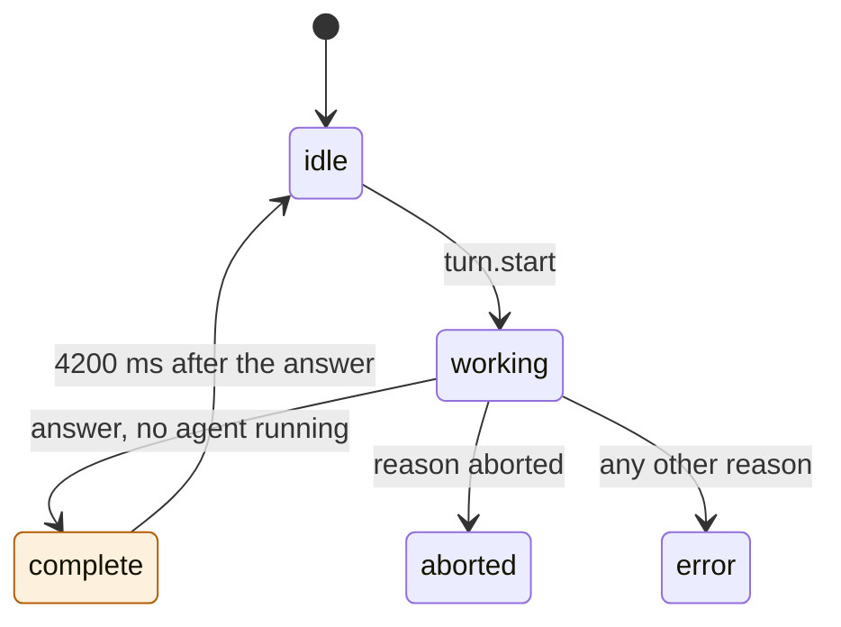
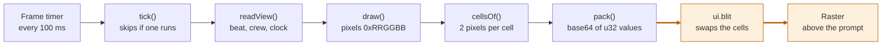
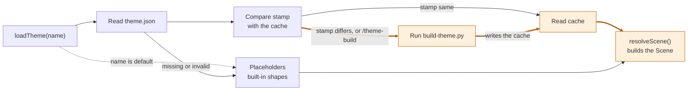

# theme-cli

A Claude Code mod. Pixel characters from your own images run along a strip above the prompt while Claude works.

An HTML version of this document is in `README.html`. It has the same content and the same diagrams.

To install the mod, go to section 5. To prove that it works, go to section 6.

## 1. Purpose

While Claude works, the prompt area shows only text. This mod adds a strip of pixel art above the prompt. The strip shows that a turn is in progress, and how many subagents run.

The strip does the following:

1. It shows a lead character that runs along the ground while a turn is in progress.
2. It adds one companion for each running subagent. Each companion has its own color.
3. It plays a finale when Claude answers. The lead runs to a flagpole, slides down it, and walks into a goal.

The characters come from a theme. A theme is a folder of your own images and one file, `theme.json`. Themes live in `~/.claude/theme-cli/themes`, outside every project. Switch themes with `/theme-use`.

Without a theme, the mod draws built-in placeholder shapes. The strip works before you set anything up.

The mod scales each theme one time, when the theme loads. It stores the scaled sprites in a cache. Drawing a frame never scales an image.

The strip uses half-block characters, so each terminal row shows 2 pixels. This sketch shows the layout. It is not real output.

```text
 lead      companion 1   companion 2                       pole   goal
  ▀█▄          ▀█▄           ▀█▄                            │     ▐█▌
▄▄▄▄▄▄▄▄▄▄▄▄▄▄▄▄▄▄▄▄▄▄▄▄▄▄▄▄▄▄▄▄▄▄▄▄▄▄▄▄▄▄▄▄▄▄▄▄▄▄▄▄▄▄▄▄▄▄▄▄▄▄▄▄▄▄▄▄
```

## 2. Where to find the code

The logic is in four files in `hooks/` and one script in `scripts/`. Search for the name if a line number is different.

| Item | File | Line |
|------|------|------|
| Constants (frame time, finale time, strip width limits) | `hooks/register.tsx` | 10–14 |
| Stored values | `hooks/register.tsx` | 16–29 |
| Module variables (`scene`, `timer`, `isTicking`, `stats`) | `hooks/register.tsx` | 33–36 |
| `isActive()` – decides if the strip shows | `hooks/register.tsx` | 42 |
| `readView()` – reads the values that a frame needs | `hooks/register.tsx` | 48 |
| `useTheme()` – loads a theme and tells the band to redraw | `hooks/register.tsx` | 65 |
| `tick()` – draws one frame and sends it with `blit` | `hooks/register.tsx` | 75 |
| `startTimer()` and `stopTimer()` | `hooks/register.tsx` | 113, 119 |
| `addAgent()` and `freeSlot()` – give a companion its color slot | `hooks/register.tsx` | 125, 131 |
| `reconcile()` – drops agents that the engine no longer lists. It keeps the crew when the list cannot be read. | `hooks/register.tsx` | 139 |
| `register()` – adds all hooks | `hooks/register.tsx` | 156 |
| Hook `session.start` (registers 9 commands, loads the theme) | `hooks/register.tsx` | 157 |
| Commands `theme-hide`, `theme-show` | `hooks/register.tsx` | 179, 185 |
| Commands `theme-mute`, `theme-unmute` | `hooks/register.tsx` | search for the name |
| Commands `theme-list`, `theme-use`, `theme-build`, `theme-new` | `hooks/register.tsx` | 191, 205, 216, 223 |
| Command `theme-dump` | `hooks/register.tsx` | 237 |
| Hooks `turn.start`, `turn.complete` | `hooks/register.tsx` | 269, 283 |
| Hooks `classic.SubagentStart`, `classic.SubagentStop` | `hooks/register.tsx` | 305, 324 |
| Hooks `tool.call`, `turn.step`, `session.measure` | `hooks/register.tsx` | 345, 360, 377 |
| Hook `session.end` | `hooks/register.tsx` | 383 |
| Hook `ui.render` (the strip) | `hooks/register.tsx` | 391 |
| Types `Frame`, `Pix`, `ThemeSpec`, `Scene` | `hooks/theme.ts` | 5, 7, 10, 27 |
| `BUILT_IN` – the theme with no files | `hooks/theme.ts` | 49 |
| `heightOf()` – rounds and limits the sprite height | `hooks/theme.ts` | 61 |
| `decode()` and `recolor()` | `hooks/theme.ts` | 120, 156 |
| `resolvePath()` and `sourcesOf()` | `hooks/theme.ts` | 173, 180 |
| `parseSpec()` – checks `theme.json` | `hooks/theme.ts` | 194 |
| `resolveScene()` – turns frames into a scene | `hooks/theme.ts` | 216 |
| `rowsOf()` – terminal rows for a scene | `hooks/draw.ts` | 16 |
| `drawGround()`, `drawCrew()`, `drawFinale()` | `hooks/draw.ts` | 58, 68, 81 |
| `draw()` – the whole scene as pixels | `hooks/draw.ts` | 108 |
| `cellsOf()`, `pack()`, `asText()` | `hooks/draw.ts` | 137, 150, 161 |
| `BUILD`, `DEFAULT_THEME` | `hooks/library.ts` | 17, 18 |
| `listThemes()`, `readChoice()`, `writeChoice()` | `hooks/library.ts` | 38, 56, 69 |
| `mark()` and `stampOf()` – build the stamp | `hooks/library.ts` | 77, 90 |
| `loadTheme()` – check, build, read | `hooks/library.ts` | 109 |
| `templateFor()` – the file that `/theme-new` writes | `hooks/library.ts` | 148 |
| `read_png()` and `read_image()` | `scripts/build-theme.py` | 72, 125 |
| `crop()` and `to_pixels()` | `scripts/build-theme.py` | 139, 152 |
| `shrink()` – scales a frame | `scripts/build-theme.py` | 170 |
| `pack()` – writes a frame as glyph rows | `scripts/build-theme.py` | 204 |
| `source_of()` and `main()` | `scripts/build-theme.py` | 218, 239 |
| Type of the stored values | `types/index.d.ts` | 26–43 |
| Tests for the strip | `hooks/register.test.tsx` | 77–271 |
| Tests for themes | `hooks/theme.test.tsx` | 74–162 |

Other files: `hooks/hooks.json` names the module. `.claude-plugin/plugin.json` is the manifest. `tsconfig.json` is for the type-check.

## 3. How it works

### 3.1 Beats

The mod keeps one beat for the main turn of the chat. The beat has five values.



Figure 1. The five beats. A `turn.start` from any beat returns to working. The path to the finale is highlighted.

| Beat | Meaning | Strip |
|------|---------|-------|
| `idle` | No turn is in progress. | Hidden, unless a subagent runs. |
| `working` | A turn is in progress, or a subagent still runs. | Lead, partner and companions run. |
| `complete` | The turn was answered and no subagent runs. | The finale plays for 4200 ms. |
| `aborted` | The turn ended with the reason `aborted`. | Hidden, unless a subagent runs. |
| `error` | The turn ended with any other reason except `answer`. | Hidden, unless a subagent runs. |

The strip shows when `isActive()` is true. That is when the beat is `working`, when the finale is still playing, or when at least 1 companion exists.

The main turn can end before its subagents end. In that case the beat stays `working`. The last `classic.SubagentStop` then sets the beat to `complete`.

### 3.2 What each hook does

| Event | Condition | Action |
|-------|-----------|--------|
| `session.start` | Always | Register 9 commands. Load the chosen theme. Drop stale agents. Start the timer if the strip is active. |
| `turn.start` | Main loop only | Store the start time. Set the beat to `working`. Start the timer. |
| `turn.complete` | Main loop only, a subagent runs | Keep the beat at `working`. |
| `turn.complete` | Main loop only, reason `answer` | Store the finale start. Set the beat to `complete`. |
| `turn.complete` | Main loop only, other reason | Set the beat to `aborted` or `error`. |
| `classic.SubagentStart` | Always | Add the agent. Give it a color slot. Start the timer. |
| `classic.SubagentStop` | The agent is known | Mark the agent done. Remove its companion. Start the finale if it was the last agent and the main turn ended. |
| `tool.call` | Subagent only | Record the tool name. Keep the last 2 names. |
| `turn.step` | Subagent only | Add 1 to the step count. Store the token count. |
| `session.measure` | Cost present | Store the session cost for `/theme-dump`. |
| `session.end` | Always | Stop the timer. Drop stale agents. If the engine cannot list agents, keep the crew as it is. |
| `ui.render` (`AbovePrompt`) | Terminal, no survey, strip not hidden, strip active | Draw the strip as one `Raster`. |

Subagent turns do not change the beat. The `turn.start` and `turn.complete` hooks check `e.agentId`.

### 3.3 The finale

The finale starts when the beat becomes `complete`. Times are milliseconds after the finale start. The code is `drawFinale()` in `hooks/draw.ts`.

| Time (ms) | What the strip shows |
|-----------|----------------------|
| 0 to 1500 | The lead runs from the left edge to the flagpole. |
| 1500 to 2600 | The flag slides down the pole. The lead holds the jump frame and slides with it. |
| 2600 to 3700 | The lead walks to the goal. |
| 3700 to 4200 | The pole, the flag and the goal stay. The lead is not drawn. |
| 4200 | The next tick sets the beat to `idle`. The timer stops. |

### 3.4 Companions

Each running subagent adds 1 companion. The companion slides in over 600 ms. It trails the lead.

A companion has a color slot. The slot is the lowest number that no running companion holds. A stop frees the slot for the next agent.

The scene holds 1 sprite for each slot. A companion draws the sprite at its slot number. If there are more agents than sprites, the slot number wraps around and colors repeat.

A theme makes the sprites in one of three ways:

- `cast.companion.frames` lists 1 frame for each slot.
- `cast.companion.frame` names 1 base frame. The mod recolors it to each hue in `recolor.to`.
- Neither is set. The mod recolors a built-in blue block to the default hues.

The default hues are green, red, yellow, blue, pink and cyan. A recolor changes a pixel only under two conditions. Its saturation must be 0.3 or more. Its hue must be within `range` degrees of `recolor.hue`.

### 3.5 How a frame is drawn

A timer starts a tick every 100 ms. A tick reads the state, draws the scene as pixels, and sends the cells to the screen.



Figure 2. One frame. `ui.blit` replaces the cells of the mounted `Raster`. The highlighted edges are the step that reaches the screen.

The first frame comes from the `ui.render` hook. It returns a `Raster`. The hook also records the `requestId` and the size of the band. A render must not write state, so the hook records them through `$.clock.after(0, …)`.

Later frames use `$.ui.blit`. A blit swaps the cells and does not restart the `Raster`. A tick does nothing until the band is known.

The width is the width of the prompt body, limited to 32 to 240 columns. The height is `ceil((sprite height + 2) / 2)` rows. The 2 extra pixels are the ground. An 8-pixel sprite needs 5 rows.

A cell holds 2 pixels. The top pixel is the foreground of `▀`. The bottom pixel is the background.

### 3.6 How a theme loads

A theme loads at `session.start`, and when you run `/theme-use` or `/theme-build`. The load checks first and scales only when needed.



Figure 3. The theme load. The highlighted path is the build. It runs only when the stamp differs or when you force it.

The stamp is one line of text. It joins these parts with `|`:

- `build` and the number `BUILD` (now 1).
- `h` and the sprite height.
- The size and the modification time of `theme.json`.
- The same data for each image file, or for each file in an image folder.

The cache is `themes/<name>/.cache/frames.json`. It stores the stamp and the scaled frames. If the stored stamp equals the new stamp, the mod reads the cache and does no image work.

If the stamp differs, the mod runs `python3 -I scripts/build-theme.py`. The run has a limit of 120,000 ms. The script crops each frame, makes the background clear, scales the frame, and writes the cache.

The scale uses a vote. Each output pixel counts the source pixels it covers. Dark pixels count 1.3 times. An output pixel is clear when more than 55 percent of its area is clear.

After the load, `resolveScene()` decodes the frames. A frame that the cast needs but the cache lacks becomes a placeholder. The scene lists these names in `missing`.

### 3.7 The theme library

The library is one folder in your home folder.

```text
~/.claude/theme-cli/
  config.json                  {"theme": "<name>"}
  themes/
    <name>/
      theme.json               what the theme draws, and where its images are
      assets/                  your images (any folder name works)
      .cache/frames.json       the scaled sprites, written by the mod
```

A theme name has 1 to 40 letters, digits, `-` or `_`. It must start with a letter or a digit. The name `default` is the built-in theme.

A path in `theme.json` is resolved in this order:

- A path that starts with `~/` is relative to your home folder.
- A path that starts with `/` is used as given.
- Any other path is relative to the theme folder.

A sheet is an image file or a folder of image files. A frame names a sheet and a box `[x, y, w, h]` on it. For a folder sheet, a frame names the sheet and a file in the folder.

If `theme.json` is missing or invalid, the mod uses the built-in theme. The reason shows in the status of the command and in `/theme-dump`.

### 3.8 Commands

| Command | Action | Reply |
|---------|--------|-------|
| `/theme-list` | List the built-in theme and the themes with a `theme.json`. | One name on each line. `*` marks the theme on show. |
| `/theme-use <name>` | Load the theme. Write the name to `config.json`. | `Theme: <name> (<status>). It stays your choice in new sessions.` |
| `/theme-build` | Rebuild the chosen theme even when the stamp matches. | `Theme <name>: <status>`. For the built-in theme: `The built-in theme has no images to build.` |
| `/theme-new <name>` | Write a template `theme.json` in a new theme folder. | The path of the new file. |
| `/theme-hide` | Hide the strip. | `Strip hidden. /theme-show shows it again.` |
| `/theme-show` | Show the strip. | `Strip shown.` |
| `/theme-mute` | Silence every sound and stop the `working` loop. | `Sounds muted. /theme-unmute plays them again.` |
| `/theme-unmute` | Play the sounds again. A turn in progress gets its loop back. | `Sounds on.` |
| `/theme-dump` | Write `theme-cli-log.txt` in the current folder. | `Wrote <n> log lines and the strip to theme-cli-log.txt.` |

The dump file has these parts:

- The log lines.
- The theme, its sprite height and its missing frames.
- The session cost.
- The theme sounds, the mute state and the loop state.
- The beat, the crew and the timer state.
- The band `requestId` and size.
- The tick, blit and denied counts, and the time for each tick.
- One line for each agent.
- The strip as text.

### 3.9 Stored values

| Name | Type | Meaning | Written by |
|------|------|---------|------------|
| `agents` | map | One record for each subagent: type, status, steps, tokens, model, last tools. | `SubagentStart`, `SubagentStop`, `tool.call`, `turn.step` |
| `crew` | list | One entry for each running companion: id, start time, color slot. | `SubagentStart`, `SubagentStop`, `reconcile()` |
| `beat` | text | The beat of the main turn. | `turn.start`, `turn.complete`, `SubagentStop`, `tick()` |
| `isWorking` | boolean | The main turn is in progress. | `turn.start`, `turn.complete` |
| `turnStart` | number | Time of the last `turn.start`. The lead position depends on it. | `turn.start` |
| `turnEnd` | number | Time of the last `turn.complete`. No code reads it. | `turn.complete` |
| `finaleStart` | number | Time that the finale started. | `turn.complete`, `SubagentStop` |
| `cost` | number | Session cost in US dollars. Only `/theme-dump` shows it. | `session.measure` |
| `isHidden` | boolean | The strip is hidden. | `/theme-hide`, `/theme-show` |
| `isMuted` | boolean | The sounds are muted. It stays through a reload. | `/theme-mute`, `/theme-unmute` |
| `band` | object | The `requestId` and size of the mounted band. | `ui.render` (after the draw) |
| `themeName` | text | The theme on show. A change redraws the band. | `useTheme()` |
| `log` | list | The last 300 log lines. | `note()` |

The engine keeps these values for the session. They stay through a reload. The variables `scene`, `sounds`, `loop`, `timer`, `isTicking` and `stats` are plain variables. A reload resets them, and `session.start` loads the theme and starts the timer again.

### 3.10 Sounds

A theme can play a sound at four moments. The sounds are optional. A theme with no `sounds` block is silent. `/theme-mute` silences all four cues without editing the theme. It stays in force in new sessions until `/theme-unmute`.

| Cue | When it plays | Play mode |
|-----|---------------|-----------|
| `start` | `turn.start`, main loop only. | Once. |
| `working` | After the `start` clip ends, while the beat is `working`. | Looped. It stops when the beat leaves `working`, at `session.end`, or when a theme switch replaces it. |
| `success` | The beat becomes `complete`. | Once, with the finale. |
| `error` | `turn.complete` with a reason other than `answer` or `aborted`. | Once. |

An aborted turn stops the `working` loop and plays no other clip.

The mod reads each audio file as bytes when the theme loads (`loadSounds()` in `hooks/library.ts`) and plays it with `$.audio.play`. The engine plays a file from the plugin folder by name, but a theme lives outside the plugin, so the mod passes the bytes instead. A file that is missing, or whose extension is not `wav`, `mp3`, `m4a`, `aac`, `aiff`, `aif` or `ogg`, is left out. The load status names it (`missing sounds: working`), and the other cues still play. A clip that cannot play is written to the log, and never thrown. On macOS the engine plays through `afplay`. A terminal without a player plays nothing.

The `mario` theme uses four clips from `scripts/make-mario-sounds.py`. The script builds each clip from square-wave notes in the style of the games: a coin for `start`, an overworld bounce for `working`, a flagpole run for `success` and a falling line for `error`. It uses no sample from any game. To write the clips into a theme:

```bash
python3 -I mods/theme-cli/scripts/make-mario-sounds.py --out ~/.claude/theme-cli/themes/mario/assets/sounds
```

Then add the `sounds` block from section 4.1 to the theme's `theme.json`, and run `/theme-use mario`. Do not commit audio that you do not own.

## 4. Settings

The mod has no `userConfig`. It has nothing to change in `/config`. You change the look in `theme.json`, and you choose the theme in `config.json` or with `/theme-use`.

### 4.1 Theme file fields

All fields in `theme.json` are optional. A field that you leave out draws a placeholder.

| Field | Value | Effect |
|-------|-------|--------|
| `height` | number | Sprite height in pixels. The mod rounds it up to an even number and limits it to 4 to 32. Default 8. |
| `sheets.<id>.file` | path | An image file, or a folder of image files. |
| `sheets.<id>.key` | `[r, g, b]` | A background color that the build makes clear. |
| `frames.<id>.sheet` | sheet id | The sheet to crop from. |
| `frames.<id>.box` | `[x, y, w, h]` | The area to crop. Leave it out to use the whole image. |
| `frames.<id>.file` | path | A file in the folder sheet, or an image file when no sheet is named. |
| `frames.<id>.key` | `[r, g, b]` | A background color for this frame. It overrides the sheet. |
| `frames.<id>.height` | number | Pixels tall for this frame. Default: the theme `height`. |
| `cast.lead.run` | frame ids | The run cycle of the lead. The cycle changes frame every 110 ms. |
| `cast.lead.jump` | frame id | The lead frame for the slide down the pole. |
| `cast.partner.run` | frame ids | A second character that trails the lead. Leave it out for none. |
| `cast.companion.frame` | frame id | The base frame of every companion. |
| `cast.companion.frames` | frame ids | One frame for each color slot. It overrides `frame`. |
| `cast.companion.recolor` | `{hue, to[], range?}` | The base hue to replace, the new hues, and the range in degrees (default 20). |
| `cast.goal.frame` | frame id | The goal at the right edge. |
| `colors.ground` | 2 colors `#rrggbb` | The two colors of the ground bricks. |
| `colors.dirt`, `colors.pole`, `colors.flag` | color `#rrggbb` | The dirt row, the flagpole and the flag. |
| `sounds.<cue>.file` | path | An audio file for the cue. The cues are `start`, `working`, `success` and `error` (section 3.10). |
| `sounds.<cue>.gain` | number | Linear volume, 0 to 4. Default 1. |

The fields `name` and `note` have no effect. The theme name is the name of its folder.

### 4.2 Fixed constants

These values are in the code. You change them by editing the file.

| Constant | Value | File and line | Effect |
|----------|-------|---------------|--------|
| `FRAME_MS` | 100 | `hooks/register.tsx` 10 | Time between ticks, in ms. |
| `FINALE_MS` | 4200 | `hooks/register.tsx` 11 | Length of the finale, in ms. |
| `MIN_COLS`, `MAX_COLS` | 32, 240 | `hooks/register.tsx` 12–13 | Limits of the strip width. |
| `SPEED` | 0.03 | `hooks/draw.ts` 8 | Lead speed, in pixels for each ms. |
| `GROUND` | 2 | `hooks/draw.ts` 9 | Ground height, in pixels. |
| Frame step | 110 | `hooks/draw.ts` 37 | Time for each frame of a run cycle, in ms. |
| Slide-in time | 600 | `hooks/draw.ts` 73 | Time that a companion takes to enter, in ms. |
| `HUES` | 130, 0, 50, 240, 320, 185 | `hooks/theme.ts` 42 | Default companion hues. |
| `BUILD` | 1 | `hooks/library.ts` 17 | Raise it to rebuild every cache. |
| Build limit | 120,000 | `hooks/library.ts` 131 | Time that the build can run, in ms. |
| `GLYPHS` | 36 symbols | `scripts/build-theme.py` 23 | The most colors in one frame. |

## 5. Install

You install this mod by telling Claude Code where its folder is. The mod is not in a marketplace yet.

### 5.1 Before you start

You need:

- Claude Code. The version used to write and test this mod is 2.1.310. To see your version, run `claude --version`.
- `python3`. The mod runs it to scale your images. The version used for the checks in this document is 3.15.0.
- A copy of this repository on your computer.
- A terminal. A terminal is a window where you type commands. On macOS, open the app named Terminal.
- Images for a theme. Each image must be an 8-bit, non-interlaced PNG, unless Pillow is installed.

This repository holds no theme images. Use only images that you are allowed to use. Do not commit or publish images that you do not own.

In this document, the **repository root** is the top folder of the repository (the folder named `claude-mods`). All commands in this document start from that folder. To go there, type `cd` and the path to the folder. Example:

```bash
cd ~/Developer/claude-mods
```

### 5.2 Choose a method

| Method | Use it when | Lasts for |
|--------|-------------|-----------|
| A. Flag `--plugin-dir` | You want to try the mod. | One session |
| B. Setting `CLAUDE_CODE_PLUGIN_DIRS` | You want the mod in every session. | All sessions, until you remove the setting |
| C. Marketplace | You want to share the mod with other people. | **Not available yet.** See 5.5. |

### 5.3 Method A: try it for one session

1. Open a terminal and go to the repository root (see 5.1).
2. Start Claude Code with the flag:

   ```bash
   claude --plugin-dir mods/theme-cli
   ```

3. Do the check in 5.6.

If you edit a file of the mod while the session is open, Claude Code reloads the mod.

### 5.4 Method B: load the mod in every session

1. Open the file `~/.claude/settings.json` in a text editor.
2. Add an `env` block that names the full path of the mod folder. If the file already has an `env` block, add only the line inside it.

   ```json
   {
     "env": {
       "CLAUDE_CODE_PLUGIN_DIRS": "/Users/your-name/Developer/claude-mods/mods/theme-cli"
     }
   }
   ```

3. Replace `/Users/your-name/Developer/claude-mods` with the real path to your repository. To print the path, run `pwd` in the repository root.
4. Save the file. Start a new Claude Code session.
5. Do the check in 5.6.

To uninstall, delete the line and start a new session.

### 5.5 Method C: marketplace (not available yet)

A marketplace install needs a marketplace file, `.claude-plugin/marketplace.json`, at the repository root. This repository does not have that file.

When the file exists and the repository is on GitHub, other people can install the mod with `/plugin install theme-cli --marketplace <owner>/<repo>`. Replace `<owner>/<repo>` with the GitHub name of the repository.

### 5.6 Check that the install worked

1. Start a session with method A or method B.
2. Type `/theme-list`. **Expected:** the reply lists `default` and any theme in your library. The `*` marks the theme on show.
3. Send any prompt, for example `hello`.
4. Look above the prompt box while Claude works. **Expected:** a strip appears with a lead character that runs.

With no theme, the lead is a built-in placeholder shape. If the strip does not appear, see the table in 6.6.

### 5.7 Make your first theme

1. In a session, type `/theme-new castle`. The mod writes `~/.claude/theme-cli/themes/castle/theme.json`.
2. Copy your PNG sprite sheet to `~/.claude/theme-cli/themes/castle/assets/sheet.png`.
3. Open `theme.json` in a text editor. Set a `box` `[x, y, w, h]` for each frame. Set `key` to the background color of your sheet.
4. Add the frame ids to `cast.lead.run`. Add a `companion` and a `goal` if you want them.
5. Type `/theme-use castle`. **Expected:** the reply starts with `Theme: castle (built:` and names the number of frames.
6. Send a prompt. The strip shows your sprites.

The first load scales the images. Later loads read the cache. After you change an image or `theme.json`, type `/theme-build`.

### 5.8 Change the settings

- To switch theme, type `/theme-use <name>`. The choice stays in new sessions.
- To change the look, edit `theme.json` and type `/theme-build`.
- To change a constant in section 4.2, edit the file. The session reloads the mod.

## 6. Validate

To validate means to prove that the mod works as this document says. There are four levels. Do level 1 and level 2 each time you change the code. Do level 3 after you change `scripts/build-theme.py`. Do level 4 once after you install.

| Level | What it proves | Time | Needs an API request |
|-------|----------------|------|----------------------|
| 1. Validate | The files are correct, and the engine can read the mod. | 2 seconds | No |
| 2. Test | The logic is correct (beats, companions, finale, themes). | 2 seconds | No |
| 3. Build check | The script scales your images. | 2 seconds | No |
| 4. Live check | The mod works in a real session. | 5 minutes | Yes |

### 6.1 Level 1: validate the files

1. Go to the repository root (see 5.1).
2. Run:

   ```bash
   claude plugin validate mods/theme-cli
   ```

3. Read the last line of the output.

| Last line | Meaning | Action |
|-----------|---------|--------|
| `✔ Validation passed` | The mod is correct. | None. This is the expected result. |
| `✔ Validation passed with warnings` | The mod is correct. | Read the warnings. None of them blocks the mod. |
| `✘ Validation failed` | The engine refuses the mod. | Read the lines that start with `✘`. Fix the file they name. Run the command again. |

The expected output contains messages that look like problems. They are not problems:

| Message | Why you can ignore it |
|---------|----------------------|
| `types … declares on $: nothing` | Correct. The mod adds nothing to `$`. |
| `answers its own command` | Correct. Each of the 9 commands answers itself. |
| `gating hook with .catch` | Correct. Three hooks pass the event on when they fail. |
| `This README has no line that installs "theme-cli" from a marketplace` | Advice only. It does not change the result. See 5.5. |

The output also lists what the mod uses. Compare it with this list:

- Hooks: `session.start`, 7 `command.run` hooks, `turn.start`, `turn.complete`, `classic.SubagentStart`, `classic.SubagentStop`, `tool.call`, `turn.step`, `session.measure`, `session.end`, `ui.render{component=AbovePrompt}`
- Stored values: the 13 names in section 3.9
- Environment reads: `HOME`. Environment writes: none.
- Engine calls: `$.agent.list`, `$.clock.after`, `$.clock.every`, `$.clock.now`, `$.command.register`, `$.env.get`, `$.fs.exists`, `$.fs.list`, `$.fs.read`, `$.fs.stat`, `$.fs.write`, `$.process.run`, `$.state.get`, `$.state.set`, `$.ui.blit`, `$.ui.resolve`

Suppose the output lists a hook or a call that is not in this list. Then the code and this document differ. Tell the owner of the mod.

### 6.2 Level 2: run the tests

1. Go to the repository root.
2. Run:

   ```bash
   claude plugin test mods/theme-cli
   ```

3. **Expected result:** the last lines are `21 pass` and `0 fail`.

The tests use a fake clock, a fake disk and a fake build script. They do not call the API and they cost nothing. No test runs `scripts/build-theme.py`. Level 3 covers the script. Section 6.5 explains each test.

If a test fails, the output shows the test name and the reason. Find the test name in the table in 6.5. It shows which rule is broken.

### 6.3 Level 3: check the build script

1. Make a theme (see 5.7).
2. Run the script on the theme folder. Replace `castle` with your theme name:

   ```bash
   python3 -I mods/theme-cli/scripts/build-theme.py --theme ~/.claude/theme-cli/themes/castle --out /tmp/theme-check.json --height 8
   ```

3. **Expected result:** the output is `built N frames to /tmp/theme-check.json`. N is the number of frames in `theme.json`.

A line that starts with `skipped` names a frame that the script could not build, and the reason. The script exits with 1 only when every frame fails.

While this document was written, the command ran on a generated test sheet with 2 frames. It printed `built 2 frames to /tmp/theme-check.json` and exited with 0.

The same command ran on a file that is not a PNG. It printed `skipped a: not a PNG` and `built 0 frames`, and exited with 1.

### 6.4 Level 4: live check in a session

Do this once after you install.

| Step | Action | Expected result |
|------|--------|-----------------|
| 1 | Type `/theme-use <name>` for a theme in your library. | `Theme: <name> (…)`. The status says `sprites from cache` or `built:`. |
| 2 | Send a prompt. | The strip appears above the prompt. Your lead character runs. The ground moves. |
| 3 | Send a prompt that starts a subagent. | 1 companion slides in for each subagent. Each has its own color. |
| 4 | Wait for the answer. | The lead runs to the pole, slides down, and walks into the goal. The strip clears about 4 seconds later. |
| 5 | Type `/theme-dump`. Open `theme-cli-log.txt`. | The `theme=` line names your theme. The line `band requestId=` does not say `unknown`. |
| 6 | Edit an image. Type `/theme-build`. | `Theme <name>: built: built N frames`. |
| 7 | Type `/theme-hide`, then `/theme-show`. | The strip hides, then shows again on the next turn. |

The owner ran steps 2, 3 and 4 in a live session on 2026-10-24 and reported that all three work, including the finale. The owner did not record the steps. On the same day, steps 1, 5, 6 and 7 also ran as commands, in a headless run and in a terminal session. `/theme-use`, `/theme-dump` and `/theme-build` replied as expected. No person has checked the live `band requestId`, because a headless run mounts no band. No person has seen the strip hide and show in step 7.

### 6.5 What each test proves

| Test (in `hooks/register.test.tsx`) | Line | Rule it proves |
|-------------------------------------|------|----------------|
| the strip stays out of the way until a turn starts | 77 | Before `turn.start`, the mod draws no `Raster`. The engine band shows. |
| a turn draws one Raster of the band width and repaints it with blit | 87 | The `Raster` is 40 columns by 5 rows. In 1,000 ms the mod sends at least 8 blits. The first and last blit differ. |
| the sprites move: a later frame differs from an earlier one | 106 | The cells at 500 ms differ from the cells at 1,000 ms. |
| each running subagent adds one companion and its stop removes it | 119 | Each new agent changes the cells. A stop for an unknown id is ignored. |
| each companion holds its own colour slot, and a stop frees the lowest one | 146 | 3 agents get `a1:0 a2:1 a3:2`. After `a2` stops, a new agent gets slot 1. |
| a subagent turn does not end the main turn | 167 | A `turn.complete` with an `agentId` does not stop the blits. |
| the finale plays once the turn is answered, then the strip clears and the timer stops | 181 | The strip shows at 2,000 ms after the answer. It is gone 3,000 ms later. No blit follows. |
| the finale waits for the last subagent when the main turn ends first | 199 | The strip stays for 6,000 ms while an agent runs. It clears 6,000 ms after the stop. |
| an aborted turn clears the strip with no finale | 215 | 200 ms after an aborted turn, the strip is gone. |
| denied blits are counted, not thrown | 226 | A denied blit adds to `denied`. The dump shows `lastDeny=not mounted`. |
| /theme-dump writes the log, the blit counts and the strip as text | 240 | The dump holds the log lines, the band size and the text of the strip. |
| the strip is a terminal Raster only: desktop is left to the engine | 259 | On the `desktop` surface the mod draws no `Raster`. |
| a session end with no agent list to read does not throw | 271 | With `$.agent.list` unavailable, `session.end` still reaches the next hook. The log says `agent list unavailable`. |

| Test (in `hooks/theme.test.tsx`) | Line | Rule it proves |
|----------------------------------|------|----------------|
| the chosen theme is built once at start, then read from the cache | 74 | 1 build at the first start, with `--height 12`. 2 more starts do not build. |
| a changed source image rebuilds the cache | 88 | A new modification time on an image causes a second build. |
| /theme-build rebuilds even when the stamp matches | 100 | `/theme-build` causes a second build. The reply names the theme. |
| /theme-list names the library, marks the one on show, and skips folders with no theme.json | 109 | `* tall` and `  default` show. A folder without `theme.json` does not show. |
| /theme-use switches at once and keeps the choice in config.json | 119 | `config.json` holds the new name. An unknown name changes nothing. |
| /theme-new writes a template once and refuses a bad or taken name | 132 | `../x` and an existing name are refused. A new name writes its file. |
| a theme with a broken theme.json falls back to placeholders and says why | 144 | No build runs. The dump says `theme tall: theme "tall" not loaded` and `theme=default`. |
| the theme sets the strip height: 12 px sprites need seven rows | 154 | The dump says `12px sprites, 7 rows` and `missing=[castle]`. |

### 6.6 Problems and solutions

| Problem | Cause | Solution |
|---------|-------|----------|
| `claude: command not found` | Claude Code is not installed, or the terminal cannot find it. | Install Claude Code. Open a new terminal. |
| `claude plugin validate` says the path does not exist | You are not in the repository root. | Run `pwd`. Run `cd` to the repository root. Try again. |
| Validation fails | A file of the mod has an error. | Read the lines that start with `✘`. Fix the file they name. |
| No strip after you send a prompt | You ran `/theme-hide`, or the surface is not a terminal. | Type `/theme-show`. The strip works in the terminal only. |
| The strip shows plain shapes, not your sprites | The theme did not load. | Type `/theme-dump`. Read the line `theme <name>:` in `theme-cli-log.txt`. It names the reason. |
| The status says `build could not run` | `python3` is not on the path of Claude Code. | Install `python3`. Start a new session. |
| The status says `needs an 8-bit, non-interlaced PNG` | The image has another PNG format. | Save the image as an 8-bit PNG without interlacing. Or install Pillow. |
| The status says `skipped <frame>: box … is outside` | The `box` is larger than the image. | Correct the `box` in `theme.json`. Type `/theme-build`. |
| The status says `missing frames: …` | The cast names a frame that the cache lacks. | Add the frame to `frames` in `theme.json`, or correct the id. Type `/theme-build`. |
| A frame has a colored box around the sprite | The sheet background is not clear. | Set `key` to the background color `[r, g, b]`. Type `/theme-build`. |
| All companions have the same color | `recolor.hue` does not match the base frame. | Set `hue` to the body hue of the base frame. Raise `range`. |
| You edited an image and nothing changed | The session loaded the theme before the edit. | Type `/theme-build`. |

### 6.7 Type-check (optional)

A type-check finds mistakes in the code types. It needs `tsc`, the TypeScript program. Load the mod in a session one time. The engine then writes the folder `.claude-plugin/types/`. The repository ignores that folder.

Run `npx -y -p typescript@5.6 tsc -p mods/theme-cli`. **Expected result:** no output and exit code 0.

While this document was written, the command printed nothing and exited with 0.

## 7. Known limits

- **Terminal only.** The `ui.render` hook draws the strip on the `terminal` surface only. Other surfaces show the engine band.
- **Python is needed to build.** The mod cannot read images itself. Without `python3`, a new or changed theme uses the older cache or placeholders.
- **PNG format.** Without Pillow, the script reads 8-bit, non-interlaced PNG files only. Other formats must be saved again.
- **36 colors for each frame.** A frame with more colors fails to build. The script prints `skipped` and the reason.
- **Cache size.** The engine rejects a file read over 4 MiB. A cache of that size does not load.
- **No enlarging.** The script scales an image down only. An image that is not taller than the theme `height` keeps its size.
- **Height.** The mod rounds the height up to an even number and limits it to 4 to 32 pixels. A strip of 8 pixels needs 5 rows.
- **Width.** The strip is 32 to 240 columns wide, whatever the terminal width.
- **Colors repeat.** The scene holds 6 default colors. A theme can list its own count. The companion in slot 6 draws the sprite of slot 0 again.
- **Manual edits.** The mod loads a theme at `session.start`, `/theme-use` and `/theme-build`. An edit while a session runs has no effect until one of these.
- **Failed load becomes the choice.** `/theme-use` writes the name to `config.json` even when the theme falls back to placeholders.
- **`/theme-build` uses the saved choice.** It rebuilds the theme in `config.json`. It does not read the theme on show.
- **Reserved name.** `/theme-new default` is refused. The mod never loads a folder named `default`, because the name always means the built-in theme.
- **No first frame without a band.** A tick does nothing until `ui.render` records the band. The first frame comes from the render.
- **No survey.** The strip does not show while the engine shows a survey.
- **No sound.** The mod makes no sound.
- **Build time.** The build stops after 120,000 ms. The mod then uses the older cache or placeholders.
- **Test coverage.** No automated test runs `scripts/build-theme.py` or reads a real image.
- **Copyright.** The mod does not check who owns an image. Use only images that you are allowed to use.

## 8. Glossary

| Term | Meaning |
|------|---------|
| Strip | The pixel-art scene above the prompt. |
| Band | The area above the prompt where the mod draws. |
| Raster | The engine element that shows a grid of colored cells. |
| Cell | One position of a `Raster`. It holds 2 pixels: a top pixel and a bottom pixel. |
| Blit | A call that swaps the cells of a mounted `Raster` without a redraw. |
| Tick | One frame of the timer, every 100 ms. |
| Theme | A folder with a `theme.json` and your images. |
| Library | The folder `~/.claude/theme-cli`. It holds `config.json` and all themes. |
| Sheet | An image file, or a folder of image files, that frames come from. |
| Frame | One sprite image. The theme names it and the build scales it. |
| Cast | The part of `theme.json` that gives a role to each frame. |
| Key color | A background color `[r, g, b]` that the build makes clear. |
| Cache | The file `.cache/frames.json`. It holds the scaled frames and the stamp. |
| Stamp | A line of text that records the data that a build depends on. |
| Scene | A theme decoded and ready to draw. |
| Placeholder | A built-in shape that the mod draws when a frame is missing. |
| Lead | The main character. It runs while a turn is in progress. |
| Companion | An extra character. One exists for each running subagent. |
| Crew | The list of running companions. |
| Slot | The color number of a companion. It is the lowest number that is free. |
| Beat | The state of the main turn: `idle`, `working`, `complete`, `aborted` or `error`. |
| Finale | The scene at the end of a turn: pole, flag and goal. |
| Turn | One model run, from your prompt to the final answer. |
| Subagent | An agent that the main loop starts to do part of the work. |
