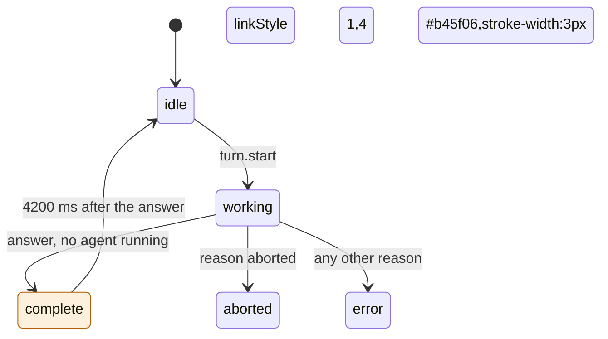
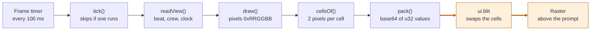
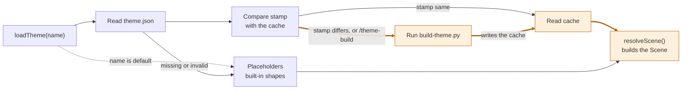

# theme-cli

A Claude Code mod. Pixel characters from your own images run along a strip above the prompt while Claude works.

An HTML version of this document is in `README.html`. It has the same content as this file.

To install the mod, go to section 5. To prove that it works, go to section 6.

## 1. Purpose

While Claude works, the prompt area shows only text. This mod adds a strip of pixel art above the prompt. The strip shows that a turn is in progress, and how many subagents run.

The strip does the following:

1. It shows a lead character that runs along the ground while a turn is in progress.
2. It adds one companion for each running subagent. Each companion has its own color.
3. It plays a finale when Claude answers. The lead runs to a flagpole, slides down it, and walks into a goal.

The characters come from a theme. A theme is a folder of your own images and one file, `theme.json`. Themes live in `~/.claude/theme-cli/themes`, outside every project. Switch themes with `/theme-use`.

Without a theme, the mod draws built-in placeholder shapes. The strip works before you set anything up.

When a theme loads, the mod scales its images if the stamp has changed. It stores the scaled sprites in a cache. Drawing a frame never scales an image.

The mod can also play a sound at four moments of a turn. On Windows, the mod plays the WAV sounds itself, because the engine has no Windows player. Section 3.10 explains the sounds.

The strip uses half-block characters, so each terminal row shows 2 pixels. This sketch shows the layout. It is not real output.

```text
 lead      companion 1   companion 2                       pole   goal
  ▀█▄          ▀█▄           ▀█▄                            │     ▐█▌
▄▄▄▄▄▄▄▄▄▄▄▄▄▄▄▄▄▄▄▄▄▄▄▄▄▄▄▄▄▄▄▄▄▄▄▄▄▄▄▄▄▄▄▄▄▄▄▄▄▄▄▄▄▄▄▄▄▄▄▄▄▄▄▄▄▄▄▄▄▄▄
```

The strip works in the terminal only. The checks in this document ran on macOS. The Windows sound path is verified by reading only. Task T5 in `docs/win-audio-merge-2026-10-25.md`, the Windows check by the user, is pending. Section 7 lists what is unverified.

## 2. Where to find the code

The logic is in six files in `hooks/` and two scripts in `scripts/`. The line numbers match the files at the time of the check. Search for the name if a line number is different.

| Item | File | Line |
|------|------|------|
| Constants: frame time, finale time, strip width limits, strip key | `hooks/register.tsx` | 13–17 |
| Stored values | `hooks/register.tsx` | 19–35 |
| Module variables: `scene`, `sounds`, `loop`, `timer`, `isTicking`, `stats` | `hooks/register.tsx` | 39–46 |
| `isActive()` – decides if the strip shows | `hooks/register.tsx` | 52 |
| `readView()` – reads the values that a frame needs | `hooks/register.tsx` | 58 |
| `note()` – writes a line to the log | `hooks/register.tsx` | 69 |
| `useTheme()` – loads a theme and tells the band to redraw | `hooks/register.tsx` | 75 |
| `play()`, `startLoop()`, `stopLoop()`, `finish()` – the sound cues | `hooks/register.tsx` | 90, 100, 111, 119 |
| `stopLoop()` calls `stopWindowsLoops()` | `hooks/register.tsx` | 115 |
| `tick()` – draws one frame and sends it with `blit` | `hooks/register.tsx` | 126 |
| `startTimer()` and `stopTimer()` | `hooks/register.tsx` | 164, 170 |
| `addAgent()` and `freeSlot()` – give a companion its color slot | `hooks/register.tsx` | 176, 182 |
| `reconcile()` – drops agents that the engine no longer lists. It keeps the crew when the list cannot be read. | `hooks/register.tsx` | 190 |
| `register()` – adds all hooks. It calls `winAudio(on)` first. | `hooks/register.tsx` | 207, 208 |
| Hook `session.start` (registers 9 commands, calls `readPlatform()`, loads the theme) | `hooks/register.tsx` | 210, 228 |
| Commands `theme-hide`, `theme-show` | `hooks/register.tsx` | 239, 245 |
| Command `theme-sound` | `hooks/register.tsx` | 251 |
| Commands `theme-list`, `theme-use`, `theme-build`, `theme-new` | `hooks/register.tsx` | 264, 278, 289, 296 |
| Command `theme-sound-test` | `hooks/register.tsx` | 310 |
| Command `theme-dump` | `hooks/register.tsx` | 322 |
| Hooks `turn.start`, `turn.complete` | `hooks/register.tsx` | 355, 375 |
| Hooks `classic.SubagentStart`, `classic.SubagentStop` | `hooks/register.tsx` | 400, 419 |
| Hooks `tool.call`, `turn.step`, `session.measure` | `hooks/register.tsx` | 441, 456, 473 |
| Hook `session.end` | `hooks/register.tsx` | 479 |
| Hook `ui.render` (the strip) | `hooks/register.tsx` | 488 |
| Module variables `windows` (is this Windows) and `loops` (looped clips now playing) | `hooks/winaudio.ts` | 66, 20 |
| Constants `WAV_MIME`, `READ`, `PLAY_ONCE`, `PLAY_LOOP` – the WAV type and the PowerShell scripts | `hooks/winaudio.ts` | 11, 14–16 |
| `stopWindowsLoops()` – ends every Windows loop | `hooks/winaudio.ts` | 22 |
| `playWav()` – plays one clip with PowerShell, or loops it. Rejects with the cause. | `hooks/winaudio.ts` | 30 |
| `readPlatform()` – reads `OS` once, at session start | `hooks/winaudio.ts` | 68 |
| `winAudio()` – adds the `audio.play` hook | `hooks/winaudio.ts` | 76 |
| Hook `audio.play` (Windows, WAV clips only) | `hooks/winaudio.ts` | 77 |
| `decode()`, `encode()`, `isWav()`, `withGain()`, `tone()` | `hooks/wav.ts` | 8, 23, 42, 48, 82 |
| Types `Frame`, `Pix`, `CUES`, `ThemeSpec`, `Scene` | `hooks/theme.ts` | 5, 7, 11, 18, 37 |
| `BUILT_IN` – the theme with no files | `hooks/theme.ts` | 59 |
| `heightOf()` – rounds and limits the sprite height | `hooks/theme.ts` | 71 |
| `decode()` and `recolor()` | `hooks/theme.ts` | 130, 166 |
| `resolvePath()` and `sourcesOf()` | `hooks/theme.ts` | 184, 191 |
| `parseSpec()` – checks `theme.json` | `hooks/theme.ts` | 205 |
| `resolveScene()` – turns frames into a scene | `hooks/theme.ts` | 238 |
| `rowsOf()` – terminal rows for a scene | `hooks/draw.ts` | 16 |
| Constants `SPEED` and `GROUND` | `hooks/draw.ts` | 8, 9 |
| `drawGround()`, `drawCrew()`, `drawFinale()` | `hooks/draw.ts` | 58, 68, 81 |
| `draw()` – the whole scene as pixels | `hooks/draw.ts` | 108 |
| `cellsOf()`, `pack()`, `asText()` | `hooks/draw.ts` | 137, 150, 161 |
| `BUILD`, `DEFAULT_THEME` | `hooks/library.ts` | 17, 18 |
| `homeOf()` and `rootOf()` – find the home folder (`HOME`, then `USERPROFILE`) | `hooks/library.ts` | 33, 37 |
| `listThemes()`, `readChoice()`, `writeChoice()` | `hooks/library.ts` | 44, 62, 75 |
| `mark()` and `stampOf()` – build the stamp | `hooks/library.ts` | 83, 96 |
| `loadSounds()` – reads the sound files | `hooks/library.ts` | 115 |
| `pythonLauncher()` – finds the first Python that answers | `hooks/library.ts` | 137 |
| `loadTheme()` – check, build, read | `hooks/library.ts` | 148 |
| `templateFor()` – the file that `/theme-new` writes | `hooks/library.ts` | 193 |
| `resolve()`, `read_png()` and `read_image()` | `scripts/build-theme.py` | 28, 73, 126 |
| `crop()` and `to_pixels()` | `scripts/build-theme.py` | 140, 153 |
| `shrink()` – scales a frame | `scripts/build-theme.py` | 171 |
| `pack()` – writes a frame as glyph rows | `scripts/build-theme.py` | 205 |
| `source_of()` and `main()` | `scripts/build-theme.py` | 219, 240 |
| Sound clip functions `voice()`, `start()`, `working()`, `success()`, `error()`, `main()` | `scripts/make-mario-sounds.py` | 28, 74, 79, 96, 108, 115 |
| Type of the stored values | `types/index.d.ts` | 28–44 |
| Tests for the strip (13 tests) | `hooks/register.test.tsx` | 77–271 |
| Tests for themes and sounds (21 tests) | `hooks/theme.test.tsx` | 98–352 |
| Tests for the Windows player (8 tests) | `hooks/winaudio.test.tsx` | 9–156 |

Other files: `hooks/hooks.json` names one hooks module, `./register.tsx`. `hooks/winaudio.ts` and `hooks/wav.ts` are imported by `register.tsx`. A test copy with a second entry in `modules` fails with `Found 1 error`, so the validator allows one module. `.claude-plugin/plugin.json` is the manifest. `.claude-plugin/marketplace.json` at the repository root lists the mod. `tsconfig.json` is for the type-check.

## 3. How it works

### 3.1 Beats

The mod keeps one beat for the main turn of the chat. The beat has five values.



Figure 1. The five beats. The diagram draws the `turn.start` edge from `idle` only. A `turn.start` sets the beat to `working` from any beat. The highlighted path is the finale path.

| Beat | Meaning | Strip |
|------|---------|-------|
| `idle` | No turn is in progress. | Hidden, unless a subagent runs. |
| `working` | A turn is in progress, or a subagent still runs. | Lead, partner and companions run. |
| `complete` | The turn was answered and no subagent runs. | The finale plays for 4200 ms. |
| `aborted` | The turn ended with the reason `aborted`. | Hidden, unless a subagent runs. |
| `error` | The turn ended with a reason other than `answer` or `aborted`. | Hidden, unless a subagent runs. |

The strip shows when `isActive()` is true. That is when the beat is `working`, when the finale is still playing, or when at least 1 companion exists.

The main turn can end before its subagents end. In that case the beat stays `working`. The last `classic.SubagentStop` then sets the beat to `complete`.

The `idle` beat returns only after the finale. The `aborted` and `error` beats stay until the next `turn.start`.

### 3.2 What each hook does

| Event | Condition | Action |
|-------|-----------|--------|
| `session.start` | Always | Register 9 commands. Read the platform. Load the chosen theme. Drop stale agents. Start the timer if the strip is active. |
| `audio.play` | Windows, and the clip is a WAV in base64 | Play the clip with PowerShell, at the gain given. Return `deny` with the cause when PowerShell fails. Other clips go on to the engine. |
| `turn.start` | Main loop only | Store the start time. Set the beat to `working`. Stop any loop. Play the `start` cue, then loop the `working` cue in `all` mode. Start the timer. |
| `turn.complete` | Main loop only, a subagent runs | Keep the beat at `working`. |
| `turn.complete` | Main loop only, reason `answer` | Store the finale start. Set the beat to `complete`. Play the `success` cue. |
| `turn.complete` | Main loop only, other reason | Set the beat to `aborted` or `error`. Stop the loop, or play the `error` cue. |
| `classic.SubagentStart` | Always | Add the agent. Give it a color slot. Start the timer. |
| `classic.SubagentStop` | The agent is known | Mark the agent done. Remove its companion. Start the finale if it was the last agent and the main turn ended. |
| `tool.call` | Subagent only | Record the tool name. Keep the last 2 names. |
| `turn.step` | Subagent only | Add 1 to the step count. Store the token count. |
| `session.measure` | Cost present | Store the session cost for `/theme-dump`. |
| `session.end` | Always | Stop the timer, the `working` loop and the Windows loop. Drop stale agents. If the engine cannot list agents, keep the crew as it is. |
| `ui.render` (`AbovePrompt`) | Terminal, no survey, strip not hidden, strip active | Draw the strip as one `Raster`. |

Subagent turns do not change the beat. The `turn.start` and `turn.complete` hooks check `e.agentId`.

### 3.3 The finale

The finale starts when the beat becomes `complete`. Times are milliseconds after the finale start. The code is `drawFinale()` in `hooks/draw.ts`, line 81.

| Time (ms) | What the strip shows |
|-----------|----------------------|
| 0 to 1500 | The lead runs from the left edge to the flagpole. |
| 1500 to 2600 | The flag slides down the pole. The lead holds the jump frame and slides with it. |
| 2600 to 3700 | The lead walks to the goal. |
| 3700 to 4200 | The pole, the flag and the goal stay. The lead is not drawn. |
| 4200 | The next tick sets the beat to `idle`. The timer stops. |

### 3.4 Companions

Each running subagent adds 1 companion. The companion slides in over 600 ms. It trails the lead.

A companion has a color slot. The slot is the lowest number that no running companion holds. A stop frees the slot for the next agent.

The scene holds 1 sprite for each slot. A companion draws the sprite at its slot number. If there are more agents than sprites, the slot number wraps around and colors repeat.

A theme makes the sprites in one of three ways:

- `cast.companion.frames` lists 1 frame for each slot.
- `cast.companion.frame` names 1 base frame. The mod recolors it to each hue in `recolor.to`.
- Neither is set. The mod recolors a built-in blue block to the default hues.

If `cast.companion.frame` is set and `recolor` is not, the scene holds 1 sprite. Every companion then looks the same.

The default hues are green, red, yellow, blue, pink and cyan. A recolor changes a pixel only under two conditions. The pixel's saturation must be 0.3 or more. Its hue must be within `range` degrees of `recolor.hue`.

### 3.5 How a frame is drawn

A timer runs `tick()` every 100 ms. A tick reads the state, draws the scene as pixels, and sends the cells to the screen.



Figure 2. One frame. `ui.blit` replaces the cells of the mounted `Raster`. The highlighted edges are the step that reaches the screen.

The first frame comes from the `ui.render` hook. It returns a `Raster`. The hook also records the `requestId` and the size of the band. A render must not write state, so the hook records them through `$.clock.after(0, …)`.

Later frames use `$.ui.blit`. A blit swaps the cells and does not restart the `Raster`. A tick does nothing until the band is known.

The width is the width of the prompt body, limited to 32 to 240 columns. The height is `ceil((sprite height + 2) / 2)` rows. The 2 extra pixels are the ground. An 8-pixel sprite needs 5 rows.

A cell holds 2 pixels. The top pixel is the foreground of `▀`. The bottom pixel is the background.

### 3.6 How a theme loads

A theme loads at `session.start`, and when you run `/theme-use` or `/theme-build`. The load checks first and scales only when needed.



Figure 3. The theme load. The highlighted path runs the build and reads the cache. The build runs only when the stamp differs or when you force it.

The stamp is one line of text. It joins these parts with `|`:

- `build` and the number `BUILD` (now 1).
- `h` and the sprite height.
- The size and the modification time of `theme.json`.
- The same data for each image file, or for each file in an image folder.

The cache is `themes/<name>/.cache/frames.json`. It stores the stamp and the scaled frames. If the stored stamp equals the new stamp, the mod reads the cache and does no image work.

If the stamp differs, the mod runs the build script with `-I`. It tries `python3`, `python` and `py -3` in that order. Each one runs `--version` first. The first one that answers runs the build. The build has a limit of 120,000 ms.

The script reads `theme.json` and writes the cache as UTF-8. It crops each frame, makes the background clear, scales the frame, and writes the cache.

The scale uses a vote. Each output pixel counts the source pixels it covers. Dark pixels (luma below 90) count 1.3 times. An output pixel is clear when more than 55 percent of its area is clear.

The script writes the cache even when some frames fail. A failed frame is left out. The stamp still matches. The mod does not retry until an image or `theme.json` changes, or until you type `/theme-build`.

If the script cannot replace the cache file, it keeps the previous cache. For example, another program can hold the file open. The script then prints a message and exits with 1.

After the load, `resolveScene()` decodes the frames. A frame that the cast needs but the cache lacks becomes a placeholder. The scene lists these names in `missing`.

### 3.7 The theme library

The library is one folder in your home folder. On Windows, the mod uses `%USERPROFILE%` when `HOME` is not set.

```text
~/.claude/theme-cli/
  config.json                  {"theme": "<name>"}
  themes/
    <name>/
      theme.json               what the theme draws, and where its images are
      assets/                  your images (any folder name works)
      .cache/frames.json       the scaled sprites, written by the mod
```

A theme name has 1 to 40 letters, digits, `-` or `_`. It must start with a letter or a digit. The name `default` is the built-in theme.

The mod reads `HOME` for the home folder. If `HOME` is not set, it reads `USERPROFILE`. The build script gets the same folder as `--home`. If neither is set, there is no library. In that case, `/theme-new` replies `HOME (or USERPROFILE) is not set, so there is no library folder.` The command `/theme-use default` throws the same message. It cannot save the choice. For other names, `/theme-use` replies `No theme`.

A path in `theme.json` is resolved in this order:

- A path that starts with `~/` or `~\` is relative to your home folder.
- A path that starts with `/` or `\`, or a drive letter such as `C:\` or `C:/`, is used as given. A UNC path such as `\\server\share` also counts.
- Any other path is relative to the theme folder.

Section 7 explains where the build script reads a drive-letter path differently.

A sheet is an image file or a folder of image files. A frame names a sheet and a box `[x, y, w, h]` on it. For a folder sheet, a frame names the sheet and a file in the folder.

If `theme.json` is missing or invalid, the mod uses the built-in theme. The reason shows in the status of the command and in `/theme-dump`.

### 3.8 Commands

| Command | Action | Reply |
|---------|--------|-------|
| `/theme-list` | List the built-in theme and the themes with a `theme.json`. | One name on each line. `*` marks the theme on show. A last line names the themes folder. |
| `/theme-use <name>` | Load the theme. Write the name to `config.json`. A name that is not listed is refused. | `Theme: <name> (<status>). It stays your choice in new sessions.` Refused: `No theme "<name>". Themes: ….` |
| `/theme-build` | Rebuild the theme in `config.json`, even when the stamp matches. | `Theme <name>: <status>`. For the built-in theme: `The built-in theme has no images to build. /theme-new <name> starts one.` |
| `/theme-new <name>` | Write a template `theme.json` in a new theme folder. | `Wrote <path>. Put your images beside it, edit it, then /theme-use <name>.` |
| `/theme-hide` | Hide the strip. | `Strip hidden. /theme-show shows it again.` |
| `/theme-show` | Show the strip. | `Strip shown.` |
| `/theme-sound <mode>` | Set the sound mode. `all` plays every cue and the working loop, and is the default. `cues` plays the start, success and error cues but no working loop. `off` plays nothing. `cues` and `off` end a loop that is playing. Going back to `all` during a turn starts the working loop. The setting lasts for the session and a hot reload. | With no mode: `Sounds: <mode>. Set with /theme-sound all, cues or off.` Unknown mode: `Unknown mode "<x>". Use all, cues or off.` A change: `Sounds: <mode>.` |
| `/theme-sound-test` | Play a 0.3 s test tone through the mod's Windows player. | On Windows: `Played a 0.3 s test tone. Heard nothing? Check the volume mixer for this terminal.` If PowerShell fails: `Could not play the tone: <cause>`. Elsewhere: `Not Windows: the engine plays sound itself here.` |
| `/theme-dump` | Write `theme-cli-log.txt` in the current folder. | `Wrote <n> log lines and the strip to theme-cli-log.txt.` |

`/theme-mute` and `/theme-unmute` were removed. `/theme-sound` replaces them.

The command `/theme-new` refuses in two cases:

- A theme with that name exists. The reply is `Theme "<name>" already exists: <path>`.
- The name has other characters, or is `default`. The reply is `Give a name of letters, digits, - or _, such as /theme-new castle.`

The dump file has these parts:

- The log lines.
- The theme, its sprite height and its missing frames.
- The session cost.
- The theme sounds, the sound mode and the loop state.
- The beat, the crew and the timer state.
- The band `requestId` and size.
- The tick, blit and denied counts, and the time for each tick.
- One line for each agent.
- The strip as text.

### 3.9 Stored values

| Name | Type | Meaning | Written by |
|------|------|---------|------------|
| `agents` | map | One record for each subagent: type, status, steps, tokens, model, last tools. | `SubagentStart`, `SubagentStop`, `tool.call`, `turn.step`, `reconcile()` |
| `crew` | list | One entry for each running companion: id, start time, color slot. | `SubagentStart`, `SubagentStop`, `reconcile()` |
| `beat` | text | The beat of the main turn. | `turn.start`, `turn.complete`, `SubagentStop`, `tick()` |
| `isWorking` | boolean | The main turn is in progress. | `turn.start`, `turn.complete` |
| `turnStart` | number | Time of the last `turn.start`. The lead position depends on it. | `turn.start` |
| `turnEnd` | number | Time of the last `turn.complete`. No code displays it. | `turn.complete` |
| `finaleStart` | number | Time that the finale started. | `turn.complete`, `SubagentStop` |
| `cost` | number | Session cost in US dollars. Only `/theme-dump` shows it. | `session.measure` |
| `isHidden` | boolean | The strip is hidden. | `/theme-hide`, `/theme-show` |
| `soundMode` | text | The sound mode: `all`, `cues` or `off`. It holds for the session and a hot reload. | `/theme-sound` |
| `band` | object | The `requestId` and size of the mounted band. | `ui.render` (a deferred update after the draw) |
| `themeName` | text | The theme on show. A change redraws the band. | `useTheme()` |
| `log` | list | The last 300 log lines. | `note()` |

The engine keeps these values for the session and through a hot reload. The engine documentation says so. How a new session starts was not tested.

The module variables `scene`, `sounds`, `loop`, `timer`, `isTicking` and `stats` in `hooks/register.tsx` are plain variables. The variables `windows` and `loops` in `hooks/winaudio.ts` are plain variables too. A hot reload resets them. `session.start` loads the theme and starts the timer again. The handle `loop` is lost on a hot reload. Section 7 explains the effect.

### 3.10 Sounds

A theme can play a sound at four moments. The sounds are optional. A theme with no `sounds` block is silent. `/theme-sound` sets the sound mode without editing the theme. The mode is `all` by default. `all` plays all four cues and the working loop. `cues` plays the start, success and error cues but no working loop. `off` plays nothing. The mode holds for the session and a hot reload.

| Cue | When it plays | Play mode |
|-----|---------------|-----------|
| `start` | `turn.start`, main loop only. | Once. |
| `working` | When the play call of the `start` cue returns, while the beat is `working`. | Looped, in `all` mode only. It stops when the turn ends, at `/theme-sound cues` or `/theme-sound off`, at `session.end`, or when a theme switch replaces it. Going back to `all` during a turn starts it again. |
| `success` | The beat becomes `complete`. | Once, with the finale. |
| `error` | `turn.complete` with a reason other than `answer` or `aborted`. | Once. |

An aborted turn stops the `working` loop and plays no other clip.

The mod reads each audio file as bytes when the theme loads (`loadSounds()` in `hooks/library.ts`). It passes the bytes to `$.audio.play`. A file is left out when it is missing, or when its extension is not supported. The supported extensions are `wav`, `mp3`, `m4a`, `aac`, `aiff`, `aif` or `ogg`. The load status names it (`missing sounds: working`), and the other cues still play. A cue that cannot play is written to the log. It is never thrown. A `sounds` entry with no `file` path, or a `gain` outside 0 to 4, sends the whole theme to placeholders.

Each platform plays the clips in a different way:

- macOS: the engine plays the clip. The engine documentation names `afplay` as the macOS player. This check did not play a sound, so playback is not verified here.
- Windows: the mod plays a WAV clip itself, in `hooks/winaudio.ts`. It starts `powershell.exe`, which uses the .NET class `System.Media.SoundPlayer`. The engine has no Windows player. Its `$.audio.play` plays nothing and resolves. Other clips (mp3, m4a, aac, aiff, ogg, `{ asset }` and URLs) go to the engine. The engine's documentation says a terminal with no player plays nothing.
- Linux: the engine's documentation says a Linux terminal with no player plays nothing, and the call resolves. The mod adds no player for Linux. This was not tested.

On Windows, `gain` changes only 16-bit PCM WAV clips, because `SoundPlayer` has no volume control. Other WAV clips play at their own level.

A looped WAV clip on Windows starts PowerShell with `PlayLooping()`. The child runs until it is stopped. The engine does not pass its signal to a hook. So `stopLoop()` also calls `stopWindowsLoops()`, which ends the child. `stopLoop()` runs at the start of a turn, at the end of a turn, at `/theme-sound cues` or `/theme-sound off`, at a theme switch and at `session.end`. The Windows stop is not verified. The tests use a fake child that ends only when the engine kills it. Section 7 lists the open points.

A failed PowerShell call returns its cause. `/theme-sound-test` shows that cause in its reply.

The `make-mario-sounds.py` script writes four clips in the style of a Mario game. Each clip is built from square-wave notes made in the script. The clips are:

- `start`: a coin.
- `working`: an overworld tune.
- `success`: a flagpole run.
- `error`: a falling tune.

The script uses no sample from any game. The script does not read `theme.json`.

Run `/theme-new mario` first. The template names four files in `assets`, and the script writes files with those names:

```bash
python3 -I mods/theme-cli/scripts/make-mario-sounds.py --out ~/.claude/theme-cli/themes/mario/assets
```

In this check the script printed these lines and exited with 0:

```text
start.wav 0.24s
working.wav 3.57s
success.wav 1.86s
error.wav 1.44s
```

Then run `/theme-use mario`. The status should then include `sounds: start, working, success, error`. This step was not run in this check. Do not commit the generated clips to the repository.

## 4. Settings

The mod has no `userConfig`. It has nothing to change in `/config`. You change the look in `theme.json`, and you choose the theme in `config.json` or with `/theme-use`.

### 4.1 Theme file fields

All fields in `theme.json` are optional. A field that you leave out draws a placeholder.

| Field | Value | Effect |
|-------|-------|--------|
| `height` | number | Sprite height in pixels. The mod rounds it up to an even number and limits it to 4 to 32. Default 8. |
| `sheets.<id>.file` | path | An image file, or a folder of image files. |
| `sheets.<id>.key` | `[r, g, b]` | A background color that the build makes clear. |
| `frames.<id>.sheet` | sheet id | The sheet to crop from. |
| `frames.<id>.box` | `[x, y, w, h]` | The area to crop. Leave it out to use the whole image. |
| `frames.<id>.file` | path | A file in the folder sheet, or an image file when no sheet is named. |
| `frames.<id>.key` | `[r, g, b]` | A background color for this frame. It overrides the sheet. |
| `frames.<id>.height` | number | Pixels tall for this frame. Default: the theme `height`. |
| `cast.lead.run` | frame ids | The run cycle of the lead. The cycle changes frame every 110 ms. |
| `cast.lead.jump` | frame id | The lead frame for the slide down the pole. |
| `cast.partner.run` | frame ids | A second character that trails the lead. Leave it out for none. |
| `cast.companion.frame` | frame id | The base frame of every companion. Without `recolor`, every companion looks the same. |
| `cast.companion.frames` | frame ids | One frame for each color slot. It overrides `frame`. |
| `cast.companion.recolor` | `{hue, to[], range?}` | The base hue to replace, the new hues, and the range in degrees (default 20). |
| `cast.goal.frame` | frame id | The goal at the right edge. |
| `colors.ground` | 2 colors `#rrggbb` | The two colors of the ground bricks. |
| `colors.dirt`, `colors.pole`, `colors.flag` | color `#rrggbb` | The dirt row, the flagpole and the flag. |
| `sounds.<cue>.file` | path | An audio file for the cue. The cues are `start`, `working`, `success` and `error` (section 3.10). |
| `sounds.<cue>.gain` | number | Linear volume, 0 to 4. Default 1. On Windows, only 16-bit PCM WAV clips are scaled. |

The fields `name` and `note` have no effect. The theme name is the name of its folder.

### 4.2 Fixed constants

These values are in the code. You change them by editing the file.

| Constant | Value | File and line | Effect |
|----------|-------|---------------|--------|
| `FRAME_MS` | 100 | `hooks/register.tsx` 13 | Time between ticks, in ms. |
| `FINALE_MS` | 4200 | `hooks/register.tsx` 14 | Length of the finale, in ms. |
| `MIN_COLS`, `MAX_COLS` | 32, 240 | `hooks/register.tsx` 15–16 | Limits of the strip width. |
| Log lines | 300 | `hooks/register.tsx` 69 | The last log lines that `/theme-dump` keeps. |
| Test tone | 880 Hz, 300 ms, 22,050 samples per second | `hooks/register.tsx` 311; `hooks/wav.ts` 82 | The tone that `/theme-sound-test` plays on Windows. |
| `SPEED` | 0.03 | `hooks/draw.ts` 8 | Lead speed, in pixels for each ms. |
| `GROUND` | 2 | `hooks/draw.ts` 9 | Ground height, in pixels. |
| Frame step | 110 | `hooks/draw.ts` 37 | Time for each frame of a run cycle, in ms. |
| Finale times | 1500, 2600, 3700 | `hooks/draw.ts` 98, 100, 102 | Times that change the lead's action in the finale, in ms. |
| Slide-in time | 600 | `hooks/draw.ts` 73 | Time that a companion takes to enter, in ms. |
| `HUES` | 130, 0, 50, 240, 320, 185 | `hooks/theme.ts` 52 | Default companion hues. |
| Default height | 8 | `hooks/theme.ts` 61 | Sprite height of the built-in theme, in pixels. |
| Height limits | 4 to 32 | `hooks/theme.ts` 74 | Lowest and highest sprite height, in pixels. |
| Saturation limit | 0.3 | `hooks/theme.ts` 174 | A pixel with a lower saturation keeps its color. |
| `BUILD` | 1 | `hooks/library.ts` 17 | Raise it to rebuild every cache. |
| Launcher limit | 10,000 | `hooks/library.ts` 139 | Time that a Python launcher has to answer `--version`, in ms. |
| Build limit | 120,000 | `hooks/library.ts` 172 | Time that the build can run, in ms. |
| `GLYPHS` | 36 symbols | `scripts/build-theme.py` 24 | The most colors in one frame. |
| Dark weight | 1.3 for luma below 90 | `scripts/build-theme.py` 194 | Dark pixels count more in the scale vote. |
| Clear share | 55 percent | `scripts/build-theme.py` 197 | An output pixel is clear above this share of clear area. |

## 5. Install

You install this mod by telling Claude Code where its folder is. You can also install it from the `claude-mods` marketplace.

### 5.1 Before you start

You need:

- Claude Code. The version used to write and test this mod is 2.1.310. To see your version, run `claude --version`.
- `python3`. The mod runs it to scale your images. The version used for the checks in this document is 3.15.0. The mod tries `python3`, then `python`, then `py -3`. It uses the first one that answers `--version`.
- A copy of this repository on your computer.
- A terminal. A terminal is a window where you type commands. On macOS, open the app named Terminal. On Windows, open PowerShell or Windows Terminal.
- Images for a theme. The script reads PNG files. It reads 8-bit, non-interlaced PNG files itself. Another PNG format needs Pillow, and without Pillow that format stops the whole build. A file that is not a PNG is skipped. Section 7 explains.

This mod folder holds no theme images. Use only images that you are allowed to use. Do not commit or publish images that you do not own.

In this document, the **repository root** is the top folder of the repository. All commands in this document start from that folder. To go there, type `cd` and the path to the folder. Example:

```bash
cd ~/Developer/claude-mods
```

On Windows PowerShell, the same step is:

```powershell
cd $HOME\Developer\claude-mods
```

On Windows, `scripts\install-mods.ps1` installs the mods through the marketplace. See section 5.5 and the root `README.md`.

### 5.2 Choose a method

| Method | Use it when | Lasts for |
|--------|-------------|-----------|
| A. Flag `--plugin-dir` | You want to try the mod. | One session |
| B. Setting `CLAUDE_CODE_PLUGIN_DIRS` | You want the mod in every session. | All sessions, until you remove the setting |
| C. Marketplace | You want the install that this repository provides. | Until you uninstall. The default scope is `user`. |

### 5.3 Method A: try it for one session

1. Open a terminal and go to the repository root (see 5.1).
2. Start Claude Code with the flag:

   ```bash
   claude --plugin-dir mods/theme-cli
   ```

3. Do the check in 5.6.

This check did not test whether Claude Code reloads the mod after a file changes. Start a new session after you change a file of the mod.

### 5.4 Method B: load the mod in every session

1. Open the file `~/.claude/settings.json` in a text editor.
2. Add an `env` block that names the full path of the mod folder. If the file already has an `env` block, add only the line inside it.

   ```json
   {
     "env": {
       "CLAUDE_CODE_PLUGIN_DIRS": "/Users/your-name/Developer/claude-mods/mods/theme-cli"
     }
   }
   ```

3. Replace `/Users/your-name/Developer/claude-mods` with the real path to your repository. To print the path, run `pwd` in the repository root.

   On Windows, the settings file is `%USERPROFILE%\.claude\settings.json`. Write the path with forward slashes, for example `C:/Users/your-name/Developer/claude-mods/mods/theme-cli`, or double each backslash in the JSON. In PowerShell, `(Get-Location).Path` prints the path of the repository root. The Windows form was not tested.
4. Save the file. Start a new Claude Code session.
5. Do the check in 5.6.

To uninstall, delete the line and start a new session. This check did not test the setting `CLAUDE_CODE_PLUGIN_DIRS`.

### 5.5 Method C: marketplace install

The repository has a marketplace file, `.claude-plugin/marketplace.json`. The marketplace is named `claude-mods`. It lists `theme-cli`.

1. Open a terminal.
2. Add the marketplace once:

   ```bash
   claude plugin marketplace add https://github.com/plaktoz/claude-mods
   ```

3. Install the mod:

   ```bash
   claude plugin install theme-cli@claude-mods
   ```

4. Start a new session. Do the check in 5.6.

The `--scope` option sets the scope of the install. The scope names and the default come from the help text of `claude plugin install`:

| Scope | Meaning in the help text |
|-------|--------------------------|
| `user` (default) | User scope. |
| `project` | Project scope. |
| `local` | Local scope. |

This check did not test where each scope writes its setting.

Inside a Claude Code session, the same steps are `/plugin marketplace add https://github.com/plaktoz/claude-mods` and `/plugin install theme-cli@claude-mods`. Then run `/reload-plugins`, or start a new session.

Add the marketplace with the repository URL. Use the repository URL, not the link to `.claude-plugin/marketplace.json`. This check did not run the command with the link.

To use your local copy of this repository, add the marketplace from its path:

```bash
claude plugin marketplace add /path/to/claude-mods
```

The install scripts do the same steps. They add this repository as the marketplace `claude-mods`, and then install the mod.

1. Go to the repository root (see 5.1).
2. Run the script for your system, and name the mod:

   ```bash
   scripts/install-mods.sh theme-cli
   ```

   On Windows PowerShell, run this instead:

   ```powershell
   scripts\install-mods.ps1 theme-cli
   ```

The shell script accepts `--scope user`, `--scope project` or `--scope local`, `--list` and `--uninstall`. The PowerShell script accepts `-Scope user`, `-Scope project` or `-Scope local`, `-List` and `-Uninstall`. The default scope is `user`. `--scope project` installs into the folder where you run the script, not into this repository.

This document check did not run the `claude plugin` commands or the install script.

The validator printed no install line in this check. Use the marketplace URL in section 5.5.

### 5.6 Check that the install worked

1. Start a session with method A or method B.
2. Type `/theme-list`. **Expected:** the reply lists `default` and any theme in your library. The `*` marks the theme on show.
3. Send any prompt, for example `hello`.
4. Look above the prompt box while Claude works. **Expected:** a strip appears with a lead character that runs.

With no theme, the lead is a built-in placeholder shape. If the strip does not appear, see the table in 6.6.

### 5.7 Make your first theme

1. In a session, type `/theme-new castle`. The mod writes `~/.claude/theme-cli/themes/castle/theme.json`. The file is a template. It names `assets/sheet.png`, two frames and four sound files.
2. Copy your PNG sprite sheet to `assets/sheet.png` in the theme folder.
3. Open `theme.json` in a text editor. Check the `box` `[x, y, w, h]` of each frame. Add `key` to `sheets.main` with the background color of your sheet.
4. Check the frame ids in `cast.lead.run`. Add `cast.companion` and `cast.goal` if you want them.
5. Type `/theme-use castle`. **Expected:** the reply starts with `Theme: castle (built:` and names the number of frames. The status also lists `missing sounds` until you add the four sound files.
6. Send a prompt. The strip shows your sprites.

The first load scales the images. Later loads read the cache. After you change an image or `theme.json`, type `/theme-build`.

### 5.8 Change the settings

- To switch theme, type `/theme-use <name>`. The choice stays in new sessions.
- To change the look, edit `theme.json` and type `/theme-build`.
- To change a constant in section 4.2, edit the file. Then start a new session.

## 6. Validate

To validate means to prove that the mod works as this document says. There are four levels. Do level 1 and level 2 each time you change the code. Do level 3 after you change `scripts/build-theme.py`. Do level 4 once after you install.

| Level | What it proves | Time | Needs an API request |
|-------|----------------|------|----------------------|
| 1. Validate | The files are correct, and the engine can read the mod. | Short. Not timed. | No |
| 2. Test | The logic is correct (beats, companions, finale, themes, sounds, the Windows player). | 1.2 to 1.5 seconds in the runs of this check. | No |
| 3. Build check | The script scales your images. | Short. Not timed. | No |
| 4. Live check | The mod works in a real session. | Several minutes. | Yes |

### 6.1 Level 1: validate the files

1. Go to the repository root (see 5.1).
2. Run:

   ```bash
   claude plugin validate mods/theme-cli
   ```

3. Read the last line of the output.

| Last line | Meaning | Action |
|-----------|---------|--------|
| `✔ Validation passed` | The mod is correct. | None. This is the expected result. |
| `✘ Validation failed` | The engine refuses the mod. | Read the lines that start with `✘`. Fix the file they name. Run the command again. |

In this check, the last line was `✔ Validation passed`, and the exit code was 0.

The expected output contains messages that look like problems. They are not problems:

| Message | Why you can ignore it |
|---------|----------------------|
| `types … declares on $: nothing` | Correct. The mod adds nothing to `$`. |
| `answers its own command` | Correct. Each of the 8 commands answers itself. |
| `gating hook with .catch` | Correct. Three hooks pass the event on when they fail. |
| `gating hook without .catch` | Correct. `audio.play` and `theme-sound-test` catch their own PowerShell error and return a reply, so they do not throw. |
| `hooks/hooks.json names a hooks module` | Not a failure. The plugin directory applies its own rules to a code module, and this command does not. The directory's own validation decides whether it accepts the plugin. |

The output ends with a note. It says that the plugin directory's own rules were not applied, so passing this command does not mean the directory accepts the plugin. The output also says that the directory runs a safety scan and a policy review that this command does not.

The output also lists what the mod uses. Compare it with this list:

- Hooks: `audio.play`, `session.start`, 9 `command.run` hooks (`theme-hide`, `theme-show`, `theme-sound`, `theme-list`, `theme-use`, `theme-build`, `theme-new`, `theme-sound-test`, `theme-dump`), `turn.start`, `turn.complete`, `classic.SubagentStart`, `classic.SubagentStop`, `tool.call`, `turn.step`, `session.measure`, `session.end`, `ui.render{component=AbovePrompt}`.
- Stored values: the 13 names in section 3.9.
- Environment reads: `HOME`, `OS`, `USERPROFILE`. Environment writes: none.
- Engine calls: `$.agent.list`, `$.audio.play`, `$.clock.after`, `$.clock.every`, `$.clock.now`, `$.command.register`, `$.env.get`, `$.fs.exists`, `$.fs.list`, `$.fs.read`, `$.fs.stat`, `$.fs.write`, `$.process.run`, `$.process.spawn`, `$.state.get`, `$.state.set`, `$.ui.blit`, `$.ui.resolve`.

If the output lists a hook or call that is not in this list, the code and this document differ. Tell the owner of the mod.

### 6.2 Level 2: run the tests

1. Go to the repository root.
2. Run:

   ```bash
   claude plugin test mods/theme-cli
   ```

3. **Expected result:** the last lines are `42 pass` and `0 fail`. The runner reports 13 tests in `register.test.tsx`, 21 in `theme.test.tsx` and 8 in `winaudio.test.tsx`.

In this check, the output ended with these lines, and the exit code was 0:

```text
 42 pass
 0 fail
Ran 42 tests across 3 files. [1.30s]
```

Do not use `bun test` for these tests. In this check, `bun test` in `mods/theme-cli` printed this error: `error: Cannot find module 'claude-code/testing'`. The output then ended with these lines, and the exit code was 1:

```text
 0 pass
 3 fail
 3 errors
Ran 3 tests across 3 files. [6.00ms]
```

The `claude plugin test` runner runs the tests.

The tests use a fake clock, a fake disk and a fake build script. The Windows tests use a fake engine and a fake PowerShell child. They do not call the API and they cost nothing. No test runs PowerShell or `scripts/build-theme.py`. Level 3 covers the script. Section 6.5 explains each test.

If a test fails, the output shows the test name and the reason. Find the test name in the table in 6.5. It shows which rule is broken.

### 6.3 Level 3: check the build script

1. Make a theme (see 5.7).
2. Run the script on the theme folder. Replace `castle` with your theme name:

   ```bash
   python3 -I mods/theme-cli/scripts/build-theme.py --theme ~/.claude/theme-cli/themes/castle --out /tmp/theme-check.json --height 8
   ```

3. **Expected result:** the output is `built N frames to /tmp/theme-check.json`. N is the number of frames in `theme.json`.

A line that starts with `skipped` names a frame that the script could not build, and the reason. The script exits with 1 when it reports problems and builds no frame. It also exits with 1 when it cannot replace the cache file.

On Windows there is no `/tmp`. Write the output to the current folder instead, and use `py -3` if `python3` is not installed. In PowerShell:

```powershell
py -3 -I mods\theme-cli\scripts\build-theme.py --theme "$HOME\.claude\theme-cli\themes\castle" --out theme-check.json --height 8
```

The expected output is `built N frames to theme-check.json`. Delete `theme-check.json` when you are done. This command was not run on Windows.

In this check, a test theme with 2 frames from an 8-bit PNG printed `built 2 frames to <path>` and exited with 0. A frame whose file is not a PNG printed `skipped lead-1: not a PNG` on the same run, and the build still exited with 0. A theme whose only frame is a 16-bit PNG, without Pillow, printed `needs an 8-bit, non-interlaced PNG (or install Pillow)`. That run exited with 1 and wrote no cache.

### 6.4 Level 4: live check in a session

Do this once after you install.

| Step | Action | Expected result |
|------|--------|-----------------|
| 1 | Type `/theme-use <name>` for a theme in your library. | `Theme: <name> (…)`. The status says `sprites from cache` or `built:`. |
| 2 | Send a prompt. | The strip appears above the prompt. Your lead character runs. The ground moves. |
| 3 | Send a prompt that starts a subagent. | 1 companion slides in for each subagent. Each has its own color. |
| 4 | Wait for the answer. | The lead runs to the pole, slides down, and walks into the goal. The strip clears about 4 seconds later. |
| 5 | Type `/theme-dump`. Open `theme-cli-log.txt`. | The `theme=` line names your theme. The line `band requestId=` does not say `unknown`. |
| 6 | Edit an image. Type `/theme-build`. | `Theme <name>: built: built N frames to <path>`. |
| 7 | Type `/theme-hide`, then `/theme-show`. | The strip hides, then shows again on the next turn. |
| 8 | Windows only. Type `/theme-sound-test`. | `Played a 0.3 s test tone. …`. A short tone is heard. |
| 9 | Windows only. Send a prompt, and wait for the answer. | The `working` sound stops when the answer arrives. |

This document check did not run steps 1 to 9 in a live session. No record in the repository shows a live run of these steps by a person.

### 6.5 What each test proves

Each row names one test and the line where the test starts.

| Test (in `hooks/register.test.tsx`) | Line | Rule it proves |
|-------------------------------------|------|----------------|
| the strip stays out of the way until a turn starts | 77 | Before `turn.start`, the mod draws no `Raster`. The engine band shows. |
| a turn draws one Raster of the band width and repaints it with blit | 87 | The `Raster` is 40 columns by 5 rows. In 1,000 ms the mod sends at least 8 blits. The first and last blit differ. |
| the sprites move: a later frame differs from an earlier one | 106 | The last blit at 1,000 ms differs from the last blit at 500 ms. |
| each running subagent adds one companion and its stop removes it | 119 | Each new agent changes the cells. A stop for an unknown id is ignored. The strip still draws after the stops. |
| each companion holds its own colour slot, and a stop frees the lowest one | 146 | 3 agents get `a1:0 a2:1 a3:2`. After `a2` stops, a new agent gets slot 1. |
| a subagent turn does not end the main turn | 167 | A `turn.complete` with an `agentId` does not stop the blits. |
| the finale plays once the turn is answered, then the strip clears and the timer stops | 181 | The strip shows 2,000 ms after the answer. It is gone 5,000 ms after the answer. No blit follows. |
| the finale waits for the last subagent when the main turn ends first | 199 | The strip stays 6,000 ms after the answer while an agent runs. It clears 6,000 ms after the agent stops. |
| an aborted turn clears the strip with no finale | 215 | 200 ms after an aborted turn, the strip is gone. |
| denied blits are counted, not thrown | 226 | A denied blit adds to `denied`. The dump shows `lastDeny=not mounted`. |
| /theme-dump writes the log, the blit counts and the strip as text | 240 | The dump holds the log lines, the band size and the text of the strip. |
| the strip is a terminal Raster only: desktop is left to the engine | 259 | On the `desktop` surface the mod draws no `Raster`. |
| a session end with no agent list to read does not throw | 271 | With `$.agent.list` unavailable, `session.end` still reaches the next hook. The log says `agent list unavailable`. |

| Test (in `hooks/theme.test.tsx`) | Line | Rule it proves |
|----------------------------------|------|----------------|
| the chosen theme is built once at start, then read from the cache | 98 | One build runs at the first start, with `--height 12`. Two more starts do not build. |
| a changed source image rebuilds the cache | 112 | A new modification time on an image causes a second build. |
| /theme-build rebuilds even when the stamp matches | 124 | `/theme-build` causes a second build. The reply names the theme. |
| /theme-list names the library, marks the one on show, and skips folders with no theme.json | 133 | `* tall` and `  default` show. A folder without `theme.json` does not show. |
| /theme-use switches at once and keeps the choice in config.json | 143 | `config.json` holds the new name. An unknown name changes nothing. |
| /theme-new writes a template once and refuses a bad or taken name | 156 | `../x` and an existing name are refused. A new name writes its file. |
| a theme with a broken theme.json falls back to placeholders and says why | 168 | No build runs. The dump says `theme tall: theme "tall" not loaded` and `theme=default`. |
| the theme sets the strip height: 12 px sprites need seven rows | 178 | The dump says `12px sprites, 7 rows` and `missing=[castle]`. |
| a turn plays the start clip, then loops the working clip until it is answered | 204 | The start clip plays, then the working loop. The answer plays the success clip. |
| a turn that fails plays the error clip, and an aborted turn plays none | 219 | A failed turn plays the error clip. An aborted turn plays no clip. |
| a theme with no sounds plays nothing | 236 | A theme without a `sounds` block plays no clip. |
| a sound file that is missing is named in the status and the other cues still play | 244 | The status says `missing sounds: working`. The start clip still plays. |
| a bad "sounds" entry in theme.json falls back to placeholders and says why | 256 | A `sounds` entry without a `file` path sends the theme to placeholders. The dump says why. |
| /theme-sound off silences every cue and the loop, and all brings them back | 265 | `off` plays no clip, and the loop stops. `all` during a turn restarts the working loop. |
| /theme-sound cues plays the start, success and error cues, but no working loop | 287 | The start clip plays, the working loop does not start, and the success clip plays at the answer. |
| /theme-sound cues stops a loop that is already playing | 300 | `cues` during a turn ends the loop. The finish cue still plays. |
| /theme-sound with no argument shows the mode, and an unknown mode is refused | 313 | The reply is `Sounds: all. Set with /theme-sound all, cues or off.` `loud` gets `Unknown mode "loud". Use all, cues or off.` |
| the build runs under the first Python launcher that answers | 320 | With only `py` installed, the build runs `py -3 -I`. |
| with no Python at all the status says so and the older cache or placeholders stand | 329 | No build runs. The dump says `no Python found`. |
| with HOME unset, the library is found under USERPROFILE | 338 | The build receives the `USERPROFILE` folder as `--home`. |
| theme.json paths: drive letters, UNC and ~\ are handled as Windows paths | 352 | The TypeScript path rule treats `C:\`, `C:/`, UNC paths and `~\` as Windows paths. |

| Test (in `hooks/winaudio.test.tsx`) | Line | Rule it proves |
|-------------------------------------|------|----------------|
| base64 round-trips bytes of every length | 9 | `encode()` and `decode()` in `hooks/wav.ts` return the same bytes for lengths 0 to 5 and 255. `TWFu` and `TQ==` are the expected encodings. |
| a generated tone is a WAV, and gain scales and clips its samples | 18 | `tone()` makes a WAV. Gain 0.5 halves a sample, gain 1 returns the same bytes, and gain 4 keeps each sample in the 16-bit range. |
| on Windows a WAV clip is played by PowerShell, not handed to the engine | 93 | On Windows, a WAV clip starts one `powershell.exe` child with `PlaySync`. The engine's player is not called. |
| a looped clip uses PlayLooping | 108 | A looped clip starts the child with `PlayLooping`. |
| off Windows, the clip goes on to the engine | 119 | On macOS, the engine's player gets the clip. No child starts. |
| a non-WAV or asset clip on Windows goes on to the engine | 131 | An mp3 clip and an asset clip reach the engine on Windows. No child starts. |
| a PowerShell failure rejects, so the caller can log it | 144 | A child that exits with code 1 makes the command reply name `powershell exited 1`. |
| theme-cli stopping its loop ends the Windows loop | 156 | `/theme-sound off` calls `stopLoop()`, which ends a looped child, and the command returns. The child is a fake. The test does not show that PowerShell stops on Windows. |

### 6.6 Problems and solutions

| Problem | Cause | Solution |
|---------|-------|----------|
| `claude: command not found` | Claude Code is not installed, or the terminal cannot find it. | Install Claude Code. Open a new terminal. |
| `claude plugin validate` says the path does not exist | You are not in the repository root. | Run `pwd`. Run `cd` to the repository root. Try again. |
| Validation fails | A file of the mod has an error. | Read the lines that start with `✘`. Fix the file they name. |
| No strip after you send a prompt | You ran `/theme-hide`, the surface is not a terminal, or no turn runs. | Type `/theme-show`. The strip works in the terminal only. |
| The strip shows plain shapes, not your sprites | The theme did not load. | Type `/theme-dump`. Read the line `theme <name>:` in `theme-cli-log.txt`. It names the reason. |
| The status says `theme "<name>" not loaded (…)` | `theme.json` is not valid JSON, or a field has the wrong kind of value. | Fix `theme.json`. Type `/theme-use <name>`. |
| The status says `build could not run (no Python found …)` | None of `python3`, `python` or `py -3` answered `--version`. | Install Python 3. Check that one of the three names runs in a terminal. Type `/theme-build`. |
| The status says `build failed (1): …needs an 8-bit, non-interlaced PNG` | The image has another PNG format, and Pillow is not installed. | Save the image as an 8-bit PNG without interlacing. Or install Pillow for `python3`. Type `/theme-build`. |
| The status says `skipped <frame>: box [...] is outside the <w>x<h> image` | The `box` is larger than the image. | Correct the `box` in `theme.json`. Type `/theme-build`. |
| The status says `missing frames: …` | The cast names a frame that the cache lacks. | Add the frame to `frames` in `theme.json`, or correct the id. Type `/theme-build`. |
| The status says `missing sounds: …` | A sound file is not found, or its extension is not supported. | Check the `file` path in `sounds`. Add the file. Type `/theme-use <name>`. |
| The status says `skipped <frame>: <n> colours is more than one frame can hold (36)` | The frame has more than 36 colors. | Use fewer colors in the image. Or make the frame smaller. Type `/theme-build`. |
| A drive-letter or UNC path fails on macOS or Linux | The build script reads the path as relative. | Use a `~/` path or a path relative to the theme folder. |
| A frame has a colored box around the sprite | The sheet background is not clear. | Set `key` to the background color `[r, g, b]`. Type `/theme-build`. |
| All companions have the same color | `cast.companion.frame` has no `recolor`, or `recolor.hue` does not match the base frame. | Add `recolor` with `hue` set to the body hue of the base frame. A second fix is below the table. |
| No sound plays on Windows | The PowerShell player failed. Or the clip is not a WAV, and the engine plays nothing on Windows. | Type `/theme-sound-test`. If it fails, the reply says why, as `Could not play the tone: <cause>`. Type `/theme-dump`. Read the `sounds=` line. Section 7 lists the Windows limits. |
| No sound plays | The theme has no `sounds` block, the sound mode is `off`, or the platform has no player (Linux). | Type `/theme-sound`. If it shows `off`, type `/theme-sound all`. Type `/theme-dump` and read the `sounds=` and `mode=` line. Section 7 lists the platform limits. |
| You edited an image and nothing changed | The session loaded the theme before the edit. | Type `/theme-build`. |

For the companion color row, list one frame for each slot in `cast.companion.frames`. Raise `range` if needed.

### 6.7 Type-check (optional)

A type-check finds mistakes in the code types. It needs `tsc`, the TypeScript compiler. The file `tsconfig.json` extends `.claude-plugin/types/tsconfig.json`. The repository ignores the folder `mods/*/.claude-plugin/types/` (see `.gitignore`). The folder existed in this check. Who creates it was not checked.

Run `npx -y -p typescript@5.6 tsc -p mods/theme-cli`. **Expected result:** no output and exit code 0.

In this check, that command printed nothing and exited with 0, run from the repository root. A second run with `typescript@5.6.3` inside `mods/theme-cli`, using `tsconfig.json`, also printed nothing and exited with 0. Both runs were on macOS.

## 7. Known limits

- **Terminal only.** The `ui.render` hook draws the strip on the `terminal` surface only. Other surfaces show the engine band.
- **Python is needed to build.** The mod cannot read images itself. Without a working launcher, a new or changed theme uses the older cache or placeholders.
- **PNG format.** Without Pillow, the script reads 8-bit, non-interlaced PNG files only. A file in another PNG format stops the whole build, and no cache is written. Pillow reads other formats. Pillow was not installed for this check, so that path did not run.
- **36 colors for each frame.** A frame with more colors is skipped. The script prints `skipped` and the reason.
- **Cache size.** The mod does not limit the cache size. The engine documentation says a file read over 4 MiB rejects. This check did not test a cache that large. A failed read returns no cache, so the mod rebuilds at every load.
- **No enlarging.** The script scales an image down only. An image that is not taller than its target height keeps its size.
- **Height.** The mod rounds the height up to an even number and limits it to 4 to 32 pixels. A strip of 8 pixels needs 5 rows.
- **Width.** The strip is 32 to 240 columns wide, whatever the terminal width.
- **Colors repeat.** The default scene holds 6 colors. With `cast.companion.frames`, the count is the number of frames listed. A companion past the last slot draws the sprite of slot 0 again.
- **One sprite without recolor.** A `cast.companion.frame` with no `recolor` gives one sprite. Every companion looks the same.
- **Manual edits.** The mod loads a theme at `session.start`, `/theme-use` and `/theme-build`. An edit while a session runs has no effect until one of these.
- **Failed load becomes the choice.** `/theme-use` writes the name to `config.json` even when the theme falls back to placeholders.
- **`/theme-build` uses the saved choice.** It rebuilds the theme in `config.json`. It does not read the theme on show.
- **Reserved name.** `/theme-new default` is refused. The mod never loads a folder named `default`, because the name always means the built-in theme.
- **A failed frame is not retried.** The script writes the cache even when frames fail. The stamp still matches, so the mod does not retry until an image or `theme.json` changes, or until `/theme-build`.
- **Drive letters and UNC paths on macOS and Linux.** The mod treats `C:\art\a.png` and `\\server\share\a.png` as absolute. The build script reads them as relative, so the build fails. Checked on macOS with `C:\art\a.png`: the build printed `skipped a: [Errno 2] No such file or directory`, built 0 frames, and exited with 1.
- **Root-relative paths on Windows.** A path such as `\art\a.png` has no drive letter. The mod and the build script can read it differently. A Python check with `PureWindowsPath` on macOS reports `\art\a.png` as not absolute. No Windows run has happened. Use `~/`, a drive letter or a path relative to the theme folder.
- **No first frame without a band.** A tick does nothing until `ui.render` records the band. The first frame comes from the render.
- **No survey.** The strip does not show while the engine shows a survey.
- **Sound mode scope.** The mode holds for the session and a hot reload. Whether a new session starts in `all` mode after `/theme-sound off` was not tested.
- **Sound on Linux.** The engine has no player on Linux, and the mod adds none. Playback on Linux was not tested.
- **Sound on Windows.** The mod plays WAV clips itself, with PowerShell, in `hooks/winaudio.ts`. Other formats go to the engine, which plays nothing on Windows. The fake-engine tests ran on macOS. Real playback on Windows is unverified. Task T5 in `docs/win-audio-merge-2026-10-25.md` is the Windows check, and it is pending. When the engine ships a Windows player, remove `hooks/winaudio.ts`, the `winAudio(on)` call and the `/theme-sound-test` command in `register.tsx`, and `hooks/wav.ts` if nothing else imports it.
- **Windows loop stop.** Unverified on Windows. `stopLoop()` ends the child through `stopWindowsLoops()`. The mod then calls `return()` on the child's stream. The engine's documentation says `return()` kills the child. The child's stream is read in a separate task at the same time, so whether `return()` ends a child that writes no output is unverified. A hot reload resets the `loops` set, so `stopWindowsLoops()` cannot stop a child that started before the reload.
- **Hot reload and the working loop.** A hot reload drops the handle `loop`. The working clip can keep playing, and the mod cannot stop it. This is open question Q4 in `library/theme-mod-spec.md`.
- **Windows.** No Windows run has happened. The code has Windows paths for the home folder, the Python launcher, drive-letter paths and UTF-8 files. Half-block characters and truecolor can render wrongly on a legacy Windows console. This is unverified. The Windows sound path is in the two items above.
- **Build time.** The build stops after 120,000 ms. The mod then uses the older cache or placeholders.
- **Test coverage.** No automated test runs `scripts/build-theme.py` or `scripts/make-mario-sounds.py`, or reads a real image. The theme tests use a fake build script and fake audio. The Windows tests use a fake engine and a fake PowerShell child.
- **Copyright.** The mod does not check who owns an image. Use only images that you are allowed to use.

## 8. Glossary

| Term | Meaning |
|------|---------|
| Strip | The pixel-art scene above the prompt. |
| Band | The area above the prompt where the mod draws. |
| Raster | The engine element that shows a grid of colored cells. |
| Cell | One position of a `Raster`. It holds 2 pixels: a top pixel and a bottom pixel. |
| Blit | A call that swaps the cells of a mounted `Raster` without a redraw. |
| Tick | One frame of the timer, every 100 ms. |
| Theme | A folder with a `theme.json` and your images. |
| Library | The folder `~/.claude/theme-cli`. It holds `config.json` and all themes. |
| Sheet | An image file, or a folder of image files, that frames come from. |
| Frame | One sprite image. The theme names it and the build scales it. |
| Cast | The part of `theme.json` that gives a role to each frame. |
| Key color | A background color `[r, g, b]` that the build makes clear. |
| Cache | The file `.cache/frames.json`. It holds the scaled frames and the stamp. |
| Stamp | A line of text that records the data that a build depends on. |
| Launcher | A Python command that runs the build script: `python3`, `python` or `py -3`. |
| Scene | A theme decoded and ready to draw. |
| Placeholder | A built-in shape that the mod draws when a frame is missing. |
| Lead | The main character. It runs while a turn is in progress. |
| Companion | An extra character. One exists for each running subagent. |
| Crew | The list of running companions. |
| Slot | The color number of a companion. It is the lowest number that is free. |
| Beat | The state of the main turn: `idle`, `working`, `complete`, `aborted` or `error`. |
| Cue | One moment of a turn that can play a sound: `start`, `working`, `success` or `error`. |
| Sound mode | The setting `all`, `cues` or `off` that decides which cues play. Set by `/theme-sound`. |
| Player | The part that plays a clip: the engine's player on macOS, or the mod's PowerShell child on Windows. |
| Child | The PowerShell process that the mod starts to play one clip on Windows. |
| Hot reload | Claude Code reloads a mod's code while a session runs. Module variables reset. |
| Finale | The scene at the end of a turn: pole, flag and goal. |
| Turn | One model run, from your prompt to the final answer. |
| Subagent | An agent that the main loop starts to do part of the work. |
